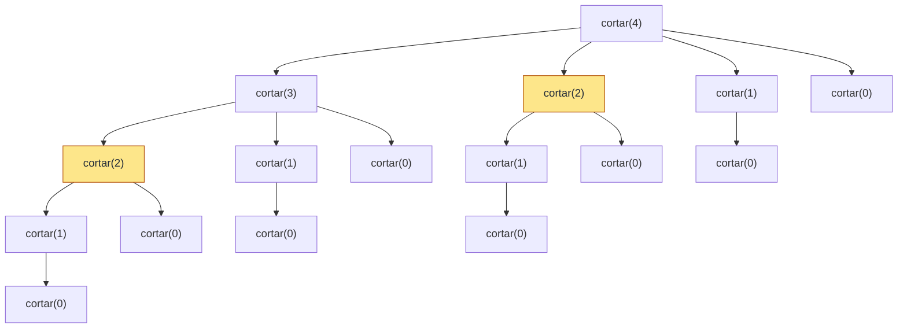

> 📖 Lectura previa a la clase — unos 13 minutos. Al final, responde la autoevaluación.

## La cinta de la mercería

Una mercería compra cinta en rollos y la vende en tramos de metros enteros. El precio no crece de forma pareja: la tabla de la tienda paga más por ciertas longitudes. Tienes una cinta de 10 m y quieres cortarla para ganar lo máximo posible.

| Metros `i` | 1 | 2 | 3 | 4 | 5 | 6 | 7 | 8 | 9 | 10 |
|---|---|---|---|---|---|---|---|---|---|---|
| Precio `p_i` | 1 | 5 | 8 | 9 | 10 | 17 | 17 | 20 | 24 | 30 |

Prueba a mano con una cinta de 4 m. Sin cortar vale 9. Cortada en 1 + 3 vale 1 + 8 = 9. Cortada en 2 + 2 vale 5 + 5 = **10**. Lo más barato de pensar (vender entera) no es lo mejor, y probar a ojo no escala: con 10 m hay 2⁹ = 512 maneras de cortar.

## Del ejemplo a la recurrencia

Para modelar el problema: la **entrada** es la longitud `n` de la varilla y los precios `p_1…p_n`; la **salida** es el ingreso máximo `r_n`; la **restricción**, tramos de longitud entera. Mira la decisión clave: el primer tramo que cortas mide `i` metros, lo vendes por `p_i`, y te queda una varilla más corta, de `n - i` metros, que es *el mismo problema* en pequeño. Probando todos los `i`:

$$r_n = \max_{1 \le i \le n} \left( p_i + r_{n-i} \right), \qquad r_0 = 0$$

¿Por qué basta con resolver bien la varilla restante? Argumento de cortar y pegar: si la parte de `n - i` metros dentro de la solución óptima no fuera óptima, la cambiarías por una mejor y ganarías más, lo cual contradice que la solución era óptima.

> **Subestructura óptima:** un problema la tiene cuando una solución óptima contiene soluciones óptimas de subproblemas del mismo tipo.

## Probar todo: la recursión ingenua

La recurrencia se traduce directo a código. Los precios van en una lista con `precios[0] = 0`, de modo que `precios[i]` es el precio de `i` metros.

```python
PRECIOS: list[int] = [0, 1, 5, 8, 9, 10, 17, 17, 20, 24, 30]


def cortar_ingenuo(precios: list[int], n: int) -> int:
    """Calcula el ingreso máximo probando todos los cortes posibles.

    Args:
        precios: Precio de un tramo de i metros en la posición i.
        n: Longitud de la varilla.

    Returns:
        El ingreso máximo para una varilla de n metros.
    """
    if n == 0:
        return 0
    mejor = 0
    for i in range(1, n + 1):
        mejor = max(mejor, precios[i] + cortar_ingenuo(precios, n - i))
    return mejor
```

`cortar_ingenuo(PRECIOS, 4)` devuelve `10` y `cortar_ingenuo(PRECIOS, 10)` devuelve `30`. Pero cuenta las llamadas: cada llamada con `n` genera otras para `n-1, n-2, …, 0`, así que $T(n) = 1 + \sum_{j=0}^{n-1} T(j)$ con $T(0) = 1$, que da $T(n) = 2^n$, es decir, $\Theta(2^n)$.



Son 16 llamadas para `n = 4`. Fíjate en los nodos resaltados: `cortar(2)` se resuelve dos veces desde cero, `cortar(1)` cuatro y `cortar(0)` ocho. Cada repetición recalcula exactamente la misma respuesta.

## Subproblemas traslapados: anotar lo ya resuelto

En la mercería nadie vuelve a medir el precio de una cinta de 2 m cada vez que la necesita: lo apunta en un cuaderno y lo consulta.

> **Subproblemas traslapados:** el espacio de subproblemas distintos es pequeño (aquí, solo `r_0, …, r_n`, es decir, n + 1 valores), pero el algoritmo recursivo los encuentra una y otra vez.

El cuaderno, en código, es un diccionario `{longitud: ingreso}`: la misma estructura de la lección Tablas hash, con búsqueda y escritura de costo esperado Θ(1). La subestructura óptima dice que *se puede* resolver por subproblemas; el traslape dice que *conviene guardar* sus respuestas.

## Memoización: recursión con cuaderno

**Memoización:** la misma recursión de arriba, pero antes de calcular `r_n` consulta el cuaderno y después de calcularlo lo anota.

```python
def cortar_memo(
    precios: list[int], n: int, memo: dict[int, int] | None = None
) -> int:
    """Calcula el ingreso máximo recordando los subproblemas resueltos.

    Args:
        precios: Precio de un tramo de i metros en la posición i.
        n: Longitud de la varilla.
        memo: Cuaderno con los valores r_j ya calculados.

    Returns:
        El ingreso máximo para una varilla de n metros.
    """
    if memo is None:
        memo = {}
    if n == 0:
        return 0
    if n in memo:
        return memo[n]
    mejor = 0
    for i in range(1, n + 1):
        mejor = max(mejor, precios[i] + cortar_memo(precios, n - i, memo))
    memo[n] = mejor
    return mejor
```

Con `n = 10` hay 11 subproblemas (`r_0` a `r_10`) y cada uno se calcula una sola vez. Calcular `r_j` gasta `j` iteraciones del ciclo, así que el total es $\sum_{j=1}^{n} j = n(n+1)/2 = 55$ evaluaciones: $\Theta(n^2)$. El diccionario termina así: `{1: 1, 2: 5, 3: 8, 4: 10, 5: 13, 6: 17, 7: 18, 8: 22, 9: 25, 10: 30}`. Nota que `memo` no es un argumento por defecto mutable (`= {}`): ese diccionario se compartiría entre llamadas distintas.

## Tabulación: llenar la tabla de menor a mayor

Si de todos modos vas a resolver todos los subproblemas, ¿para qué recursión? Se llena una tabla `r[0..n]` empezando por la varilla más corta, de modo que cuando calculas `r[j]` ya tienes `r[j-i]` para todo `i`.

La traza para los primeros valores: `r[1] = 1`; `r[2] = max(1 + r[1], 5 + r[0]) = 5`; `r[3] = max(1 + r[2], 5 + r[1], 8 + r[0]) = 8`; `r[4] = max(1 + 8, 5 + 5, 8 + 1, 9 + 0) = 10`. Es el mismo trabajo y la misma tabla que el cuaderno, sin llamadas recursivas.

## No basta el valor: recuperar los cortes

Saber que 4 m rinden 10 no le dice al operario dónde cortar. Junto a `r[j]` se guarda `s[j]`: la longitud del primer tramo en una solución óptima de `j` metros. Si dos cortes empatan, se queda con el primer `i` que alcanza el máximo (comparación `>` estricta).

```python
def cortar_tabulado(precios: list[int], n: int) -> tuple[list[int], list[int]]:
    """Calcula r y s llenando la tabla de menor a mayor longitud.

    Args:
        precios: Precio de un tramo de i metros en la posición i.
        n: Longitud de la varilla.

    Returns:
        Una pareja (r, s): r[j] es el ingreso máximo para j metros y
        s[j] es la longitud del primer tramo en una solución óptima.
    """
    r = [0] * (n + 1)
    s = [0] * (n + 1)
    for j in range(1, n + 1):
        for i in range(1, j + 1):
            if precios[i] + r[j - i] > r[j]:
                r[j] = precios[i] + r[j - i]
                s[j] = i
    return r, s


def reconstruir_cortes(s: list[int], n: int) -> list[int]:
    """Recorre s para listar los tramos de una solución óptima.

    Args:
        s: Longitud del primer tramo óptimo para cada j.
        n: Longitud de la varilla.

    Returns:
        Las longitudes de los tramos, en el orden en que se cortan.
    """
    tramos: list[int] = []
    while n > 0:
        tramos.append(s[n])
        n -= s[n]
    return tramos
```

Para `n = 10` la tabla queda así:

| j | 0 | 1 | 2 | 3 | 4 | 5 | 6 | 7 | 8 | 9 | 10 |
|---|---|---|---|---|---|---|---|---|---|---|---|
| `r[j]` | 0 | 1 | 5 | 8 | 10 | 13 | 17 | 18 | 22 | 25 | 30 |
| `s[j]` | 0 | 1 | 2 | 3 | 2 | 2 | 6 | 1 | 2 | 3 | 10 |

`reconstruir_cortes(s, 4)` devuelve `[2, 2]`. Con `n = 7`: `s[7] = 1` deja 6 m, y `s[6] = 6` ya no deja nada; el resultado es `[1, 6]`, de valor 1 + 17 = 18, que empata con 2 + 2 + 3 (5 + 5 + 8). Reconstruir recorre a lo sumo `n` tramos.

## Dónde se rompe la analogía

- **La mercería ya fija el corte:** el operario decide con la tabla de precios a la vista. En un problema real no llega una tabla de precios: la entrada es un *modelo* que tú construyes, y la recurrencia depende de que ese modelo sea correcto.
- **El precio por metro no decide:** con `n = 4`, el mejor precio por metro es el de 3 m (8/3 ≈ 2,67), y con él se cortan 3 m + 1 m por 8 + 1 = 9, frente al óptimo 10. Elegir siempre lo que parece mejor ahora es otra estrategia, la voraz, y no siempre acierta.
- **Guardar cuesta memoria:** el cuaderno y la tabla ocupan Θ(n) casillas, que la recursión ingenua no necesita.

## Resumen operativo

| Variante | Tiempo | Espacio adicional |
|---|---|---|
| Ingenua | Θ(2ⁿ) | Θ(n) (pila de llamadas) |
| Memoización | Θ(n²) | Θ(n) (cuaderno) + Θ(n) (pila) |
| Tabulación | Θ(n²) | Θ(n) (tablas `r` y `s`) |
| Reconstrucción | Θ(n) | Θ(n) (lista de tramos) |

## ¿Dónde aparece en la práctica?

En la consolidación de lecturas de telemedición (contexto narrativo del curso: los datos son órdenes de magnitud, no mediciones, y el caso **no** usa programación dinámica) imagina decidir cómo partir un lote de longitud `n` en bloques que se procesan por separado, con un costo por bloque. Solo importa la escala:

- **n = 20:** la ingenua hace 2²⁰ = 1.048.576 llamadas; la tabla, 20·21/2 = 210 operaciones.
- **n = 40:** ≈ 1,1·10¹² llamadas contra 820 operaciones.
- **Ventana de 4 h en minutos (n = 240):** 2²⁴⁰ ≈ 1,8·10⁷² llamadas contra 28.920.

Si suponemos 10⁷ llamadas por segundo (un **supuesto**, no una medición), 1,1·10¹² llamadas son ≈ 1,1·10⁵ s, unas 30,5 h. En un servidor de 450 W eso son ≈ 13,7 kWh por una sola ejecución con `n = 40`, frente a una fracción de segundo para 820 operaciones. Con `n = 240` la ingenua directamente no termina.

## Síntesis

- **Cinta de la mercería:** cortar para ganar más se modela con `r_n = max(p_i + r_{n-i})`, y la mejor opción no es siempre la obvia.
- **Recurrencia:** la subestructura óptima justifica resolver el resto de la varilla de forma óptima.
- **Ingenua:** probar todo repite subproblemas y cuesta Θ(2ⁿ).
- **Traslape:** solo hay n + 1 subproblemas distintos; conviene anotarlos.
- **Memoización:** recursión con diccionario, n(n+1)/2 evaluaciones, Θ(n²).
- **Tabulación:** misma tabla, de menor a mayor, sin recursión.
- **Reconstrucción:** `s[j]` guarda el primer corte y permite listar los tramos.
- **Límites de la analogía:** el modelo no viene dado y el precio por metro no decide.
- **Práctica:** de ≈ 10¹² llamadas a 820 operaciones para n = 40.

Lecturas: Cormen et al., _Introduction to Algorithms_, 3.ª ed., cap. 15 (15.1, Rod cutting).
