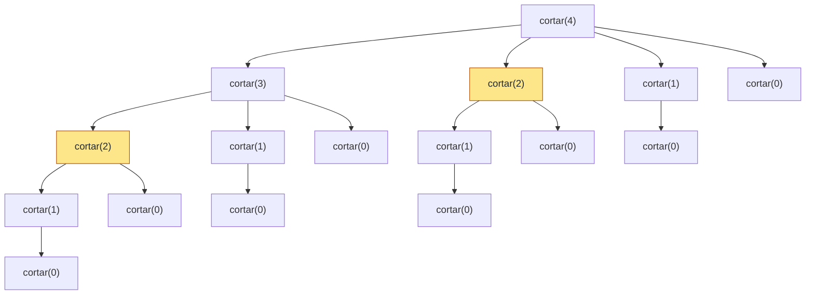

> 📘 **Lección de estudio autónomo.** Este tema no tiene clase en vivo: está escrito para que lo estudies solo o con tu equipo, de principio a fin. Ten abierto un editor de Python y **ejecuta cada bloque de código** a medida que lees; cuando la lección haga una traza a mano, hazla tú primero en papel y después compara.

## Antes de empezar: video introductorio

Mira este video antes de leer. Te da la intuición general de la programación dinámica; la lección la convierte después en un método y en código.

<YouTubeEmbed
  id="e5zaZEfHsIs"
  title="Video introductorio a la programación dinámica"
/>

## Cómo está organizado este tema

La programación dinámica se estudia en **dos lecciones**. Esta es la primera; la segunda se estudia después de la lección Estrategia voraz, porque compara las dos estrategias:

| Lección                                              | Qué aprendes                                                                                                                                                              |
| ---------------------------------------------------- | ------------------------------------------------------------------------------------------------------------------------------------------------------------------------- |
| 1. Fundamentos de programación dinámica              | La idea con un solo problema, el corte de varillas: recursión ingenua, memoización, tabulación, reconstrucción y una receta para plantear cualquier programación dinámica |
| 2. Programación dinámica: decidir, verificar y medir | Cuándo basta una regla voraz y cuándo hace falta programación dinámica, cómo verificar una solución con otra exhaustiva y cómo medir y extrapolar su costo                |

Esta es la primera. Trabaja un solo problema de principio a fin para que la idea quede firme antes de aplicarla a otros. Calcula entre 50 y 60 minutos.

## La cinta de la mercería

Una mercería compra cinta en rollos y la vende en tramos de metros enteros. El precio no crece de forma pareja: la tabla de la tienda paga más por ciertas longitudes. Tienes una cinta de 10 m y quieres cortarla para ganar lo máximo posible.

| Metros `i`   | 1   | 2   | 3   | 4   | 5   | 6   | 7   | 8   | 9   | 10  |
| ------------ | --- | --- | --- | --- | --- | --- | --- | --- | --- | --- |
| Precio `p_i` | 1   | 5   | 8   | 9   | 10  | 17  | 17  | 20  | 24  | 30  |

Prueba a mano con una cinta de 4 m. Sin cortar vale 9. Cortada en 1 + 3 vale 1 + 8 = 9. Cortada en 2 + 2 vale 5 + 5 = **10**. Lo más fácil de pensar (vender entera) no es lo mejor, y probar a ojo no escala: entre cada par de metros consecutivos puedes cortar o no, así que una cinta de 10 m tiene 2⁹ = 512 maneras de cortarse, y una de 40 m, más de medio billón.

## Del ejemplo a la recurrencia

Para modelar el problema: la **entrada** es la longitud `n` de la varilla y los precios `p_1…p_n`; la **salida** es el ingreso máximo `r_n`; la **restricción**, tramos de longitud entera. Mira la decisión clave: el primer tramo que cortas mide `i` metros, lo vendes por `p_i`, y te queda una varilla más corta, de `n - i` metros, que es _el mismo problema_ en pequeño. Como no sabes cuál `i` es el bueno, los pruebas todos y te quedas con el mejor:

$$r_n = \max_{1 \le i \le n} \left( p_i + r_{n-i} \right), \qquad r_0 = 0$$

La fórmula usa `r_{n-i}`, el **mejor** resultado para lo que sobra, y no cualquier forma de cortarlo. ¿Por qué basta con eso? Míralo con una cinta de 7 m. Un vendedor propone este plan: primer tramo de 2 m (vale 5) y los 5 m restantes cortados en 1 + 4 (valen 1 + 9 = 10). Total: **15**. Ahora mira solo la parte que sobra: esos 5 m cortados en 2 + 3 valen 5 + 8 = 13. Cambia solo el resto, sin tocar el primer tramo, y el plan sube a 5 + 13 = **18**.

| Plan para 7 m         | Primer tramo | Los 5 m restantes | Total  |
| --------------------- | ------------ | ----------------- | ------ |
| Original              | 2 m → 5      | 1 + 4 → 10        | 15     |
| Con el resto mejorado | 2 m → 5      | 2 + 3 → 13        | **18** |

La idea es general: si el resto de un plan no está cortado de la mejor manera, el plan se puede mejorar cambiando solo el resto. Por eso un plan óptimo **nunca** tiene el resto mal cortado, y para evaluar "primer tramo de `i` metros" basta con usar el mejor resto, `r_{n-i}`. Este razonamiento se llama **cortar y pegar**: se corta la parte mala de la solución y se pega una mejor. En el ejemplo, la fórmula calcula directamente `p_2 + r_5` = 5 + 13 = 18, que es el ingreso máximo para 7 m.

> **Subestructura óptima:** un problema la tiene cuando una solución óptima contiene soluciones óptimas de subproblemas del mismo tipo.

## Probar todo: la recursión ingenua

La recurrencia se traduce directo a código: cada `r_{n-i}` se calcula llamando otra vez a la función. Los precios van en una lista con `precios[0] = 0`, de modo que `precios[i]` es el precio de `i` metros. Para ver cuánto cuesta, la función recibe además un **contador** que suma 1 en cada llamada. Cópialo y ejecútalo:

```python
import time

PRECIOS: list[int] = [0, 1, 5, 8, 9, 10, 17, 17, 20, 24, 30]


class Contador:
    """Acumula el número de operaciones elementales de un algoritmo."""

    def __init__(self) -> None:
        """Inicia el conteo en cero."""
        self.total = 0


def cortar_ingenuo(precios: list[int], n: int, contador: Contador) -> int:
    """Calcula el ingreso máximo probando todos los cortes posibles.

    Args:
        precios: Precio de un tramo de i metros en la posición i.
        n: Longitud de la varilla.
        contador: Contador compartido por todas las llamadas recursivas.

    Returns:
        El ingreso máximo para una varilla de n metros.
    """
    contador.total += 1  # cuenta esta llamada
    if n == 0:
        return 0  # caso base: r_0 = 0
    mejor = 0
    for i in range(1, n + 1):  # i = longitud del primer tramo
        candidato = precios[i] + cortar_ingenuo(precios, n - i, contador)
        if candidato > mejor:
            mejor = candidato
    return mejor


def tabla_de_complejidad(longitudes: list[int]) -> None:
    """Imprime las llamadas y el tiempo de la recursión por longitud.

    Args:
        longitudes: Longitudes de varilla a medir, en orden creciente.
    """
    # El número de llamadas no depende de los precios: sirve cualquier tabla.
    precios = [0]
    for i in range(1, longitudes[-1] + 1):
        precios.append(3 * i)
    print(f"{'n':>3} | {'llamadas':>10} | {'factor':>6} | {'tiempo (s)':>10}")
    anteriores = 0
    for n in longitudes:
        contador = Contador()  # un contador nuevo para cada longitud
        inicio = time.perf_counter()
        cortar_ingenuo(precios, n, contador)
        tiempo = time.perf_counter() - inicio
        factor = f"{contador.total / anteriores:.1f}" if anteriores else "—"
        print(
            f"{n:>3} | {contador.total:>10,} | {factor:>6} | {tiempo:>10.3f}"
        )
        anteriores = contador.total


print(cortar_ingenuo(PRECIOS, 4, Contador()))   # 10
print(cortar_ingenuo(PRECIOS, 10, Contador()))  # 30
tabla_de_complejidad(list(range(12, 23)))
```

La función es correcta: devuelve `10` para 4 m y `30` para 10 m. El problema es su costo. La columna **factor** divide las llamadas de cada fila entre las de la fila anterior. En un portátil corriente la salida es esta (tus tiempos serán distintos; las llamadas, no):

| `n` (metros) | Llamadas  | Factor | Tiempo (s) |
| ------------ | --------- | ------ | ---------- |
| 12           | 4.096     | —      | 0,0004     |
| 13           | 8.192     | 2,0    | 0,001      |
| 14           | 16.384    | 2,0    | 0,002      |
| 15           | 32.768    | 2,0    | 0,004      |
| 16           | 65.536    | 2,0    | 0,007      |
| 17           | 131.072   | 2,0    | 0,012      |
| 18           | 262.144   | 2,0    | 0,022      |
| 19           | 524.288   | 2,0    | 0,043      |
| 20           | 1.048.576 | 2,0    | 0,085      |
| 21           | 2.097.152 | 2,0    | 0,169      |
| 22           | 4.194.304 | 2,0    | 0,340      |

Lee la tabla columna por columna:

- **Llamadas:** son exactamente $2^n$ (4.096 = 2¹², 1.048.576 = 2²⁰). No es una aproximación.
- **Factor:** siempre 2,0. **Cada metro adicional duplica el trabajo.** Esa es la huella de un crecimiento exponencial, $\Theta(2^n)$.
- **Tiempo:** también se duplica en cada fila, y por eso pasa de menos de un milisegundo a un tercio de segundo en solo diez metros.

Ahora extrapola con el mismo factor: si 22 m tardan 0,34 s, 32 m tardarían unas 2¹⁰ ≈ 1.000 veces más, unos 6 minutos, y 42 m, unas 2²⁰ ≈ un millón de veces más, alrededor de 4 días. La conclusión de la tabla: **la recurrencia es correcta, pero aplicarla así es inservible para varillas de tamaño real.**

## Subproblemas traslapados: por qué explota

¿De dónde salen tantas llamadas, si una varilla de `n` metros solo tiene `n + 1` subproblemas distintos (`r_0, …, r_n`)? Dibuja las llamadas para `n = 4`:



Son 16 llamadas, es decir, 2⁴. Fíjate en los dos nodos resaltados: `cortar(2)` se resuelve dos veces desde cero. Lo mismo ocurre con `cortar(1)`, que aparece cuatro veces, y con `cortar(0)`, ocho. Cada repetición recalcula exactamente la misma respuesta. En general, cada llamada con `n` genera otras para `n-1, n-2, …, 0`, así que $T(n) = 1 + \sum_{j=0}^{n-1} T(j)$ con $T(0) = 1$, que da $T(1) = 2$, $T(2) = 4$, $T(3) = 8$ y, en general, $T(n) = 2^n$: lo mismo que mediste.

> **Subproblemas traslapados:** el espacio de subproblemas distintos es pequeño (aquí, solo n + 1 valores), pero el algoritmo recursivo los encuentra una y otra vez.

En la mercería nadie vuelve a calcular el mejor corte de una cinta de 2 m cada vez que lo necesita: lo apunta en un cuaderno y lo consulta. Esa es la idea de toda la programación dinámica, y aclara el papel de cada propiedad:

- La **subestructura óptima** dice que _se puede_ armar la respuesta a partir de respuestas de subproblemas.
- El **traslape** dice que _conviene guardar_ esas respuestas, porque se piden muchas veces.

Si un problema tiene subestructura pero sus subproblemas no se repiten (como en merge sort, donde cada mitad es distinta), basta dividir y vencer: guardar no ahorra nada.

## Memoización: recursión con cuaderno

El cuaderno, en código, es un diccionario `{longitud: ingreso}`. **Memoización** es la misma recursión de antes, pero antes de calcular `r_n` consulta el cuaderno y después de calcularlo lo anota. Para medirla igual que a la versión ingenua, la función recibe el mismo `Contador`. Escribe este código **en el mismo archivo** del bloque anterior: reutiliza `time`, `PRECIOS` y la clase `Contador`.

```python
def cortar_memo(
    precios: list[int],
    n: int,
    contador: Contador,
    memo: dict[int, int] | None = None,
) -> int:
    """Calcula el ingreso máximo recordando los subproblemas resueltos.

    Args:
        precios: Precio de un tramo de i metros en la posición i.
        n: Longitud de la varilla.
        contador: Contador compartido por todas las llamadas recursivas.
        memo: Cuaderno con los valores r_j ya calculados.

    Returns:
        El ingreso máximo para una varilla de n metros.
    """
    contador.total += 1  # cuenta esta llamada, aunque se resuelva con memo
    if memo is None:
        memo = {}  # cuaderno nuevo en cada llamada externa
    if n == 0:
        return 0
    if n in memo:
        return memo[n]  # ya resuelto: se consulta, no se recalcula
    mejor = 0
    for i in range(1, n + 1):
        candidato = precios[i] + cortar_memo(precios, n - i, contador, memo)
        if candidato > mejor:
            mejor = candidato
    memo[n] = mejor  # se anota antes de devolver
    return mejor


def tabla_memo(longitudes: list[int]) -> None:
    """Imprime las llamadas y el tiempo de la memoización por longitud.

    Args:
        longitudes: Longitudes de varilla a medir; cada una es el doble
            de la anterior.
    """
    precios = [0]
    for i in range(1, longitudes[-1] + 1):
        precios.append(3 * i)
    print(f"{'n':>4} | {'llamadas':>8} | {'factor':>6} | {'tiempo (ms)':>11}")
    anteriores = 0
    for n in longitudes:
        contador = Contador()  # un contador nuevo para cada longitud
        inicio = time.perf_counter()
        cortar_memo(precios, n, contador)
        milisegundos = (time.perf_counter() - inicio) * 1000
        factor = f"{contador.total / anteriores:.2f}" if anteriores else "—"
        print(
            f"{n:>4} | {contador.total:>8,} | {factor:>6} | "
            f"{milisegundos:>11.2f}"
        )
        anteriores = contador.total


print(cortar_memo(PRECIOS, 10, Contador()))  # 30
tabla_memo([25, 50, 100, 200, 400, 800])
```

Hay una diferencia con la tabla de la versión ingenua: aquí cada longitud es **el doble** de la anterior, no un metro más. Con un crecimiento exponencial, sumar un metro ya duplicaba el trabajo; con uno polinomial hay que duplicar `n` para ver la huella. La salida, en el mismo portátil:

| `n` (metros) | Llamadas | Factor | Tiempo (ms) |
| ------------ | -------- | ------ | ----------- |
| 25           | 326      | —      | 0,03        |
| 50           | 1.276    | 3,91   | 0,10        |
| 100          | 5.051    | 3,96   | 0,43        |
| 200          | 20.101   | 3,98   | 2,25        |
| 400          | 80.201   | 3,99   | 7,45        |
| 800          | 320.401  | 3,99   | 30,16       |

Lee la tabla igual que la anterior:

- **Llamadas:** son exactamente $1 + n(n+1)/2$ (con `n = 25`: 1 + 25·26/2 = 326). Cada `r_j` se calcula **una sola vez** y su ciclo hace `j` llamadas, la mayoría resueltas al instante con el cuaderno. Sumando `j` de 1 a `n` sale $n(n+1)/2$, y el 1 es la llamada inicial.
- **Factor:** se acerca a **4** cada vez que `n` se duplica. Esa es la huella de $\Theta(n^2)$: $(2n)^2 = 4n^2$. No es exactamente 4 en las primeras filas porque el término $n/2$ de $n(n+1)/2$ todavía pesa cuando `n` es pequeño.
- **Tiempo:** también se multiplica por cerca de 4 en las filas grandes; en las pequeñas lo distorsionan el ruido del sistema y el costo fijo de Python, que es la razón por la que las llamadas son mejor evidencia que los milisegundos.

Compara las dos tablas: la versión ingenua necesitó más de 4 millones de llamadas para **22 m**; la memoización hace 320.401 para **800 m**, en 30 ms. Con `n = 22` hace solo 254 llamadas. Y la extrapolación ahora es tranquilizadora: duplicar `n` multiplica el trabajo por 4, así que 1.600 m costarían unas 1,3 millones de llamadas y unos 120 ms.

## Ingenua frente a memoización en una gráfica

Las dos tablas muestran números; una gráfica muestra la **forma** del crecimiento, que es lo que define la complejidad. El código siguiente cuenta las llamadas de las dos versiones para cada `n` de 1 a 22 y las dibuja en los mismos ejes con `matplotlib`. Escríbelo en el mismo archivo: reutiliza `Contador`, `cortar_ingenuo` y `cortar_memo`. Si `matplotlib` no está instalado en tu entorno virtual, instálalo con `pip install matplotlib`.

```python
import matplotlib.pyplot as plt


def contar_llamadas(n_maximo: int) -> tuple[list[int], list[int], list[int]]:
    """Cuenta las llamadas de ambas versiones para n = 1, 2, ..., n_maximo.

    Args:
        n_maximo: Longitud máxima de varilla a medir.

    Returns:
        Tres listas del mismo tamaño: las longitudes, las llamadas de la
        versión ingenua y las llamadas de la versión con memoización.
    """
    precios = [0]
    for i in range(1, n_maximo + 1):
        precios.append(3 * i)
    longitudes: list[int] = []
    ingenua: list[int] = []
    memo: list[int] = []
    for n in range(1, n_maximo + 1):
        contador_ingenuo = Contador()
        cortar_ingenuo(precios, n, contador_ingenuo)
        contador_memo = Contador()
        cortar_memo(precios, n, contador_memo)
        longitudes.append(n)
        ingenua.append(contador_ingenuo.total)
        memo.append(contador_memo.total)
    return longitudes, ingenua, memo


def graficar_comparacion(n_maximo: int, archivo: str) -> None:
    """Grafica las llamadas de ambas versiones en escala lineal y logarítmica.

    Args:
        n_maximo: Longitud máxima de varilla a medir.
        archivo: Ruta del archivo PNG donde se guarda la gráfica.
    """
    longitudes, ingenua, memo = contar_llamadas(n_maximo)
    figura, (lineal, logaritmica) = plt.subplots(1, 2, figsize=(11, 4.5))
    for eje in (lineal, logaritmica):
        eje.plot(longitudes, ingenua, "o-", label="Ingenua: Θ(2ⁿ)")
        eje.plot(longitudes, memo, "s-", label="Memoización: Θ(n²)")
        eje.set_xlabel("Longitud de la varilla n (metros)")
        eje.set_ylabel("Número de llamadas")
        eje.grid(True, alpha=0.3)
        eje.legend()
    lineal.set_title("Escala lineal")
    logaritmica.set_yscale("log")  # cada marca del eje y vale 10 veces más
    logaritmica.set_title("Escala logarítmica en el eje y")
    figura.suptitle("Corte de varillas: llamadas de cada versión")
    figura.tight_layout()
    figura.savefig(archivo, dpi=150)
    plt.show()


graficar_comparacion(22, "ingenua_vs_memoizacion.png")
```

La gráfica tiene dos paneles con los mismos datos; solo cambia la escala del eje vertical:


- **Escala lineal (izquierda).** La versión ingenua parece plana hasta `n = 15` y después se dispara hasta unos 4 millones de llamadas (el `1e6` sobre el eje significa "multiplica por un millón"). La memoización queda **pegada al cero** en toda la gráfica: con 22 m hace 254 llamadas, que a esta escala no se distinguen de cero. Así se ve, en la práctica, la distancia entre exponencial y polinomial.
- **Escala logarítmica (derecha).** Cada marca del eje vale 10 veces la anterior, y eso permite ver las dos curvas a la vez. La ingenua se vuelve una **línea recta**: es la firma de un crecimiento exponencial, porque multiplicar por 2 en cada paso es sumar siempre la misma distancia en escala logarítmica. La memoización se **curva y se aplana**: un polinomio crece cada vez más despacio en esta escala. Con `n` muy pequeño las dos versiones hacen casi lo mismo; desde `n = 5` la diferencia ya no deja de crecer.

Cuando compares estrategias, grafica siempre **en los mismos ejes** y, si una curva aplasta a la otra, agrega el panel logarítmico: sin él, la versión eficiente parece no hacer nada y no se puede leer su forma.

## Tabulación: llenar la tabla de menor a mayor

Si de todos modos vas a resolver todos los subproblemas, ¿para qué recursión? Se llena una tabla `r[0..n]` empezando por la varilla más corta, de modo que cuando calculas `r[j]` ya tienes `r[j-i]` para todo `i`. La traza para los primeros valores (hazla en papel antes de leerla):

- `r[1] = 1 + r[0] = 1`
- `r[2] = max(1 + r[1], 5 + r[0]) = max(2, 5) = 5`
- `r[3] = max(1 + r[2], 5 + r[1], 8 + r[0]) = max(6, 6, 8) = 8`
- `r[4] = max(1 + r[3], 5 + r[2], 8 + r[1], 9 + r[0]) = max(9, 10, 9, 9) = 10`

En código son dos ciclos anidados. La tabla `s` la explica la sección siguiente:

```python
def cortar_tabulado(precios: list[int], n: int) -> tuple[list[int], list[int]]:
    """Calcula r y s llenando la tabla de menor a mayor longitud.

    Args:
        precios: Precio de un tramo de i metros en la posición i.
        n: Longitud de la varilla.

    Returns:
        Una pareja (r, s): r[j] es el ingreso máximo para j metros y
        s[j] es la longitud del primer tramo en una solución óptima.
    """
    r = [0] * (n + 1)
    s = [0] * (n + 1)
    for j in range(1, n + 1):  # longitudes de menor a mayor
        for i in range(1, j + 1):  # longitud del primer tramo
            if precios[i] + r[j - i] > r[j]:
                r[j] = precios[i] + r[j - i]
                s[j] = i  # se recuerda la decisión, no solo el valor
    return r, s
```

Es el mismo trabajo que la memoización, Θ(n²), sin llamadas recursivas. Tiene dos ventajas prácticas en Python: no hay riesgo de `RecursionError` (la pila de Python se corta, por defecto, cerca de las 1.000 llamadas anidadas, así que `cortar_memo(precios, 2000, Contador())` falla) y el orden de llenado queda escrito en los ciclos, a la vista.

> **Memoización (de arriba hacia abajo):** recursión que guarda cada respuesta; solo calcula los subproblemas que se piden.
> **Tabulación (de abajo hacia arriba):** ciclos que llenan la tabla en un orden en que cada casilla ya tiene listas las casillas de las que depende.

> 💾 **Guardar cuesta memoria:** el cuaderno de la mercería es pequeño, pero la memoización y la tabulación ocupan Θ(n) casillas que la recursión ingenua no necesita. La programación dinámica cambia tiempo por espacio.

## No basta el valor: recuperar los cortes

Saber que 4 m rinden 10 no le dice al operario dónde cortar. Por eso `cortar_tabulado` guarda, junto a `r[j]`, el valor `s[j]`: la longitud del primer tramo en una solución óptima de `j` metros. Si dos cortes empatan, se queda con el primer `i` que alcanza el máximo (comparación `>` estricta). Para `n = 10` las dos tablas quedan así:

| j      | 0   | 1   | 2   | 3   | 4   | 5   | 6   | 7   | 8   | 9   | 10  |
| ------ | --- | --- | --- | --- | --- | --- | --- | --- | --- | --- | --- |
| `r[j]` | 0   | 1   | 5   | 8   | 10  | 13  | 17  | 18  | 22  | 25  | 30  |
| `s[j]` | 0   | 1   | 2   | 3   | 2   | 2   | 6   | 1   | 2   | 3   | 10  |

Para listar los tramos se sigue `s` desde la varilla completa: se corta `s[n]`, quedan `n - s[n]` metros, y se repite hasta no dejar nada.

```python
def reconstruir_cortes(s: list[int], n: int) -> list[int]:
    """Recorre s para listar los tramos de una solución óptima.

    Args:
        s: Longitud del primer tramo óptimo para cada j.
        n: Longitud de la varilla.

    Returns:
        Las longitudes de los tramos, en el orden en que se cortan.
    """
    tramos: list[int] = []
    while n > 0:
        tramos.append(s[n])
        n -= s[n]  # salta a la varilla que queda
    return tramos
```

`reconstruir_cortes(s, 4)` devuelve `[2, 2]`. Con `n = 7`: `s[7] = 1` deja 6 m, y `s[6] = 6` ya no deja nada; el resultado es `[1, 6]`, de valor 1 + 17 = 18, que empata con el plan 2 + 2 + 3 (5 + 5 + 8) de la sección de la recurrencia. Reconstruir recorre a lo sumo `n` tramos.

> **Reconstrucción:** guardar, junto a cada valor óptimo, **qué decisión** lo produjo, y después seguir esas decisiones desde el problema completo hasta el caso base.

## Receta: cómo plantear cualquier programación dinámica

Lo que hiciste con la cinta se repite en todo problema de programación dinámica. Antes de escribir una línea de código, responde por escrito estas siete preguntas:

| #   | Pregunta                                                                                      | En el corte de varillas                                  |
| --- | --------------------------------------------------------------------------------------------- | -------------------------------------------------------- |
| 1   | ¿Qué **decisión** tomo primero?                                                               | La longitud `i` del primer tramo                         |
| 2   | Después de decidir, ¿qué **queda**? Eso define el **estado** (los parámetros del subproblema) | Una varilla de `n - i` metros: el estado es una longitud |
| 3   | ¿Cuál es la **recurrencia**? (mejor opción entre todas las decisiones posibles)               | `r_n = max(p_i + r_{n-i})`                               |
| 4   | ¿Cuál es el **caso base**?                                                                    | `r_0 = 0`                                                |
| 5   | ¿En qué **orden** se llena la tabla para que cada casilla tenga listas sus dependencias?      | De `j = 1` hasta `n`                                     |
| 6   | ¿Qué guardo para **reconstruir** la solución?                                                 | `s[j]`, el primer tramo                                  |
| 7   | ¿Cuánto cuesta? **Número de estados × trabajo por estado**                                    | `(n + 1)` estados × hasta `n` opciones = Θ(n²)           |

La pregunta 2 es la difícil. Una buena pista: el estado es **lo mínimo que necesitas saber del pasado** para decidir bien el futuro. En la cinta no importa cómo cortaste lo anterior, solo cuántos metros quedan.

La pregunta 7 es la que convierte la receta en análisis de algoritmos: si el estado tiene un parámetro que va de 0 a `n` y cada estado prueba `k` opciones, el costo es Θ(n·k); si tiene dos parámetros, la tabla es bidimensional y el costo se multiplica. Con ella puedes plantear cualquier problema nuevo: identifica la decisión, el estado y la recurrencia antes de escribir una línea de código.

## Resumen operativo

| Variante          | Tiempo en la cinta | Ventaja                                                     | Cuidado                                 |
| ----------------- | ------------------ | ----------------------------------------------------------- | --------------------------------------- |
| Recursión ingenua | Θ(2ⁿ)              | Traduce la recurrencia literalmente                         | Repite subproblemas: exponencial        |
| Memoización       | Θ(n²)              | Misma forma que la recurrencia; solo calcula lo que se pide | Pila de llamadas y `RecursionError`     |
| Tabulación        | Θ(n²)              | Sin recursión; orden explícito                              | Hay que elegir bien el orden de llenado |
| Reconstrucción    | Θ(n)               | Entrega la solución, no solo el valor                       | Requiere guardar las decisiones         |

## Síntesis

- **Cinta de la mercería:** cortar para ganar más se modela con `r_n = max(p_i + r_{n-i})`, y la mejor opción no es siempre la obvia.
- **Subestructura óptima:** el argumento de cortar y pegar justifica usar el mejor resultado para lo que sobra.
- **Ingenua:** probar todo repite subproblemas; la tabla de llamadas muestra el factor 2 de Θ(2ⁿ).
- **Traslape:** pocos subproblemas distintos, pedidos muchas veces: conviene anotarlos.
- **Memoización:** recursión con cuaderno; el factor ≈ 4 al duplicar `n` muestra Θ(n²).
- **Gráfica:** en escala logarítmica, la exponencial es una recta y la cuadrática se aplana.
- **Tabulación:** la misma tabla, de menor a mayor, sin recursión.
- **Reconstrucción:** guardar la decisión de cada estado para entregar la solución, no solo el valor.
- **Receta:** decisión, estado, recurrencia, caso base, orden, reconstrucción y costo = estados × trabajo por estado.
