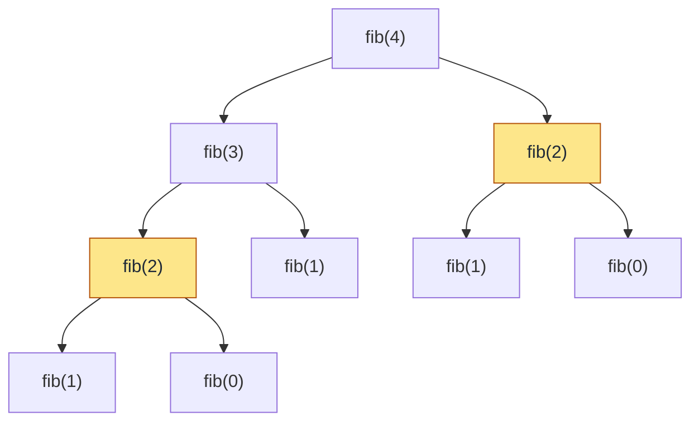

> 📘 **Lección guion para clase en vivo.** Se dicta en la sesión y se sigue paso a paso: ten tu editor abierto, escribe el código a medida que avanzamos y haz cada traza en papel **antes** de mirar la solución. Los bloques de «Factorial» hasta «Hanói: cuántos movimientos» son acumulativos y viven en un mismo archivo, `Clasicos.java`: «añade» significa dentro de la clase y encima de `main`; «reemplaza el cuerpo de `main`» significa borrar el anterior.

## Tres problemas, una misma idea

Ya sabes preguntar dos cosas: **¿cuándo paro?** (caso base) y **¿cómo me acerco al paro?** (caso recursivo). Hoy usas ese esquema en tres problemas clásicos, cada uno con su situación cotidiana.

**Ordenar amigos en una fila.** Tienes 3 amigos (Ana, Beto y Carla) y quieres saber de cuántas formas distintas pueden formarse. Eliges a quién ponen primero (3 opciones) y los otros dos se ordenan como quieran (2 formas): 3 × 2 = 6. Con n amigos: n opciones para el primero y luego la misma pregunta con **n − 1** amigos. Con 0 amigos hay una sola fila posible, la vacía. Es la fila de la lección Fundamentos de recursividad, pero ahora la pregunta es «¿cuántas filas hay?».

**Subir una escalera.** Subes de 1 o de 2 escalones por paso. Para llegar al escalón n, tu último paso vino del escalón n − 1 o del n − 2, así que las formas de llegar son la suma de esas dos. Los resultados (1, 2, 3, 5, 8...) son la sucesión de Fibonacci, corrida un lugar: llegar al escalón n tiene fib(n + 1) formas.

**Mover un rompecabezas de discos.** Imagina una pila de platos de distinto tamaño, el más grande abajo (como la pila de la lección Implementación de pilas en Java), que debes pasar a otra pila de a un plato por vez, sin poner nunca uno grande sobre uno pequeño y con una tercera pila de ayuda. Ese es el problema de las Torres de Hanói.

🛑 **Pausa:** en cada uno, ¿cuál sería el caso más pequeño que ya sabes resolver sin pensar?

## Factorial

El **factorial** de n, escrito n!, es el producto 1 · 2 · ... · n, y cuenta justo las filas de las que hablamos arriba. Sale del ejemplo: n! = n · (n − 1)!, con 0! = 1 como caso base. Crea `Clasicos.java`:

```java
public class Clasicos {

    static int factorial(int n) {
        if (n == 0) {                       // caso base: 0! = 1
            return 1;
        }
        return n * factorial(n - 1);        // caso recursivo: n! = n * (n - 1)!
    }

    public static void main(String[] args) {
        System.out.println(factorial(5));
    }
}
```

🛑 **Antes de ejecutar:** ¿qué imprime `factorial(5)`? Escribe tu predicción y compila.

```text
120
```

Ahora la traza a mano de `factorial(4)`, con la misma tabla de la lección Fundamentos de recursividad. Complétala en papel antes de mirarla:

| Llamada | `n` | ¿Caso base? | Acción | Retorna |
|---|---|---|---|---|
| `factorial(4)` | 4 | No | Llama a `factorial(3)` y espera | (pendiente) |
| `factorial(3)` | 3 | No | Llama a `factorial(2)` y espera | (pendiente) |
| `factorial(2)` | 2 | No | Llama a `factorial(1)` y espera | (pendiente) |
| `factorial(1)` | 1 | No | Llama a `factorial(0)` y espera | (pendiente) |
| `factorial(0)` | 0 | Sí | Devuelve 1 sin llamar | 1 |
| `factorial(1)` (sube) | 1 | No | Recibe 1 y calcula 1 · 1 | 1 |
| `factorial(2)` (sube) | 2 | No | Recibe 1 y calcula 2 · 1 | 2 |
| `factorial(3)` (sube) | 3 | No | Recibe 2 y calcula 3 · 2 | 6 |
| `factorial(4)` (sube) | 4 | No | Recibe 6 y calcula 4 · 6 | 24 |

Las llamadas **bajan** hasta el caso base y las multiplicaciones ocurren **subiendo**.

## Factorial iterativo

El mismo cálculo se puede hacer sin que el método se llame a sí mismo: un ciclo y una variable que va acumulando el producto. Añade este método y **reemplaza** el cuerpo de `main`:

```java
    static int factorialIter(int n) {
        int resultado = 1;
        for (int i = 2; i <= n; i++) {
            resultado = resultado * i;      // acumula 2 * 3 * ... * n
        }
        return resultado;
    }
```

```java
        System.out.println(factorial(5));
        System.out.println(factorialIter(5));
```

```text
120
120
```

| | Recursivo | Iterativo |
|---|---|---|
| Qué guarda mientras trabaja | Un marco de pila por cada llamada pendiente | Una sola variable acumulada, `resultado` |
| Cuándo multiplica | Subiendo, al desapilar | Bajando, en cada vuelta del ciclo |
| Memoria usada | Crece con n | Constante |

## Cuidado: el factorial se desborda

Reemplaza el cuerpo de `main` y observa qué pasa cuando n crece:

```java
        System.out.println(factorial(12));
        System.out.println(factorial(13));
        System.out.println(factorialIter(13));
```

```text
479001600
1932053504
1932053504
```

13! vale 6 227 020 800, pero Java imprime 1 932 053 504 y **no lanza ninguna excepción**. Un `int` solo guarda hasta 2 147 483 647; al pasarse, el valor «da la vuelta» en silencio. Fíjate en que la versión **iterativa** falla igual: el límite es del **tipo**, no de la recursión. La solución es cambiar el tipo. Añade este método y **reemplaza** el cuerpo de `main`:

```java
    static long factorialLargo(int n) {
        if (n == 0) {
            return 1;
        }
        return n * factorialLargo(n - 1);
    }
```

```java
        System.out.println(factorialLargo(13));
        System.out.println(factorialLargo(20));
        System.out.println(factorialLargo(21));
```

```text
6227020800
2432902008176640000
-4249290049419214848
```

Con `long` llegas hasta 20!. En 21! vuelve a desbordarse y sale **negativo**, la señal clásica de desbordamiento. Un tipo más grande solo mueve el límite; no lo elimina.

## Fibonacci

La sucesión de Fibonacci empieza en 0 y 1, y cada término es la suma de los dos anteriores: 0, 1, 1, 2, 3, 5, 8... Como en la escalera, el término n depende de **dos** términos anteriores. Eso trae dos consecuencias para el esquema: hacen falta **dos casos base** (`n == 0` y `n == 1`) y el caso recursivo tiene **dos llamadas**. Añade el método y **reemplaza** el cuerpo de `main`:

```java
    static int fib(int n) {
        if (n == 0) {                       // primer caso base
            return 0;
        }
        if (n == 1) {                       // segundo caso base
            return 1;
        }
        return fib(n - 1) + fib(n - 2);     // dos llamadas más pequeñas
    }
```

```java
        System.out.println(fib(6));
```

```text
8
```

## Fibonacci iterativo

El ciclo recuerda solo los dos últimos términos. Añade el método y **reemplaza** el cuerpo de `main`:

```java
    static int fibIter(int n) {
        int anterior = 0;
        int actual = 1;
        for (int i = 0; i < n; i++) {
            int siguiente = anterior + actual;
            anterior = actual;
            actual = siguiente;
        }
        return anterior;
    }
```

```java
        System.out.println(fib(6));
        System.out.println(fibIter(6));
```

```text
8
8
```

Ambas dan lo mismo. ¿Cuál trabaja más? La votación te ayuda a averiguarlo.

## 🗳️ Votación — ¿cuántas veces se calcula fib(2)?

Antes de mostrar nada, **dibuja a mano** el árbol de llamadas de `fib(4)`: `fib(4)` llama a `fib(3)` y a `fib(2)`, y cada una sigue llamando hasta llegar a los casos base. Luego, sin hablar con nadie: al calcular `fib(4)`, ¿cuántas veces se llama a `fib(2)`?

- (a) 1
- (b) 2
- (c) 3
- (d) 4

Vota solo. Si entre el 30 % y el 70 % del grupo acierta, discutan 2 minutos en parejas y vuelvan a votar; si más del 70 % acierta, la explicación es rápida; si menos del 30 %, vuelve a explicar el árbol antes de discutir.

## Qué hace fib(4) por dentro

Estas son las 9 llamadas que genera `fib(4)`. Los nodos resaltados son el mismo cálculo, `fib(2)`, hecho dos veces:



**La respuesta es (b), 2 veces.** Qué revela cada opción: (a) 1 supone que cada valor se calcula una sola vez, que es justo lo que **no** pasa; (c) 3 es el número de veces que aparece `fib(1)`, otro valor repetido; (d) 4 sale de confundir el 4 de `fib(4)` con el número de veces.

Para comprobarlo con el programa, sin dibujar nada, cuenta las llamadas con un atributo `static`. Reemplaza `fib` por esta versión, añade el contador y el método `contarLlamadas`, y **reemplaza** el cuerpo de `main`:

```java
    static int llamadas = 0;

    static int fib(int n) {
        llamadas++;                         // cuenta cada llamada
        if (n == 0) {
            return 0;
        }
        if (n == 1) {
            return 1;
        }
        return fib(n - 1) + fib(n - 2);
    }

    static void contarLlamadas(int n) {
        llamadas = 0;
        int resultado = fib(n);
        System.out.println("fib(" + n + ") = " + resultado + ", llamadas = " + llamadas);
    }
```

```java
        contarLlamadas(4);
        contarLlamadas(10);
        contarLlamadas(20);
        contarLlamadas(30);
```

```text
fib(4) = 3, llamadas = 9
fib(10) = 55, llamadas = 177
fib(20) = 6765, llamadas = 21891
fib(30) = 832040, llamadas = 2692537
```

| n | Llamadas a `fib` | Vueltas de `fibIter` |
|---|---|---|
| 4 | 9 | 4 |
| 10 | 177 | 10 |
| 20 | 21 891 | 20 |
| 30 | 2 692 537 | 30 |

Para el término 30 la versión recursiva hace más de dos millones y medio de llamadas; el ciclo, 30 vueltas. El árbol repite trabajo porque cada `fib(k)` olvida que otra rama ya lo calculó. No es un error de programación: es el costo de plantearlo así.

## Torres de Hanói: el planteamiento

Hay tres varillas, `A`, `B` y `C`, y `n` discos de tamaños distintos apilados en `A`, el mayor abajo. El objetivo es pasarlos todos a `C` cumpliendo dos reglas:

- Se mueve **un disco por vez**: el que está arriba de una varilla.
- Nunca puede haber un disco grande **sobre** uno más pequeño.

La varilla `B` es la ayuda. Con 1 disco es trivial; con 2 ya hay que usar `B`. ¿Cómo escribir una solución para cualquier n?

## Hanói: la solución recursiva

Piensa en el disco más grande. Para moverlo de `A` a `C` todos los demás deben estar fuera de camino, en `B`. Entonces el problema se parte en tres partes, dos de las cuales son **el mismo problema con un disco menos**:

1. Mover los `n - 1` discos de arriba de `A` a `B` (usando `C` de ayuda).
2. Mover el disco `n` de `A` a `C`.
3. Mover los `n - 1` discos de `B` a `C` (usando `A` de ayuda).

El caso base es `n == 0`: no hay discos, no se hace nada. Añade el método y **reemplaza** el cuerpo de `main`:

```java
    static void hanoi(int n, char origen, char destino, char auxiliar) {
        if (n == 0) {                       // caso base: sin discos no hay nada que mover
            return;
        }
        hanoi(n - 1, origen, auxiliar, destino);    // 1. quitar los discos de arriba del camino
        System.out.println("Mueve el disco " + n + " de " + origen + " a " + destino);   // 2.
        hanoi(n - 1, auxiliar, destino, origen);    // 3. ponerlos encima del disco n
    }
```

```java
        hanoi(3, 'A', 'C', 'B');
```

```text
Mueve el disco 1 de A a C
Mueve el disco 2 de A a B
Mueve el disco 1 de C a B
Mueve el disco 3 de A a C
Mueve el disco 1 de B a A
Mueve el disco 2 de B a C
Mueve el disco 1 de A a C
```

El disco se identifica por su tamaño: el 1 es el más pequeño. Observa que en las dos llamadas recursivas los papeles de las varillas se **intercambian**: lo que era `auxiliar` pasa a ser `destino` u `origen`.

## Hanói: traza a mano con 3 discos

Completa en papel el estado de las varillas después de cada movimiento (de abajo hacia arriba) antes de mirar la tabla:

| Movimiento | Lo imprime la llamada | Disco | `A` | `B` | `C` |
|---|---|---|---|---|---|
| 1 | `hanoi(1, A, C, B)` | 1: A → C | 3, 2 | — | 1 |
| 2 | `hanoi(2, A, B, C)` | 2: A → B | 3 | 2 | 1 |
| 3 | `hanoi(1, C, B, A)` | 1: C → B | 3 | 2, 1 | — |
| 4 | `hanoi(3, A, C, B)` | 3: A → C | — | 2, 1 | 3 |
| 5 | `hanoi(1, B, A, C)` | 1: B → A | 1 | 2 | 3 |
| 6 | `hanoi(2, B, C, A)` | 2: B → C | 1 | — | 3, 2 |
| 7 | `hanoi(1, A, C, B)` | 1: A → C | — | — | 3, 2, 1 |

El movimiento 4 mueve el disco grande justo cuando los discos 1 y 2 ya están en `B`; los movimientos 1 a 3 y 5 a 7 son el problema de 2 discos resuelto dos veces.

## Hanói: cuántos movimientos

Cuenta los movimientos con un atributo `static` y una bandera para apagar la impresión. **Reemplaza** `hanoi` por esta versión (con `imprimir = true` se comporta igual que antes) y **reemplaza** el cuerpo de `main`:

```java
    static int movimientos = 0;
    static boolean imprimir = true;

    static void hanoi(int n, char origen, char destino, char auxiliar) {
        if (n == 0) {
            return;
        }
        hanoi(n - 1, origen, auxiliar, destino);
        movimientos++;
        if (imprimir) {
            System.out.println("Mueve el disco " + n + " de " + origen + " a " + destino);
        }
        hanoi(n - 1, auxiliar, destino, origen);
    }
```

```java
        imprimir = false;
        for (int n = 1; n <= 5; n++) {
            movimientos = 0;
            hanoi(n, 'A', 'C', 'B');
            System.out.println("n = " + n + " -> " + movimientos + " movimientos");
        }
```

```text
n = 1 -> 1 movimientos
n = 2 -> 3 movimientos
n = 3 -> 7 movimientos
n = 4 -> 15 movimientos
n = 5 -> 31 movimientos
```

La regla sale de la propia solución: mover n discos cuesta mover `n - 1` discos, más 1 movimiento, más mover otra vez `n - 1` discos. Es decir, m(n) = 2 · m(n − 1) + 1, con m(1) = 1. Al duplicar y sumar 1 sucesivamente (1, 3, 7, 15, 31...) cada valor es una potencia de 2 menos 1:

**m(n) = 2^n − 1**

Con 10 discos son 1023 movimientos, y cada disco extra **duplica** el trabajo más uno. Por eso en clase solo imprimimos hasta 3 discos.

## ¿Cuándo preferir recursión sobre iteración?

La elección no es de gusto: depende de la forma del problema.

| | Recursión conviene cuando... | Iteración conviene cuando... |
|---|---|---|
| Forma del problema | Se parte en subproblemas del mismo tipo (como Hanói) | Es una repetición simple de pasos iguales (factorial) |
| Legibilidad | El código es casi la definición del problema | La receta paso a paso es igual de clara |
| Memoria | No te importa un marco apilado por llamada | Quieres memoria constante |

Tres cosas para revisar siempre antes de elegir recursión:

- **Marcos apilados.** Cada llamada pendiente ocupa un marco; con n muy grande la pila puede llenarse.
- **Trabajo repetido.** En Fibonacci el árbol recalcula los mismos valores, como viste en el conteo de llamadas.
- **Desbordamiento.** Es un límite del tipo y afecta igual a la versión iterativa; no es una razón para elegir una u otra.

**Regla práctica:** si el problema se describe de forma natural partiéndose en copias más pequeñas de sí mismo (Hanói), la recursión es clara y adecuada; si es una repetición simple (factorial) o la versión recursiva repite trabajo (Fibonacci), un ciclo suele ser mejor.

## Resumen operativo

| Algoritmo | Casos base | Caso recursivo | Versión iterativa |
|---|---|---|---|
| Factorial | `n == 0` devuelve 1 | `n * factorial(n - 1)` | Ciclo con una variable acumulada |
| Fibonacci | `n == 0` y `n == 1` | `fib(n - 1) + fib(n - 2)` | Ciclo con los dos últimos términos |
| Hanói | `n == 0`: no hace nada | Mover n − 1, mover el disco n, mover n − 1 | No se escribe aquí |

## Síntesis

- Los tres problemas se resuelven con el mismo esquema: un caso base (¿cuándo paro?) y un caso recursivo que se acerca a él.
- El **factorial** sale de n! = n · (n − 1)!, con 0! = 1, y se traza con la misma tabla de la lección Fundamentos de recursividad.
- La versión **iterativa** del factorial usa una variable acumulada en lugar de marcos apilados.
- El factorial **se desborda** con `int` desde 13! y con `long` desde 21!; el límite es del tipo, no de la recursión.
- **Fibonacci** necesita dos casos base y dos llamadas recursivas.
- La versión iterativa de Fibonacci recuerda solo los dos últimos términos.
- La votación mostró que el árbol de `fib(4)` calcula `fib(2)` dos veces, y que el trabajo repetido crece rápido.
- En el árbol de `fib(4)` hay 9 llamadas; con n = 30 son 2 692 537, contra 30 vueltas del ciclo.
- **Hanói** se plantea con tres varillas y dos reglas, y se resuelve en tres partes: quitar, mover, volver a poner.
- La solución recursiva de Hanói tiene caso base `n == 0` e intercambia los papeles de las varillas.
- La traza con 3 discos tiene 7 movimientos y deja ver cómo el disco grande se mueve en el centro.
- El número de movimientos es **2^n − 1**: cada disco extra duplica el trabajo más uno.
- Elegir entre recursión e iteración depende de la forma del problema y de dos riesgos que inclinan la decisión: marcos apilados y trabajo repetido; el desbordamiento es un límite del tipo y afecta igual a las dos versiones.
