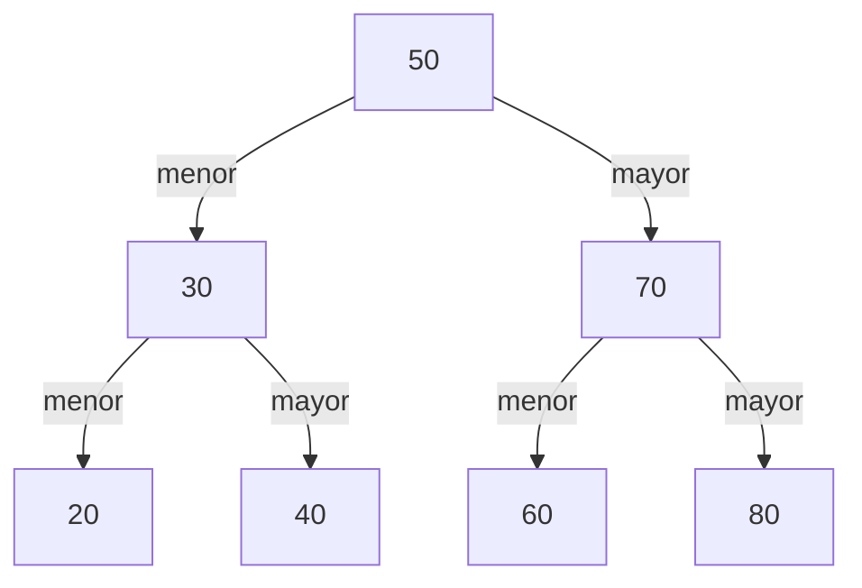
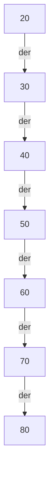

> 📘 **Lección guion para clase en vivo.** Se dicta en la sesión y se sigue paso a paso: ten tu editor abierto, escribe el código a medida que avanzamos y haz cada traza en papel **antes** de mirar la tabla. El código vive en `ArbolBusqueda.java`, que se completa a lo largo de la lección, y usa `NodoArbol.java` y `Recorridos.java` tal como quedaron en la lección Inserción y recorridos, en la misma carpeta y sin modificarlos. «Añade» significa dentro de la clase y encima de `main`; «añade al final de `main`» significa poner las líneas nuevas después de las que ya hay; «reemplaza el contenido de `main`» significa borrar todo lo que hay entre sus llaves; y «reemplaza lo que sigue a la construcción» significa borrar las líneas de `main` posteriores a las que arman el árbol y poner las nuevas. Para compilar y ejecutar: `javac NodoArbol.java Recorridos.java ArbolBusqueda.java` y luego `java ArbolBusqueda`.

## Adivina el número

Piensa un número del 1 al 100 y pídele a un compañero que lo adivine. En cada intento solo recibe una de tres respuestas: «es ese», «el mío es mayor» o «el mío es menor». Quien adivina quiere gastar la menor cantidad de intentos posible.

Hay dos maneras de jugar. Si pregunta 1, luego 2, luego 3 y así seguido, en el peor caso necesita **100 intentos**. Si pregunta por la mitad, 50, cada respuesta le quita la mitad de los números que quedan: con «menor» descarta el 50 **y todos los mayores que 50**, no solo uno. Así el peor caso baja a **7 intentos**, porque `2^7 = 128` alcanza para cubrir los 100 números.

🛑 **Pausa:** ¿qué número preguntas primero y por qué? Y si te responden «menor», ¿qué números acabas de descartar?

Primero el 50, porque es el que deja menos números pendientes en el peor de los dos casos. Con «menor» descartaste del 50 al 100 completos: 51 números de un golpe. Esa idea de descartar **todo un lado** de una sola pregunta es la que vamos a convertir en estructura de datos.

Para trabajar a mano usaremos siete tarjetas sobre la mesa: 20, 30, 40, 50, 60, 70 y 80. La primera pregunta es siempre el 50.

## Del juego a la regla: menores a la izquierda, mayores a la derecha

Cada pregunta del juego es un nodo. La respuesta «menor» te manda a las preguntas de un lado y «mayor» a las del otro. Con las siete tarjetas, las preguntas forman este árbol:



Si te dicen «menor» en el 50, el número buscado está en todo el subárbol izquierdo; si te dicen «mayor», en todo el derecho. Eso solo funciona si el árbol cumple una regla:

> **Árbol binario de búsqueda (BST, _binary search tree_):** árbol binario en el que, para cada nodo, **todos** los datos de su subárbol izquierdo son menores que el dato del nodo y **todos** los de su subárbol derecho son mayores. En este curso los datos no se repiten.

🛑 **Pausa:** con las siete tarjetas ya colocadas, ¿dónde caería una tarjeta nueva con el 65?

Preguntas igual que en el juego: 65 es mayor que 50, así que bajas por la derecha; es menor que 70, bajas por su izquierda; es mayor que 60, bajas por su derecha, y ahí no hay nada. El 65 queda como hijo derecho del 60.

## Buscar: bajar por el lado que dice la regla

Como en la lección Inserción y recorridos, el recorrido es recursivo y se responde con las dos preguntas de la lección Fundamentos de recursividad. **¿Cuándo paro?** En dos casos: el árbol está vacío, y el dato no está; o el dato del nodo es igual al buscado, y lo encontré. **¿Cómo me acerco al paro?** Cada llamada baja a un solo subárbol, el que indica la regla, y el otro lado se descarta completo.

Crea `ArbolBusqueda.java`. Los datos son enteros y se comparan con `==` y `<`, como siempre. Cada nodo visitado es una pregunta del juego: ¿es igual, menor o mayor? El contador `comparaciones` suma **una por nodo visitado**, al entrar a él, antes de decidir. Los métodos son `static` y el árbol vacío es `null`, igual que en `Recorridos`:

```java
public class ArbolBusqueda {

    static int comparaciones = 0;       // solo para contar; se pone en 0 antes de cada prueba

    static boolean buscar(NodoArbol<Integer> nodo, int dato) {
        if (nodo == null) {                              // caso base: arbol vacio, no esta
            return false;
        }
        comparaciones++;                                 // una pregunta por nodo visitado
        int actual = nodo.getDato();
        if (dato == actual) {                            // caso base: lo encontre
            return true;
        }
        if (dato < actual) {
            return buscar(nodo.getIzquierdo(), dato);    // menor: solo puede estar a la izquierda
        }
        return buscar(nodo.getDerecho(), dato);          // mayor: solo puede estar a la derecha
    }

    public static void main(String[] args) {
    }
}
```

La llamada con el árbol vacío **no compara nada**: no hay nodo con el cual comparar. Ahora la traza a mano de `buscar(65)` sobre el árbol de las siete tarjetas, que armaremos en código más adelante.

🛑 **Antes de mirar la tabla:** haz la traza en papel. ¿Cuántas llamadas hay? ¿Cuántas de ellas comparan?

| # | Llamada | Compara | Decisión |
|---|---|---|---|
| 1 | `buscar(50, 65)` | 65 con 50 | mayor: sigue por el derecho |
| 2 | `buscar(70, 65)` | 65 con 70 | menor: sigue por el izquierdo |
| 3 | `buscar(60, 65)` | 65 con 60 | mayor: sigue por el derecho |
| 4 | Árbol vacío (derecho de `60`) | nada | `false` |

Son 4 llamadas: 3 con nodo (50, 70 y 60) y 1 con árbol vacío. Solo las 3 primeras comparan, así que `buscar(65)` hace **3 comparaciones** y devuelve `false`. De las 7 tarjetas, miró 3.

## 🗳️ Votación — ¿qué imprime buscar sobre este árbol?

Reemplaza el contenido de `main`. Esta vez el árbol se arma a mano, con `insertarIzquierdo` e `insertarDerecho` de la lección Inserción y recorridos:

```java
        NodoArbol<Integer> r = new NodoArbol<>(50);
        NodoArbol<Integer> n30 = r.insertarIzquierdo(30);
        r.insertarDerecho(70);
        n30.insertarIzquierdo(20);
        n30.insertarDerecho(60);
        comparaciones = 0;
        System.out.println(buscar(r, 60) + " " + comparaciones);
```

Dibuja el árbol, haz la traza en papel y, sin ejecutar y sin hablar con nadie: ¿qué imprime?

- (a) `true 3`
- (b) `false 2`
- (c) `false 3`
- (d) `true 4`

Vota solo. Si entre el 30 % y el 70 % del grupo acierta, discutan 2 minutos en parejas y vuelvan a votar; si más del 70 % acierta, la explicación es rápida; si menos del 30 %, vuelve a explicar cómo `buscar` decide hacia dónde bajar antes de discutir.

## Comprobar la votación

Reemplaza lo que sigue a la construcción y ejecuta:

```java
        comparaciones = 0;
        System.out.println(buscar(r, 60) + " " + comparaciones);
        comparaciones = 0;
        System.out.println(buscar(r, 20) + " " + comparaciones);
        System.out.print("in-orden: ");
        Recorridos.inOrden(r);
        System.out.println();
```

```text
false 2
true 3
in-orden: 20 30 60 50 70 
```

**La respuesta es (b).** `buscar` no sigue el dibujo, sigue la regla: 60 es mayor que 50 y baja por la derecha; ahí 60 es menor que 70 y baja por su izquierda, que es un árbol vacío. Hizo 2 comparaciones y dijo `false`, aunque el 60 **sí está** en el árbol. Qué revela cada opción: (a) sigue el camino dibujado 50, 30, 60 en vez de la regla; (c) cuenta como comparación la llamada con el árbol vacío; (d) recorre el árbol en pre-orden, como si no hubiera orden.

El culpable es el árbol: no es un BST. El 60 cuelga a la derecha del 30 y **cumple con su padre**, pero está en el subárbol izquierdo del 50 y es mayor que 50. Cumplir con el padre no basta: la regla es sobre **todo** el subárbol. La pista visible es el in-orden: `20 30 60 50 70` no sale ordenado.

Un BST nunca se arma así si lo construye `insertar`, porque `insertar` siempre empieza por la raíz y compara con cada ancestro en el camino: el 60 se habría comparado con el 50 antes de llegar al 30.

## Insertar: buscar y colgar donde falló la búsqueda

Para guardar la tarjeta 65 haces las mismas preguntas que para buscarla; cuando el juego te diría «ahí no hay nada», **ahí** la pones. Insertar es buscar y colgar el dato donde la búsqueda falla. Añade este método encima de `main`:

```java
    static boolean insertar(NodoArbol<Integer> nodo, int dato) {
        comparaciones++;                                 // una pregunta por nodo visitado
        int actual = nodo.getDato();
        if (dato == actual) {                            // duplicado: no se inserta
            return false;
        }
        if (dato < actual) {
            if (nodo.getIzquierdo() == null) {           // lado libre: aqui cuelga
                nodo.insertarIzquierdo(dato);
                return true;
            }
            return insertar(nodo.getIzquierdo(), dato);
        }
        if (nodo.getDerecho() == null) {
            nodo.insertarDerecho(dato);
            return true;
        }
        return insertar(nodo.getDerecho(), dato);
    }
```

Esta versión necesita un árbol con raíz: el primer dato se crea con el constructor, y `insertar` agrega los demás. Por eso su caso base **no** es el árbol vacío. **¿Cuándo paro?** Cuando el dato ya está (devuelve `false` y no cambia nada) o cuando el lado por donde debo bajar está libre (cuelga el dato y devuelve `true`). **¿Cómo me acerco al paro?** Cada llamada baja a un hijo. Como solo cuelga donde hay hueco, el `IllegalStateException` de la lección Inserción y recorridos nunca se lanza aquí.

La traza de `insertar(raiz, 65)` en el árbol de las siete tarjetas recorre el mismo camino que `buscar(65)`:

| # | Llamada | Compara | Decisión |
|---|---|---|---|
| 1 | `insertar(50, 65)` | 65 con 50 | mayor; el derecho existe, baja |
| 2 | `insertar(70, 65)` | 65 con 70 | menor; el izquierdo existe, baja |
| 3 | `insertar(60, 65)` | 65 con 60 | mayor; el derecho está libre: cuelga el 65, `true` |

Son 3 llamadas y 3 comparaciones, las mismas que hizo la búsqueda fallida. Y con `insertar`, los cinco datos de la votación en el orden 50, 30, 70, 20 y 60 sí dan un BST: el 60 acaba a la izquierda del 70 y `buscar(60)` devuelve `true` con 3 comparaciones.

🛑 **Pausa:** ¿qué pasa si insertas un dato que ya está? ¿Por qué devolver `false` y no lanzar una excepción?

El dato se ignora y el árbol queda igual: un BST de este curso es un conjunto de claves. No es una falla del programa sino una respuesta, y el `boolean` ya se la da a quien llama. En `insertarIzquierdo` la excepción sí protegía algo, porque reemplazar perdía un subárbol; ignorar un duplicado no pierde nada.

## Construir el árbol por inserciones y leerlo en in-orden

Reemplaza el contenido de `main`. La raíz es el primer dato, 50, y los demás entran con `insertar`:

```java
        NodoArbol<Integer> raiz = new NodoArbol<>(50);
        insertar(raiz, 30);
        insertar(raiz, 70);
        insertar(raiz, 20);
        insertar(raiz, 40);
        insertar(raiz, 60);
        insertar(raiz, 80);
```

Reemplaza lo que sigue a la construcción y lee el árbol con el `inOrden` de la lección Inserción y recorridos, sin código de recorrido nuevo:

```java
        System.out.print("in-orden: ");
        Recorridos.inOrden(raiz);
        System.out.println();
```

```text
in-orden: 20 30 40 50 60 70 80 
```

Sale **ordenado**. La lección Inserción y recorridos no lo dijo porque aún no había regla: ahora el in-orden visita el subárbol izquierdo (todo menor), luego el nodo y luego el derecho (todo mayor), y por eso un BST leído en in-orden siempre queda de menor a mayor. Reemplaza lo que sigue a la construcción y busca tres datos:

```java
        comparaciones = 0;
        System.out.println(buscar(raiz, 40) + " " + comparaciones);
        comparaciones = 0;
        System.out.println(buscar(raiz, 65) + " " + comparaciones);
        comparaciones = 0;
        System.out.println(buscar(raiz, 80) + " " + comparaciones);
```

```text
true 3
false 3
true 3
```

Ahora inserta el 65 dos veces. Reemplaza lo que sigue a la construcción:

```java
        System.out.println(insertar(raiz, 65));
        System.out.println(insertar(raiz, 65));
        System.out.print("in-orden: ");
        Recorridos.inOrden(raiz);
        System.out.println();
```

```text
true
false
in-orden: 20 30 40 50 60 65 70 80 
```

La primera vez cuelga el 65 y devuelve `true`; la segunda lo encuentra y devuelve `false`, y el árbol no cambia. El in-orden sigue ordenado con el 65 en su lugar.

## Dónde se rompe la analogía: tú no eliges la raíz

En el juego **tú eliges qué preguntar**: siempre la mitad, y por eso el peor caso son 7 intentos. En el BST no: la primera pregunta de cualquier búsqueda es la raíz, y la raíz es el primer dato que llegó. El orden de llegada de los datos decide la forma del árbol.

Veamos los mismos siete datos, pero llegando ya ordenados: primero el 20 y luego 30, 40, 50, 60, 70 y 80. Cada dato nuevo es mayor que todos, así que siempre baja por la derecha:



Es el árbol **degenerado** de la lección Conceptos y TAD árbol binario, el que «puede ser alto y flaco»: cada nodo tiene un solo hijo y el árbol es una lista enlazada disfrazada. Reemplaza lo que sigue a la construcción y constrúyelo junto al otro:

```java
        NodoArbol<Integer> degenerado = new NodoArbol<>(20);
        insertar(degenerado, 30);
        insertar(degenerado, 40);
        insertar(degenerado, 50);
        insertar(degenerado, 60);
        insertar(degenerado, 70);
        insertar(degenerado, 80);
        comparaciones = 0;
        System.out.println(buscar(degenerado, 80) + " " + comparaciones);
        comparaciones = 0;
        System.out.println(buscar(degenerado, 20) + " " + comparaciones);
        comparaciones = 0;
        System.out.println(buscar(degenerado, 55) + " " + comparaciones);
        comparaciones = 0;
        System.out.println(buscar(raiz, 55) + " " + comparaciones);
        System.out.print("in-orden: ");
        Recorridos.inOrden(degenerado);
        System.out.println();
```

```text
true 7
true 1
false 5
false 3
in-orden: 20 30 40 50 60 70 80 
```

El in-orden es igual de ordenado: la regla se cumple en los dos árboles, pero el costo no. Buscar el 80 cuesta 7 comparaciones en el degenerado, y buscar el 55, que no está, cuesta 5 frente a 3 en el equilibrado. Para medir todos los datos, añade al final de `main` un ciclo que busca cada uno de los siete en ambos árboles y suma las comparaciones:

```java
        int[] datos = {20, 30, 40, 50, 60, 70, 80};
        int totalEquilibrado = 0;
        int totalDegenerado = 0;
        for (int i = 0; i < datos.length; i++) {
            comparaciones = 0;
            buscar(raiz, datos[i]);
            totalEquilibrado += comparaciones;
            comparaciones = 0;
            buscar(degenerado, datos[i]);
            totalDegenerado += comparaciones;
        }
        System.out.println("equilibrado: " + totalEquilibrado);
        System.out.println("degenerado: " + totalDegenerado);
```

Al final de la salida aparecen dos líneas nuevas:

```text
equilibrado: 17
degenerado: 28
```

El equilibrado suma `1 + 2 + 2 + 3 + 3 + 3 + 3 = 17`; el degenerado, `1 + 2 + ... + 7 = 28`. Y no todo es peor en el degenerado: buscar el 20 cuesta 1 allí y 3 en el equilibrado. Lo que importa es el peor caso y el promedio.

Lo que cuenta es la **altura** `h` del árbol: en el peor caso, buscar o insertar hace `h + 1` comparaciones, es decir, **O(h)**. Con mil datos insertados desde la mediana hacia afuera, el árbol sale de altura 9, que según la lección Conceptos y TAD árbol binario admite hasta 1023 nodos, y la peor búsqueda cuesta 10 comparaciones. Con los mil datos llegando ordenados, la altura es 999 y la peor búsqueda cuesta 1000. En el primer caso `h` crece como `log n`, la misma idea de la búsqueda binaria en la lección Notación Big O y análisis de complejidad; en el segundo, como `n`. Un BST es rápido **si está equilibrado**, y con este `insertar` el orden de llegada de los datos decide si lo está.

## Resumen operativo

| Operación | Caso base (cuándo paro) | Costo en el peor caso |
|---|---|---|
| `buscar` | Árbol vacío (`false`) o dato igual al del nodo (`true`) | O(h) comparaciones |
| `insertar` | Dato repetido (`false`) o lado libre donde colgarlo (`true`) | O(h) comparaciones |

## Síntesis

- Preguntar por la mitad en el juego del 1 al 100 baja el peor caso de 100 a 7 intentos, porque cada «menor» o «mayor» descarta **todo** un lado, no un solo número.
- Esa idea es la regla del BST: para cada nodo, todo el subárbol izquierdo es menor y todo el derecho es mayor.
- Cada nodo visitado es una pregunta (¿igual, menor o mayor?) y el contador suma una comparación por nodo visitado, al entrar a él.
- `buscar` tiene dos casos base, árbol vacío y dato encontrado, y baja por un solo lado; `buscar(65)` en el árbol de las siete tarjetas hace 4 llamadas, 3 con nodo y 1 con árbol vacío, y 3 comparaciones.
- En la votación, `buscar(r, 60)` imprime `false 2` porque el árbol no cumplía la regla: cumplir con el padre no basta, la regla es sobre todo el subárbol, y el in-orden desordenado `20 30 60 50 70` lo delata.
- `insertar` busca y cuelga el dato donde la búsqueda falla; su caso base es dato repetido o lado libre, y los duplicados se ignoran devolviendo `false`.
- Un BST leído en in-orden sale ordenado, y `insertar` siempre parte de la raíz, por eso nunca arma un árbol que rompa la regla.
- La analogía se rompe en que tú no eliges la raíz: con los mismos siete datos, el orden de llegada da un árbol equilibrado (17 comparaciones en total) o uno degenerado (28).
- Buscar e insertar cuestan O(h): rápidos si el árbol está equilibrado, y O(n) si está degenerado.
