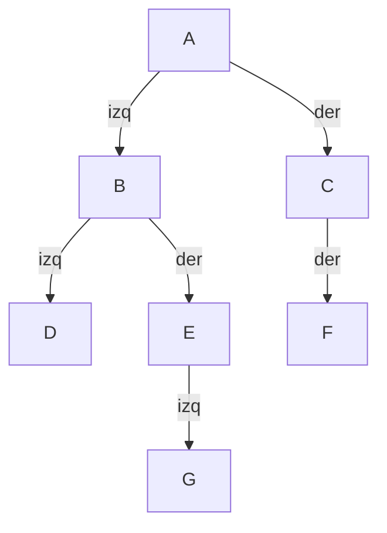

> 📘 **Lección guion para clase en vivo.** Se dicta en la sesión y se sigue paso a paso: ten papel y lápiz a la mano, dibuja cada árbol a medida que avanzamos y resuelve cada pausa 🛑 **antes** de mirar la respuesta. Todo el tiempo trabajamos con un mismo árbol de ejemplo, el de la sección «Vocabulario de un árbol».

## Las carpetas de tu computador

Abre el explorador de archivos. Tu disco tiene carpetas; dentro de una carpeta hay otras carpetas y archivos; dentro de esas, más de lo mismo. Por ejemplo:

```text
Disco
├── Semestre4
│   ├── ED
│   │   ├── parcial.pdf
│   │   └── lab1.java
│   └── Redes
│       └── resumen.docx
└── Fotos
    └── viaje.jpg
```

Cada carpeta está **dentro de otra**, salvo el disco, que no está dentro de nada. Un archivo como `lab1.java` no contiene nada más. Y si copias la carpeta `ED`, te llevas con ella todo lo que tiene adentro.

Ahora imagina que tu computador guardara todo en **una sola lista plana**: `parcial.pdf`, `viaje.jpg`, `lab1.java`, `resumen.docx`... Los mismos archivos, pero sin carpetas.

🛑 **Pausa:** con todos los archivos en una lista, ¿cómo encuentras todo lo que está dentro de `ED`?

## ¿Qué problemas piden una estructura jerárquica?

La lista plana pierde la información de **quién cuelga de quién**. Esa relación aparece en muchos problemas:

- Un **organigrama**: el gerente tiene directores a cargo, y cada director tiene su equipo.
- El **índice de un libro**: capítulos que contienen secciones que contienen subsecciones.
- El **menú de categorías** de una tienda en línea: Tecnología contiene Computadores, y Computadores contiene Portátiles.

La lista, la pila y la cola que ya conoces son **lineales**: cada elemento tiene un anterior y un siguiente, y nada más. Aquí un elemento puede tener varios elementos «debajo».

| Problema | ¿Hay un «contiene a»? | ¿Basta una estructura lineal? |
|---|---|---|
| Fila del banco | No: solo hay un orden | Sí, una cola |
| Pila de platos | No: solo importa el de arriba | Sí, una pila |
| Carpetas del computador | Sí: carpeta dentro de carpeta | No |
| Organigrama de una empresa | Sí: el jefe contiene a su equipo | No |
| Menú de categorías | Sí: categoría dentro de categoría | No |

Cuando hay un «contiene a», la forma natural es un **árbol**.

## Vocabulario de un árbol

Este es el árbol de ejemplo de toda la lección. Los nodos son letras para que no dependan de ningún contexto:



Cada término tiene su equivalente en las carpetas:

| Término | En las carpetas | En el árbol de ejemplo |
|---|---|---|
| **Raíz** | El disco, que no está dentro de nada | `A` |
| **Nodo** | Cada carpeta o archivo | `A`, `B`, `C`, `D`, `E`, `F`, `G` (7 nodos) |
| **Padre / hijo** | Carpeta y lo que tiene directamente adentro | `B` es hijo de `A`; `A` es padre de `B` y `C` |
| **Hoja** | Un archivo, o una carpeta sin nada adentro | `D`, `G`, `F` (3 hojas) |
| **Subárbol** | Una carpeta con todo su contenido | El subárbol de `B` es `B`, `D`, `E`, `G` |
| **Grado** | Cuántos elementos tiene directamente adentro | `A` tiene grado 2; `E` tiene grado 1; `D`, grado 0 |
| **Nivel** | Cuántos saltos hay desde el disco hasta esa carpeta | `A` en el nivel 0; `B` y `C` en el 1; `D`, `E` y `F` en el 2; `G` un nivel más abajo que `E` |
| **Altura** | Cuántos saltos hay en el camino más largo hacia abajo | La calculamos en la votación de más abajo |

🛑 **Pausa:** en el árbol de ejemplo, ¿cuál es la raíz? ¿Cuáles son las hojas? ¿Quién es el padre de `G`?

**Convención de este curso.** La **altura** es el número de **aristas** (las líneas que unen un nodo con su hijo) del camino más largo desde la raíz hasta una hoja. Por eso una hoja sola tiene altura 0, un **árbol vacío** tiene altura -1, y la raíz está en el **nivel 0**. Otros libros cuentan nodos en vez de aristas y obtienen números distintos; aquí usamos siempre esta convención.

## Del árbol al árbol binario

Un árbol cualquiera deja que un nodo tenga cuantos hijos quiera. Un **árbol binario** pone dos restricciones:

- Cada nodo tiene **como máximo dos hijos**.
- Los dos hijos se **distinguen**: uno es el hijo **izquierdo** y el otro el **derecho**.

La segunda restricción es la que se olvida. En `B`, el hijo izquierdo es `D` y el derecho es `E`. Si los intercambias, queda `B` con `E` a la izquierda y `D` a la derecha: los mismos nodos, pero **otro árbol binario**, porque la posición de cada hijo importa. Por la misma razón, en `C` el único hijo (`F`) es un hijo **derecho**: el lado izquierdo de `C` está vacío, y eso también es información.

> **Árbol binario:** árbol en el que cada nodo tiene como máximo dos hijos, llamados hijo izquierdo e hijo derecho, y la posición de cada uno es parte de la estructura.

## La definición recursiva

Ya sabes leer una definición con las dos preguntas de la lección Fundamentos de recursividad: **¿cuándo paro?** (caso base) y **¿cómo me acerco al paro?** (caso recursivo). Un árbol binario se define así:

> **Árbol binario:** es **vacío**, o es un nodo —la **raíz**— con un **subárbol izquierdo** y un **subárbol derecho**, ambos árboles binarios.

- **Caso base:** el árbol vacío, que no tiene nodos.
- **Caso recursivo:** una raíz más dos subárboles, que son árboles binarios más pequeños.

Con esa definición, el árbol de ejemplo es la raíz `A`, con el subárbol que empieza en `B` a la izquierda y el que empieza en `C` a la derecha. Y el subárbol de `B` se vuelve a leer igual: raíz `B` con dos subárboles. La definición se repite hasta llegar a los árboles vacíos.

🛑 **Pausa:** ¿cuál es el caso base de la definición? ¿Cuántos subárboles tiene una hoja, y cómo son?

Una hoja tiene dos subárboles, y **los dos son vacíos**. Eso es lo que la distingue.

## 🗳️ Votación — ¿cuál es la altura del árbol de ejemplo?

Con la convención del curso (altura = aristas del camino más largo, hoja = 0) y sin hablar con nadie: ¿cuál es la altura del árbol de ejemplo?

- (a) 7
- (b) 4
- (c) 3
- (d) 2

Vota solo. Si entre el 30 % y el 70 % del grupo acierta, discutan 2 minutos en parejas y vuelvan a votar; si más del 70 % acierta, la explicación es rápida; si menos del 30 %, vuelve a explicar la convención antes de discutir.

Después de votar, la sección siguiente lo comprueba con la definición recursiva: **la respuesta es (c), 3**, el camino `A`, `B`, `E`, `G` tiene 3 aristas. Qué revela cada opción: (a) 7 cuenta los nodos, no el camino más largo; (b) 4 cuenta los nodos de ese camino (o usa hoja = 1), que es la otra convención y no la de este curso; (d) 2 olvida sumar la raíz y se queda con la altura del subárbol de `B`.

## La definición en acción: calcular la altura

La definición recursiva sirve para algo concreto: comprobar la votación. La altura de un árbol se calcula con las mismas dos preguntas.

- **Caso base:** la altura del árbol vacío es -1.
- **Caso recursivo:** altura = 1 + max(altura del subárbol izquierdo, altura del subárbol derecho).

El -1 del caso base hace que una hoja dé 1 + max(-1, -1) = 0, justo como pide la convención. Haz la traza a mano sobre el árbol de ejemplo, igual que en la lección Algoritmos recursivos clásicos: las preguntas **bajan** hasta los árboles vacíos y las respuestas **suben** sumando 1.

Al bajar, `A` pregunta por `B`, `B` por `D`, y `D` pregunta por sus dos subárboles vacíos, que responden -1. Después de `D`, `B` pregunta por `E`, `E` por `G`, y así sucesivamente. Completa la tabla en papel antes de mirarla; las filas están en el orden en que se **resuelven**, al subir:

| Se resuelve | Altura izquierda | Altura derecha | 1 + max | Retorna |
|---|---|---|---|---|
| `D` (hoja) | -1 (vacío) | -1 (vacío) | 1 + max(-1, -1) | 0 |
| `G` (hoja) | -1 (vacío) | -1 (vacío) | 1 + max(-1, -1) | 0 |
| `E` | 0 (`G`) | -1 (vacío) | 1 + max(0, -1) | 1 |
| `B` | 0 (`D`) | 1 (`E`) | 1 + max(0, 1) | 2 |
| `F` (hoja) | -1 (vacío) | -1 (vacío) | 1 + max(-1, -1) | 0 |
| `C` | -1 (vacío) | 0 (`F`) | 1 + max(-1, 0) | 1 |
| `A` | 2 (`B`) | 1 (`C`) | 1 + max(2, 1) | 3 |

La altura del árbol de ejemplo sale de la raíz: 1 + max(2, 1) = 3. El camino más largo es el que pasa por `B` y `E`.

## Propiedades: cuántos nodos caben

Cuenta los nodos del árbol de ejemplo por nivel: el nivel 0 tiene 1 nodo, el 1 tiene 2, el 2 tiene 3 y el 3 tiene 1. En total, 7 nodos. ¿Cuántos podrían caber como máximo? Como cada nodo tiene a lo sumo dos hijos, el nivel siguiente puede tener a lo sumo el doble de nodos que el anterior:

| Nivel k | Máx. de nodos en el nivel (**2^k**) | Máx. de nodos acumulado hasta ese nivel |
|---|---|---|
| 0 | 1 | 1 |
| 1 | 2 | 3 |
| 2 | 4 | 7 |
| 3 | 8 | 15 |
| 4 | 16 | 31 |
| 5 | 32 | 63 |

De ahí salen las propiedades:

- El nivel k tiene como máximo **2^k** nodos.
- Un árbol de altura h tiene como máximo **2^(h+1) - 1** nodos. Con altura 3, hasta 15: el árbol de ejemplo, con 7, deja huecos.
- Un árbol de altura h tiene como mínimo **h + 1** nodos, porque necesita al menos uno por nivel. Con altura 3, mínimo 4.

Un ejemplo: ¿en qué altura caben 1000 nodos? Con altura 8 caben a lo sumo 511, que no alcanza; con altura 9 caben a lo sumo 1023. Así que 1000 nodos pueden acomodarse en un árbol de **altura 9**: para guardar mil datos, el camino más largo puede tener solo nueve aristas.

## Un árbol puede ser alto y flaco

El máximo de nodos no es una obligación. Un árbol puede tener muchos nodos y casi ningún nivel lleno: si cada nodo tiene un solo hijo, el árbol es una cadena de `n` nodos con altura `n - 1`. Se llama **degenerado**, y en el fondo es una lista enlazada disfrazada de árbol.

🛑 **Pausa:** dibuja un árbol de 4 nodos con altura 3 y otro de 4 nodos con altura 2.

Con 4 nodos, una cadena da altura 3 (el mínimo de nodos para esa altura: h + 1 = 4). Con la misma cantidad de nodos puedes lograr altura 2, por ejemplo con una raíz que tiene un hijo con su propio hijo y otro hijo suelto.

Esta diferencia es la que importa en la práctica: **la altura manda cuánto cuesta llegar a un nodo**. Cuando sabes qué camino tomar, bajas por un camino que tiene como máximo la altura del árbol: con mil nodos en un árbol de altura 9 llegas a cualquiera en pocos pasos, y en una cadena de mil nodos puedes tener que pasar por casi todos. Si el árbol no está ordenado y no sabes por dónde ir, `contiene` puede tener que visitar todos los nodos, sea cual sea la altura.

## El TAD árbol binario

Un **TAD** (tipo abstracto de datos) describe qué se puede hacer con la estructura, sin decir cómo se guarda por dentro. Para el árbol binario, el contrato lo dan las operaciones que salen de la definición recursiva:

| Operación | Qué responde o hace |
|---|---|
| `estaVacio` | Si el árbol es el caso base: no tiene nodos |
| `raiz` | El dato guardado en la raíz |
| `izquierdo` | El subárbol izquierdo, que también es un árbol binario |
| `derecho` | El subárbol derecho, que también es un árbol binario |
| `altura` | Altura del árbol, con la convención del curso |
| `tamano` | Cuántos nodos tiene |
| `contiene` | Si un dato aparece en algún nodo |
| `preOrden`, `inOrden`, `postOrden` | Visitan todos los nodos en un orden determinado |

Como contrato en Java, solo con firmas:

```java
public interface ArbolBinario<T> {
    boolean estaVacio();
    T raiz();
    ArbolBinario<T> izquierdo();
    ArbolBinario<T> derecho();
    int altura();
    int tamano();
    boolean contiene(T dato);
    void preOrden();
    void inOrden();
    void postOrden();
}
```

Observa que `izquierdo()` y `derecho()` devuelven un `ArbolBinario<T>`: el contrato repite la definición recursiva. Nada dice aquí cómo se guardan los nodos, y no hace falta: quien use el árbol solo necesita estas operaciones.

> **TAD árbol binario:** contrato formado por las operaciones que permiten preguntar si el árbol está vacío, acceder a su raíz y a sus dos subárboles, y consultar propiedades como la altura y el tamaño, sin fijar cómo se almacena.

## Dónde se rompe la analogía

Las carpetas explican bien el árbol, pero se separan del árbol binario en cuatro puntos:

- Una carpeta real admite **n subcarpetas**; un nodo del árbol binario admite **dos** a lo sumo.
- Las subcarpetas **no tienen orden**; los hijos de un nodo binario sí: izquierdo y derecho no son intercambiables.
- Una carpeta mezcla archivos y carpetas; en el árbol, todos los nodos son del mismo tipo.
- Una carpeta vacía sigue siendo una carpeta; el **árbol vacío** no tiene ningún nodo y es la pieza que cierra la definición.

## Resumen operativo

| Término | Qué es | En el árbol de ejemplo vale |
|---|---|---|
| Raíz | Nodo que no es hijo de nadie | `A` |
| Hoja | Nodo con sus dos subárboles vacíos | `D`, `G`, `F` |
| Subárbol | Un nodo con todo lo que cuelga de él | El de `B`: `B`, `D`, `E`, `G` |
| Nivel | Distancia en aristas desde la raíz | 0: `A`; 1: `B`, `C`; 2: `D`, `E`, `F`; 3: `G` |
| Altura | Aristas del camino más largo; hoja = 0, vacío = -1 | 3 |
| Nodos en el nivel k | Como máximo 2^k | Nivel 2: 3 de un máximo de 4 |
| Nodos en altura h | Entre h + 1 y 2^(h+1) - 1 | Altura 3: entre 4 y 15; el ejemplo tiene 7 |
| Árbol binario | Vacío, o raíz con un subárbol izquierdo y uno derecho | Raíz `A` con los subárboles de `B` y de `C` |

## Síntesis

- Una **lista plana** pierde quién cuelga de quién; cuando hay un «contiene a» (carpetas, organigramas, menús), la forma natural es un árbol.
- Lista, pila y cola son **lineales**: cada elemento tiene un anterior y un siguiente, sin ramas.
- El vocabulario del árbol (raíz, nodo, padre, hijo, hoja, subárbol, grado, nivel, altura) tiene su equivalente en las carpetas.
- En este curso la **altura** cuenta aristas: hoja = 0, árbol vacío = -1, raíz en el nivel 0.
- Un **árbol binario** tiene como máximo dos hijos y distingue el izquierdo del derecho: intercambiarlos da otro árbol.
- Se define de forma **recursiva**: es vacío (caso base), o es una raíz con dos subárboles que son árboles binarios (caso recursivo).
- La altura se calcula con la misma definición: -1 para el vacío y 1 + max(izquierda, derecha) para los demás; la del árbol de ejemplo es 3.
- La votación obligó a separar la altura (aristas del camino más largo) de otras cuentas posibles: nodos, nodos de un camino o altura sin sumar la raíz.
- El nivel k tiene a lo sumo **2^k** nodos, y un árbol de altura h tiene entre **h + 1** y **2^(h+1) - 1** nodos.
- Un árbol degenerado puede tener n nodos y altura n - 1; la altura marca cuántos saltos cuesta llegar a un nodo cuando se sabe el camino.
- El **TAD árbol binario** es un contrato de operaciones (`estaVacio`, `raiz`, `izquierdo`, `derecho`, `altura`, `tamano`, `contiene` y recorridos) que repite la definición recursiva y no fija cómo se almacena.
- La analogía de las carpetas se rompe en que una carpeta admite n subcarpetas sin orden y el árbol binario solo dos, con posición.
