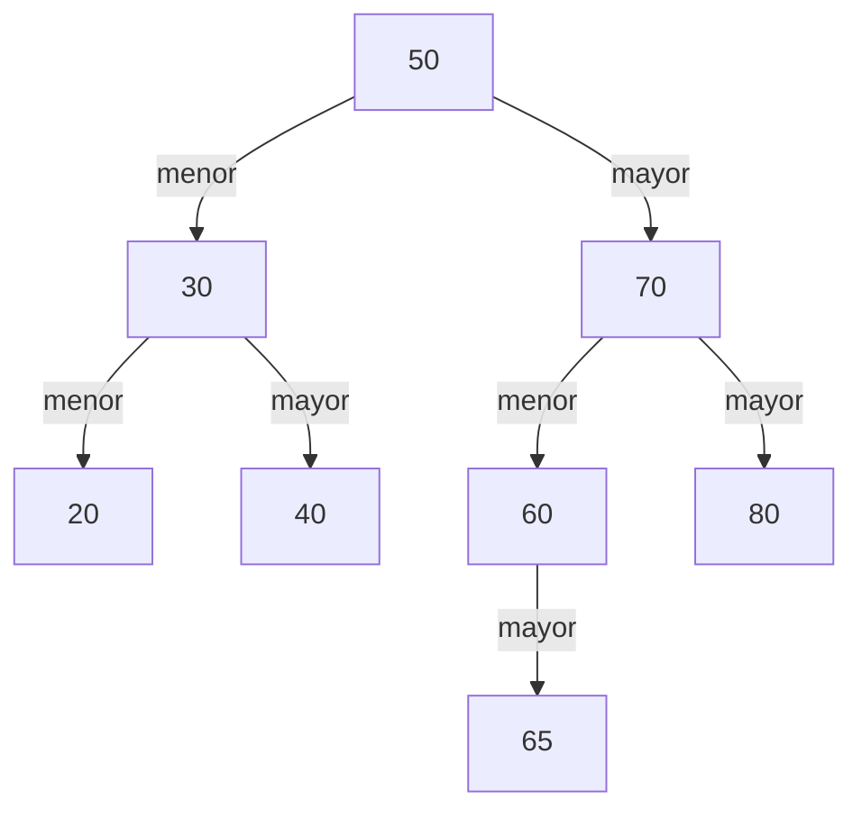

> 📘 **Lección guion para clase en vivo.** Se dicta en la sesión y se sigue paso a paso: ten tu editor abierto, escribe el código a medida que avanzamos y haz cada traza en papel **antes** de mirar la tabla. El código vive en `Eliminacion.java`, que se completa a lo largo de la lección. Usa `Recorridos.java` y `ArbolBusqueda.java` tal como quedaron en la lección BST: búsqueda e inserción, en la misma carpeta y sin modificarlos; **`NodoArbol.java` sí se modifica aquí** (sección «Encontrar el nodo y devolver la nueva raíz del subárbol»). «Añade» significa dentro de la clase y encima de `main`; «añade al final de `main`» significa poner las líneas nuevas después de las que ya hay; y «reemplaza el contenido de `main`» significa borrar todo lo que hay entre sus llaves. Las eliminaciones de la lección son **acumulativas**: cada una se hace sobre el mismo `raiz`, tal como lo dejó la anterior. Para compilar y ejecutar: `javac NodoArbol.java Recorridos.java ArbolBusqueda.java Eliminacion.java` y luego `java Eliminacion`.

## Retirar una tarjeta de la mesa

Volvemos al juego de las siete tarjetas de la lección BST: búsqueda e inserción: 20, 30, 40, 50, 60, 70 y 80 sobre la mesa, con la primera pregunta siempre en el 50. Entre una clase y otra alguien agregó la tarjeta 65, así que ahora hay ocho. Este es el árbol de preguntas, al que llamaremos T0:



Ahora hay que **retirar** tarjetas, y el juego tiene que seguir funcionando: cada «menor» y cada «mayor» debe seguir llevando a las tarjetas correctas. Retirar no es solo guardar una tarjeta: es dejar la mesa en un estado en que todavía se pueda jugar.

🛑 **Pausa:** retira primero el 20. ¿Qué otras tarjetas tienes que mover? Después retira el 60, que tiene colgando solo el 65. ¿Dónde queda el 65?

El 20 se retira y no hay que mover nada: no tenía a nadie colgando. Con el 60 pasa algo distinto: el 65 sube a su lugar, como hijo izquierdo del 70. Sigue siendo menor que 70 y mayor que 50, así que el juego sigue funcionando.

## Los tres casos

Cuando retiras un nodo, lo que importa es **cuántos hijos tiene**. Son tres casos:

- **Hoja (cero hijos):** se retira y listo. El lugar donde estaba queda vacío.
- **Un hijo:** el hijo ocupa el lugar del nodo retirado, con todo lo que cuelga de él. La regla se conserva porque ese hijo ya estaba en el lado correcto de todos los ancestros del nodo retirado.
- **Dos hijos:** aquí hay un problema. Si retiras el 50, hay dos subárboles colgando y un solo lugar libre. Hay que **elegir una tarjeta que ocupe el lugar de la raíz** sin romper la regla.

Esa tarjeta tiene que ser mayor que todo el subárbol izquierdo y menor que todo el derecho. Hay una candidata natural: la menor del subárbol derecho, el **sucesor in-order**, porque es la que viene justo después en el in-orden. Es mayor que todo lo que había a la izquierda, porque venía del lado derecho, y es menor que todo lo demás del lado derecho, porque es la menor de ese lado. Por eso la regla se conserva sobre **todo** el subárbol, no solo con los vecinos inmediatos. El predecesor, la mayor del izquierdo, también serviría, pero en este curso se usa siempre el sucesor.

> **Sucesor in-order de un nodo con dos hijos:** el nodo de menor dato de su subárbol derecho. Para encontrarlo se baja siempre por el hijo izquierdo hasta que no haya más.

Ocupar el lugar significa **copiar el dato** del sucesor en el nodo que se retira; después ese dato se retira de donde estaba, en el subárbol derecho.

## Encontrar el nodo y devolver la nueva raíz del subárbol

Para retirar un dato primero hay que encontrarlo, igual que en `buscar`. Pero ahora, al regresar de la recursión, algo puede haber cambiado: el nodo que se retira ya no está y su lugar lo ocupa otro. Por eso `eliminar` **devuelve la raíz del subárbol que queda**, y quien la llama la cuelga de nuevo en su lugar.

Hasta ahora los campos de `NodoArbol` solo cambiaban para colgar hijos nuevos con `insertarIzquierdo` e `insertarDerecho`. Eliminar es la primera operación que **reemplaza**, así que `NodoArbol.java` necesita tres *setters*. Añade estos métodos dentro de `NodoArbol`, debajo de `insertarDerecho`:

```java
    public void setDato(T dato) {
        this.dato = dato;
    }

    public void setIzquierdo(NodoArbol<T> izquierdo) {
        this.izquierdo = izquierdo;
    }

    public void setDerecho(NodoArbol<T> derecho) {
        this.derecho = derecho;
    }
```

Crea `Eliminacion.java`. Aplica las dos preguntas de la lección Fundamentos de recursividad. **¿Cuándo paro?** Si el árbol está vacío (el dato no está, no hay nada que retirar) o si el nodo actual es el que busco. **¿Cómo me acerco al paro?** Cada llamada baja a un solo subárbol, el que indica la regla. El contador suma una comparación por nodo visitado, como en `buscar`. Por ahora la rama de dos hijos queda pendiente:

```java
public class Eliminacion {

    static int comparaciones = 0;       // solo para contar; se pone en 0 antes de cada prueba

    static NodoArbol<Integer> eliminar(NodoArbol<Integer> nodo, int dato) {
        if (nodo == null) {                              // caso base: arbol vacio, el dato no esta
            return null;
        }
        comparaciones++;                                 // una pregunta por nodo visitado
        int actual = nodo.getDato();
        if (dato < actual) {
            nodo.setIzquierdo(eliminar(nodo.getIzquierdo(), dato));   // lo retiro de la izquierda y la cuelgo de nuevo
            return nodo;
        }
        if (dato > actual) {
            nodo.setDerecho(eliminar(nodo.getDerecho(), dato));       // lo retiro de la derecha y la cuelgo de nuevo
            return nodo;
        }
        // aqui dato == actual: este es el nodo a retirar
        if (nodo.getIzquierdo() == null) {               // hoja (devuelve null) o solo hijo derecho
            return nodo.getDerecho();
        }
        if (nodo.getDerecho() == null) {                 // solo hijo izquierdo
            return nodo.getIzquierdo();
        }
        return nodo;                                     // dos hijos: pendiente
    }

    public static void main(String[] args) {
    }
}
```

El patrón `nodo.setIzquierdo(eliminar(nodo.getIzquierdo(), dato))` es el corazón del método: la llamada recursiva devuelve la raíz del subárbol ya sin el dato, y el padre la cuelga en el mismo lado. Si no se retiró nada, devuelve el mismo hijo y el `set` no cambia nada.

Una hoja entra por el primer `if` de los hijos: no tiene izquierdo, así que devuelve su derecho, que es `null`, y el lugar queda vacío. Y como el nodo que se retira puede ser la propia raíz, desde fuera siempre se llama con `raiz = eliminar(raiz, x)`: si la raíz cambia, `raiz` apunta a la nueva.

## Hoja y un hijo: traza y ejecución

Reemplaza el contenido de `main`. El árbol T0 se arma con el `insertar` de la lección BST: búsqueda e inserción, en el orden 50, 30, 70, 20, 40, 60, 80 y 65, y se lee en in-orden:

```java
        NodoArbol<Integer> raiz = new NodoArbol<>(50);
        ArbolBusqueda.insertar(raiz, 30);
        ArbolBusqueda.insertar(raiz, 70);
        ArbolBusqueda.insertar(raiz, 20);
        ArbolBusqueda.insertar(raiz, 40);
        ArbolBusqueda.insertar(raiz, 60);
        ArbolBusqueda.insertar(raiz, 80);
        ArbolBusqueda.insertar(raiz, 65);
        System.out.print("in-orden: ");
        Recorridos.inOrden(raiz);
        System.out.println();
```

```text
in-orden: 20 30 40 50 60 65 70 80 
```

Añade al final de `main` la eliminación de la hoja 20, con el contador en cero y mostrando la raíz y el recorrido:

```java
        comparaciones = 0;
        raiz = eliminar(raiz, 20);
        System.out.println("raiz " + raiz.getDato() + ", comparaciones " + comparaciones);
        System.out.print("in-orden: ");
        Recorridos.inOrden(raiz);
        System.out.println();
```

```text
in-orden: 20 30 40 50 60 65 70 80 
raiz 50, comparaciones 3
in-orden: 30 40 50 60 65 70 80 
```

Visitó el 50, el 30 y el 20: 3 comparaciones. El 20 desaparece del in-orden y todo lo demás sigue ordenado. Ahora, sobre el árbol que dejó esa eliminación, el caso de un hijo: retirar el 60, que tiene solo al 65.

🛑 **Antes de mirar la tabla:** haz en papel la traza de `eliminar(raiz, 60)`. ¿Cuántas llamadas hay y cuántas comparan? ¿Qué devuelve la llamada que encuentra el 60?

| # | Llamada | Compara | Decisión |
|---|---|---|---|
| 1 | `eliminar(50, 60)` | 60 con 50 | mayor: el derecho será lo que devuelva la llamada 2 |
| 2 | `eliminar(70, 60)` | 60 con 70 | menor: el izquierdo será lo que devuelva la llamada 3 |
| 3 | `eliminar(60, 60)` | 60 con 60 | igual; no tiene izquierdo: devuelve su derecho, el 65 |

Son 3 llamadas y las 3 comparan: **3 comparaciones**. Al regresar, el 70 ejecuta `setIzquierdo(65)` y el 50 vuelve a colgar al 70 en el mismo lugar. El 60 ya no está en el árbol. Añade al final de `main` el mismo bloque con el 60 y ejecuta:

```java
        comparaciones = 0;
        raiz = eliminar(raiz, 60);
        System.out.println("raiz " + raiz.getDato() + ", comparaciones " + comparaciones);
        System.out.print("in-orden: ");
        Recorridos.inOrden(raiz);
        System.out.println();
```

Al final de la salida aparecen dos líneas nuevas:

```text
raiz 50, comparaciones 3
in-orden: 30 40 50 65 70 80 
```

## Dos hijos: el sucesor in-order

Falta la rama pendiente. Para el sucesor necesitamos `minimo`, que baja siempre por el hijo izquierdo. Su caso base es un nodo sin hijo izquierdo: ese es el menor. Añade este método encima de `eliminar`:

```java
    static NodoArbol<Integer> minimo(NodoArbol<Integer> nodo) {
        if (nodo.getIzquierdo() == null) {               // nada menor a la izquierda: este es el minimo
            return nodo;
        }
        return minimo(nodo.getIzquierdo());
    }
```

Y en `eliminar`, reemplaza la última línea (`return nodo;` con el comentario «dos hijos: pendiente») por la rama completa:

```java
        NodoArbol<Integer> sucesor = minimo(nodo.getDerecho());           // el menor del subarbol derecho
        nodo.setDato(sucesor.getDato());                                  // su dato ocupa el lugar de este nodo
        nodo.setDerecho(eliminar(nodo.getDerecho(), sucesor.getDato()));  // y se retira de donde estaba
        return nodo;
```

El dato del sucesor se copia al nodo y luego se vuelve a llamar a `eliminar`, pero solo sobre el subárbol derecho, para retirar el original. Como los datos no se repiten, el mínimo de ese subárbol es único y la búsqueda lo encuentra.

Añade al final de `main` la eliminación de la raíz, el 50, que ahora tiene dos hijos. Primero haz la traza en papel: **`minimo` no suma al contador**, que solo cuenta las comparaciones de `eliminar`.

```java
        comparaciones = 0;
        raiz = eliminar(raiz, 50);
        System.out.println("raiz " + raiz.getDato() + ", comparaciones " + comparaciones);
        System.out.print("in-orden: ");
        Recorridos.inOrden(raiz);
        System.out.println();
```

El árbol que le llega es 50 con el 30 a la izquierda (su único hijo es el 40) y el 70 a la derecha (con el 65 y el 80). La traza tiene 5 llamadas:

| # | Llamada | Compara | Qué pasa |
|---|---|---|---|
| 1 | `eliminar(50, 50)` | 50 con 50 (1) | igual y con dos hijos: pide `minimo(70)` |
| 2 | `minimo(70)` | nada | el 70 tiene izquierdo: baja al 65 |
| 3 | `minimo(65)` | nada | sin izquierdo: devuelve el 65; la raíz toma el dato 65 |
| 4 | `eliminar(70, 65)` | 65 con 70 (2) | menor: el izquierdo será lo que devuelva la llamada 5 |
| 5 | `eliminar(65, 65)` | 65 con 65 (3) | igual; sin izquierdo: devuelve su derecho, `null`; el 70 ejecuta `setIzquierdo(null)` |

Al final de la salida aparecen dos líneas nuevas:

```text
raiz 65, comparaciones 3
in-orden: 30 40 65 70 80 
```

Son 3 comparaciones, todas de `eliminar`. La raíz sigue siendo el mismo nodo, pero ahora guarda el 65: lo único que cambió fue su dato.

🛑 **Pausa corta:** el sucesor es el mínimo de un subárbol. ¿Por qué podemos estar seguros de que tiene **a lo sumo un hijo**?

No tiene hijo izquierdo: si lo tuviera, ese hijo sería menor y no sería el mínimo. Le queda, como mucho, un hijo derecho, así que retirarlo es siempre el caso de hoja o de un hijo, y la recursión termina.

## 🗳️ Votación — ¿qué imprime eliminar con dos hijos?

Reemplaza el contenido de `main`. Esta vez el árbol se arma con otros datos:

```java
        NodoArbol<Integer> r = new NodoArbol<>(50);
        ArbolBusqueda.insertar(r, 30);
        ArbolBusqueda.insertar(r, 70);
        ArbolBusqueda.insertar(r, 20);
        ArbolBusqueda.insertar(r, 40);
        ArbolBusqueda.insertar(r, 35);
        ArbolBusqueda.insertar(r, 60);
        comparaciones = 0;
        r = eliminar(r, 30);
        System.out.println(r.getIzquierdo().getDato() + " " + comparaciones);
```

Dibuja el árbol, haz la traza en papel y, sin ejecutar y sin hablar con nadie: ¿qué imprime?

- (a) `35 4`
- (b) `40 2`
- (c) `35 2`
- (d) `20 3`

Vota solo. Si entre el 30 % y el 70 % del grupo acierta, discutan 2 minutos en parejas y vuelvan a votar; si más del 70 % acierta, la explicación es rápida; si menos del 30 %, vuelve a explicar cómo se elige el sucesor antes de discutir.

## Comprobar la votación

Añade al final de `main` el recorrido y ejecuta:

```java
        System.out.print("in-orden: ");
        Recorridos.inOrden(r);
        System.out.println();
```

```text
35 4
in-orden: 20 35 40 50 60 70 
```

**La respuesta es (a).** El nodo que se retira tiene dos hijos, el 20 y el 40. El sucesor es el mínimo de su subárbol derecho: ese subárbol empieza en el 40, que tiene un hijo izquierdo, el 35, y el 35 no tiene más a la izquierda. El 35 sube al lugar del nodo retirado y el hijo izquierdo de la raíz pasa a valer 35. Después se retira el 35 original del subárbol derecho, que es una hoja.

Las 4 comparaciones son las de `eliminar`: el 50, el nodo que se retira, el 40 y el 35 que se retira del subárbol derecho. Qué revela cada opción: (b) sube el hijo derecho entero sin buscar el sucesor, y se queda en 2 comparaciones; (c) acierta el dato pero no cuenta la eliminación del sucesor, las dos comparaciones finales; (d) usa el predecesor, el mayor del izquierdo, que también conservaría la regla, pero la convención del curso es el sucesor.

El in-orden queda ordenado con el 30 ausente y el 35 en su lugar: la prueba de que la regla se conserva.

## Dónde se rompe la analogía: retirar sin que el juego se desordene

Con tarjetas sobre una mesa, retirar una no cambia a las demás: cada tarjeta es independiente. En el BST los nodos están encadenados: retirar un nodo con dos hijos deja un hueco que no se puede dejar vacío, y por eso **otro dato tiene que subir** a ocuparlo. Además, `eliminar` no reorganiza el árbol: solo arregla el lugar del nodo retirado. Cuesta O(h) comparaciones, como `buscar` e `insertar`, y tampoco lo vuelve a equilibrar: si el árbol estaba desequilibrado, sigue desequilibrado.

## Resumen operativo

| Caso del nodo a retirar | Qué devuelve `eliminar` | Qué cambia en el árbol |
|---|---|---|
| Hoja (cero hijos) | `null` (su derecho, que es `null`) | El lugar queda vacío |
| Un hijo | Ese hijo | El hijo ocupa el lugar del nodo |
| Dos hijos | El mismo nodo | Su dato se reemplaza por el del sucesor, que se retira del subárbol derecho |

| Operación | Caso base | Costo en el peor caso |
|---|---|---|
| `eliminar` | Árbol vacío (`null`) o el nodo con el dato buscado | O(h) comparaciones |
| `minimo` | Nodo sin hijo izquierdo | O(h), y no suma al contador |

## Síntesis

- Retirar una tarjeta de la mesa obliga a dejar el juego en un estado en que cada «menor» y cada «mayor» siga llevando a las tarjetas correctas.
- Lo que decide el caso es cuántos hijos tiene el nodo: hoja, un hijo o dos hijos.
- Una hoja se retira sin más; con un hijo, el hijo ocupa su lugar; con dos hijos, el dato del sucesor in-order (el mínimo del subárbol derecho) ocupa el lugar y se retira de donde estaba.
- El sucesor conserva la regla sobre **todo** el subárbol: es mayor que todo el izquierdo y menor que el resto del derecho.
- `eliminar` devuelve la raíz del subárbol que queda, por eso se escribe `nodo.setIzquierdo(eliminar(...))` y `raiz = eliminar(raiz, x)`; para eso `NodoArbol` ganó los *setters* `setDato`, `setIzquierdo` y `setDerecho`.
- En la secuencia de la clase, `eliminar(raiz, 60)` hace 3 llamadas y 3 comparaciones; `eliminar(raiz, 50)` hace 5 llamadas, 3 de ellas de `eliminar` y 2 de `minimo`, y 3 comparaciones, porque `minimo` no suma al contador.
- El sucesor tiene a lo sumo un hijo porque no tiene hijo izquierdo, así que la recursión siempre termina.
- En la votación el resultado fue `35 4`: sube el 35, mínimo del subárbol que empieza en el 40, y se retira después como hoja con dos comparaciones más.
- Tras cada eliminación el in-orden sigue saliendo ordenado, y `eliminar` cuesta O(h): no reorganiza el árbol.
