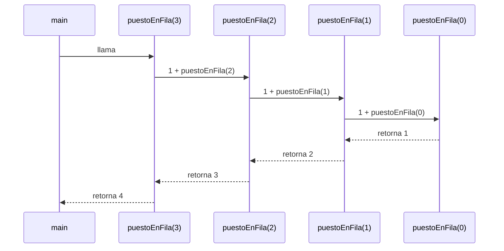

> 📘 **Lección guion para clase en vivo.** Se dicta en la sesión y se sigue paso a paso: ten tu editor abierto, escribe el código a medida que avanzamos y haz cada traza en papel **antes** de mirar la solución. Los bloques de código de las secciones «De la fila a Java» y «Bajar y subir» son acumulativos y viven en un mismo archivo, `Recursion.java`; los de las tres secciones «Error planeado» van en bloques aparte y no se copian a ese archivo.

## La fila del banco

Llegas a la sucursal y hay una fila larga. Sin salirte de tu puesto, quieres saber: **¿en qué puesto estoy?** No puedes contar a todos de un vistazo, así que haces lo que haría cualquiera: le preguntas a la persona de adelante "¿tú en qué puesto estás?", y esa persona le pregunta a la de adelante, y así sucesivamente.

Cada persona hace lo mismo: no resuelve el problema completo, solo **delega una versión más pequeña** (la fila sin ella) y, cuando recibe la respuesta, le suma 1. Igual que con la pila de platos de la lección Implementación de pilas en Java, cada pregunta queda **pendiente** hasta que responde la persona de adelante.

🛑 **Pausa:** ¿qué pasaría si nadie en la fila supiera que es el primero? ¿Quién respondería primero?

## Del ejemplo a las reglas: caso base y caso recursivo

La fila se detiene en un punto: la **primera persona** no tiene a nadie delante, así que no pregunta; responde directamente "estoy en el puesto 1". Todas las demás preguntan y suman 1.

> **Caso base:** situación tan pequeña que se resuelve directamente, sin volver a llamar al mismo método. Es la persona que no tiene a nadie delante.

> **Caso recursivo:** situación que se resuelve llamando al **mismo método** con un problema más pequeño y combinando la respuesta. Es la persona que pregunta a la de adelante y suma 1.

> **Recursividad:** técnica en la que un método se define en términos de sí mismo, apoyada en un caso base que detiene las llamadas.

Para diseñar cualquier método recursivo, hazte siempre dos preguntas:

- **¿Cuándo paro?** Eso es el caso base.
- **¿Cómo me acerco al paro?** Eso es que cada llamada recursiva reciba un problema más pequeño que el actual.

## Primera traza a mano, sin código

Una fila de 4 personas: Ana está de primera, luego Beto, Carla y Diego. Diego pregunta "¿en qué puesto estoy?". Completa la traza en papel antes de ver la tabla.

| Persona | Personas delante | ¿Es la primera? | Qué hace | Responde |
|---|---|---|---|---|
| Diego | 3 | No | Pregunta a Carla y suma 1 | 3 + 1 = 4 |
| Carla | 2 | No | Pregunta a Beto y suma 1 | 2 + 1 = 3 |
| Beto | 1 | No | Pregunta a Ana y suma 1 | 1 + 1 = 2 |
| Ana | 0 | Sí | Responde sin preguntar | 1 |

Observa el orden: las preguntas **bajan** de Diego hasta Ana, y las respuestas **suben** de Ana hasta Diego. Nadie responde hasta que la persona de adelante responde, excepto Ana.

## De la fila a Java

Una persona es una llamada al método; "personas delante" es el parámetro. Crea `Recursion.java`:

```java
public class Recursion {

    static int puestoEnFila(int delante) {
        if (delante == 0) {                     // caso base: soy la primera
            return 1;
        }
        return 1 + puestoEnFila(delante - 1);   // caso recursivo: pregunto y sumo 1
    }

    public static void main(String[] args) {
        System.out.println(puestoEnFila(3));
    }
}
```

🛑 **Antes de ejecutar:** ¿qué imprime `puestoEnFila(3)`? Escribe tu predicción y luego compílalo.

```text
4
```

El argumento baja de 3 a 2, a 1, a 0: cada llamada recibe un problema más pequeño y por eso se llega al caso base.

## La pila de llamadas

Cuando un método llama a otro, el primero **no termina**: queda en pausa esperando. Java guarda ese estado en un **marco** (_frame_) y lo apila. Es la misma pila LIFO que implementaste: la última llamada en entrar es la primera en resolverse.

> **Marco de pila:** bloque de memoria que Java crea en cada llamada a un método. Guarda los parámetros, las variables locales y el **punto de retorno**: la línea exacta donde debe continuar el método que llamó.

> **Pila de llamadas (_call stack_):** pila donde Java apila un marco por cada llamada activa y lo desapila cuando el método devuelve su resultado.

Aquí el estado de `puestoEnFila(3)` en cada instante: cada flecha continua es una pregunta que baja; cada flecha punteada, una respuesta que sube.



Mientras `puestoEnFila(0)` corre, hay cuatro marcos de `puestoEnFila` apilados (encima del de `main`) y los tres de abajo siguen esperando su `1 + ...`. Cuando el de arriba devuelve, se desapila, y el siguiente por fin puede sumar.

## Bajar y subir

Para ver la pila trabajar, añade impresiones al método. Déjalo como un método aparte, `puestoConTrazas`, en el mismo archivo, y llámalo desde `main`:

```java
    static int puestoConTrazas(int delante) {
        System.out.println("baja: delante = " + delante);
        if (delante == 0) {
            System.out.println("sube: caso base, retorna 1");
            return 1;
        }
        int respuesta = 1 + puestoConTrazas(delante - 1);
        System.out.println("sube: delante = " + delante + ", retorna " + respuesta);
        return respuesta;
    }
```

Y en `main`, **reemplaza** la línea que imprimía `puestoEnFila(3)` por: `System.out.println(puestoConTrazas(3));`.

## 🗳️ Votación — ¿en qué orden salen las líneas?

Sin ejecutar, y sin hablar con nadie: ¿cuál es la línea que se imprime **justo después** de `baja: delante = 0`?

- (a) `baja: delante = -1`
- (b) `sube: caso base, retorna 1`
- (c) `sube: delante = 3, retorna 4`
- (d) `4`

Vota solo. Si el grupo se divide, discutan 2 minutos en parejas y vuelvan a votar. Después ejecuta para resolver:

```text
baja: delante = 3
baja: delante = 2
baja: delante = 1
baja: delante = 0
sube: caso base, retorna 1
sube: delante = 1, retorna 2
sube: delante = 2, retorna 3
sube: delante = 3, retorna 4
4
```

La respuesta es (b). Las líneas `baja` aparecen **antes** de la llamada recursiva y las líneas `sube` **después**: lo que escribes después de la llamada solo se ejecuta cuando la llamada de abajo ya devolvió.

## Prueba de escritorio paso a paso

Una **prueba de escritorio** es ejecutar el código a mano, anotando qué hace cada llamada. Es la herramienta para entender cualquier método recursivo. Completa en papel las celdas con `____` para `puestoEnFila(2)`:

| Llamada | `delante` | ¿Caso base? | Acción | Retorna |
|---|---|---|---|---|
| `puestoEnFila(2)` | 2 | No | Llama a `puestoEnFila(1)` y espera | (pendiente) |
| `puestoEnFila(1)` | 1 | No | Llama a `puestoEnFila(0)` y espera | (pendiente) |
| `puestoEnFila(0)` | ____ | ____ | ____ | ____ |
| `puestoEnFila(1)` (sube) | 1 | No | Recibe ____ y suma 1 | ____ |
| `puestoEnFila(2)` (sube) | 2 | No | Recibe ____ y suma 1 | ____ |

La solución: la fila 3 tiene `delante` = 0, caso base **Sí**, acción "devuelve 1 sin llamar" y retorna 1. Luego `puestoEnFila(1)` recibe 1, suma 1 y retorna 2; y `puestoEnFila(2)` recibe 2, suma 1 y retorna 3.

La mitad de bajada solo apila; **todo el trabajo de combinar ocurre en la subida**, cuando cada marco recupera su respuesta y se desapila.

## Error planeado 1: sin caso base

Este bloque va aparte, **no lo copies en tu archivo principal**. Escríbelo en una carpeta de prueba:

```java
static int puestoEnFila(int delante) {
    return 1 + puestoEnFila(delante - 1);   // ¿y cuándo paro?
}
```

Al ejecutarlo con `puestoEnFila(3)`:

```text
Exception in thread "main" java.lang.StackOverflowError
	at Recursion.puestoEnFila(Recursion.java:3)
	at Recursion.puestoEnFila(Recursion.java:3)
	at Recursion.puestoEnFila(Recursion.java:3)
	...
```

El número de línea (`Recursion.java:3`) depende de dónde pongas el método en tu archivo; lo importante es que **se repite**.

🛑 **Pausa:** no creamos ninguna variable gigante. ¿Por qué se acaba la memoria? Porque cada llamada apila un marco nuevo y **nunca ninguna devuelve**: la pila crece hasta llenarse. Una fila donde nadie sabe que es el primero pregunta hacia adelante sin fin.

Este también es el lugar donde se rompe la analogía: una fila real termina en alguien que está de primero; una fila "sin primera persona" o circular no existe en el banco, pero en código sí es posible escribirla, y Java no se da cuenta hasta que la pila se agota.

## Error planeado 2: caso base inalcanzable

Otra versión que parece correcta porque **sí tiene caso base**. Este bloque también va aparte:

```java
static int puestoEnFila(int delante) {
    if (delante == 0) {
        return 1;
    }
    return 1 + puestoEnFila(delante - 1);
}
// main: System.out.println(puestoEnFila(-1));
```

El método es el correcto; el problema es la entrada. Con `-1`, la secuencia es -1, -2, -3... y se aleja del 0: el resultado vuelve a ser `StackOverflowError`. Que el caso base exista no basta: responde también la segunda pregunta de diseño, **¿cómo me acerco al paro?** Cada llamada tiene que acercarse al caso base desde la entrada con la que se invoca, y `-1` no lo hace. La solución es validar la entrada o aclarar con un comentario que `delante` no puede ser negativo.

## Error planeado 3: olvidar el return

El error más traicionero: parece funcionar y devuelve un valor equivocado. Bloque aparte:

```java
static int puestoEnFila(int delante) {
    if (delante == 0) {
        return 1;
    }
    puestoEnFila(delante - 1);   // la respuesta se descarta
    return 1;
}
```

Compila y se ejecuta sin excepciones. Con `puestoEnFila(3)` imprime:

```text
1
```

en lugar de 4. La llamada recursiva sí se hizo, pero su respuesta se descartó: cada persona respondió "1" sin sumar lo que le dijo la de adelante. Y la versión que ni siquiera escribe `return` al final del caso recursivo no compila, porque Java exige que el método devuelva un `int` en todos los caminos. La regla: **en el caso recursivo, usa el valor que devuelve la llamada**.

## Retos

Resuelve primero en papel; abre la pista solo si te atascas.

**Reto A — `sumaHasta(n)`:** suma 1 + 2 + ... + n. Traza `sumaHasta(4)`: debe dar 10.

<Tabs>
  <Tab label="Pista A">

El caso base es `n == 0`, que vale 0. En el caso recursivo, `n` se suma al resultado de `sumaHasta(n - 1)`.

  </Tab>
  <Tab label="Solución A">

```java
static int sumaHasta(int n) {
    if (n == 0) {
        return 0;
    }
    return n + sumaHasta(n - 1);
}
```

Traza: `sumaHasta(4)` = 4 + `sumaHasta(3)` = 4 + 3 + `sumaHasta(2)` = 4 + 3 + 2 + `sumaHasta(1)` = 4 + 3 + 2 + 1 + `sumaHasta(0)` = 4 + 3 + 2 + 1 + 0 = **10**.

  </Tab>
</Tabs>

**Reto B — `cuentaRegresiva(n)`:** imprime n, n-1, ..., 1 y luego "Despegue". Después, con **mover una sola línea**, haz que imprima "Despegue" y luego 1, 2, ..., n.

<Tabs>
  <Tab label="Pista B">

Recuerda el paso 6: lo que va antes de la llamada recursiva se ejecuta bajando; lo que va después, subiendo. Para invertir el orden, cambia de lado el `println` de `n`.

  </Tab>
  <Tab label="Solución B">

```java
static void cuentaRegresiva(int n) {
    if (n == 0) {
        System.out.println("Despegue");
        return;
    }
    System.out.println(n);          // antes de la llamada: imprime bajando
    cuentaRegresiva(n - 1);
}

static void cuentaInvertida(int n) {
    if (n == 0) {
        System.out.println("Despegue");
        return;
    }
    cuentaInvertida(n - 1);
    System.out.println(n);          // la misma línea, ahora imprime subiendo
}
```

Con `n = 3`, la primera imprime `3`, `2`, `1`, `Despegue`; la segunda imprime `Despegue`, `1`, `2`, `3`.

  </Tab>
</Tabs>

**Reto C — encuentra el error:** de estos tres métodos, dos tienen un defecto y uno es correcto. Decide cuál es cuál sin ejecutarlos.

```java
static int sumaA(int n) {
    return n + sumaA(n - 1);
}

static int cuentaB(int n) {
    if (n == 0) {
        return 0;
    }
    return 1 + cuentaB(n);
}

static int dobleC(int n) {
    if (n == 0) {
        return 0;
    }
    return 2 + dobleC(n - 1);
}
```

<Tabs>
  <Tab label="Pista C">

Para cada método pregúntate: ¿tiene caso base? ¿El argumento de la llamada recursiva se acerca a ese caso base?

  </Tab>
  <Tab label="Solución C">

`sumaA` no tiene caso base: `StackOverflowError`. `cuentaB` tiene caso base, pero llama con `n` en vez de `n - 1`, así que nunca se acerca a 0: también `StackOverflowError`. `dobleC` es el correcto: `dobleC(3)` devuelve 6.

  </Tab>
</Tabs>

**Extensión opcional — `potencia(base, exp)`:** calcula `base` elevado a `exp` solo con multiplicaciones, sin ciclos. Piensa primero cuál es el caso base (`exp == 0`, devuelve 1) y cómo se reduce `exp`. Comprueba que `potencia(2, 5)` da 32.

## Resumen operativo

| Pieza | Pregunta que responde | En `puestoEnFila` |
|---|---|---|
| Caso base | ¿Cuándo paro? | `delante == 0` devuelve 1 |
| Caso recursivo | ¿Cómo me acerco al paro? | `1 + puestoEnFila(delante - 1)` |
| Marco de pila | ¿Qué recuerda cada llamada pendiente? | Su `delante` y dónde seguir |
| Bajada | ¿Qué ocurre antes de la llamada? | Se apilan marcos; nada se resuelve |
| Subida | ¿Qué ocurre después de la llamada? | Se desapilan marcos y se combinan respuestas |
| `StackOverflowError` | ¿Qué pasa si nunca paro? | La pila de llamadas se llena |

## Síntesis

- La **fila del banco** muestra la idea: cada persona delega una versión más pequeña del problema y suma 1 a lo que recibe.
- Un método recursivo tiene un **caso base** (¿cuándo paro?) y un **caso recursivo** (¿cómo me acerco al paro?).
- La traza a mano baja desde la persona de atrás hasta la primera y las respuestas suben de vuelta.
- En Java, `puestoEnFila(delante)` es esa fila: `delante == 0` es la primera persona.
- La **pila de llamadas** guarda un marco por llamada pendiente, con parámetros, variables locales y punto de retorno: la misma pila LIFO de la lección de pilas.
- Lo que va antes de la llamada recursiva se ejecuta **bajando**; lo que va después, **subiendo**.
- La **prueba de escritorio** es la herramienta para entender un método recursivo: anota llamada, parámetro, caso base y valor devuelto, y completa la subida.
- Sin caso base, la pila se llena y Java lanza `StackOverflowError`.
- Con caso base pero argumento que no se acerca a él (como `-1`), ocurre lo mismo.
- Si descartas el valor de la llamada recursiva, el método compila pero responde mal.

## Qué sigue

Con el caso base, el caso recursivo y la pila de llamadas claros, el siguiente tema son los algoritmos recursivos clásicos, donde vas a usar este mismo esquema sobre problemas más conocidos (lección Algoritmos recursivos clásicos).
