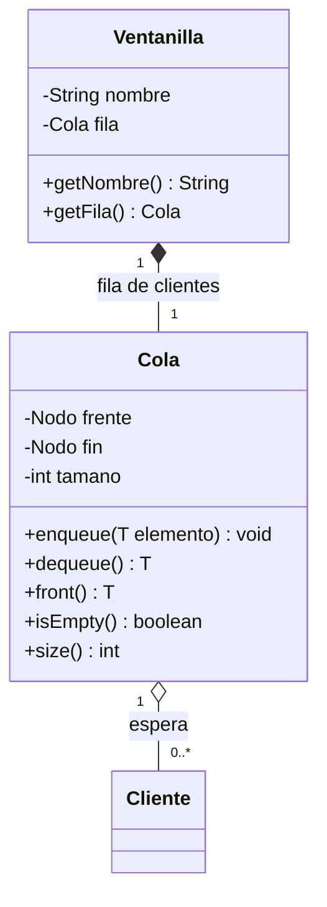
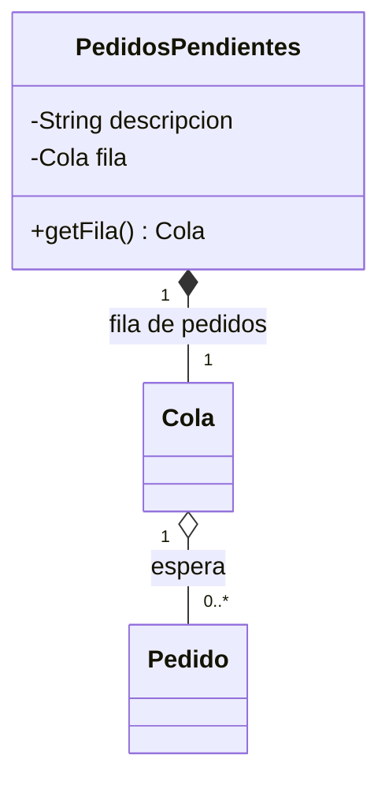
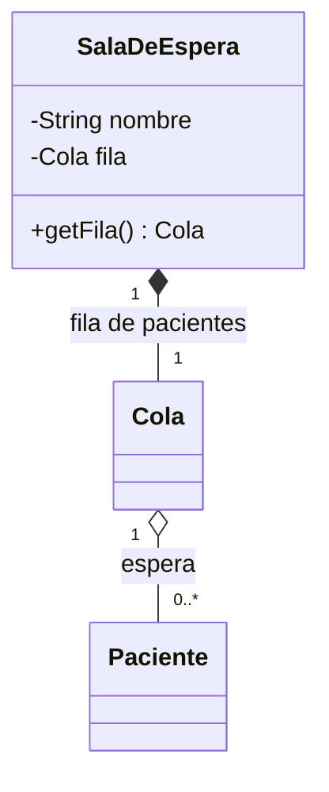
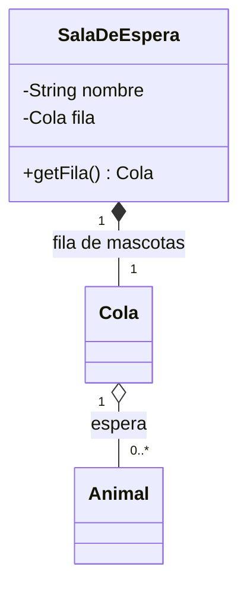
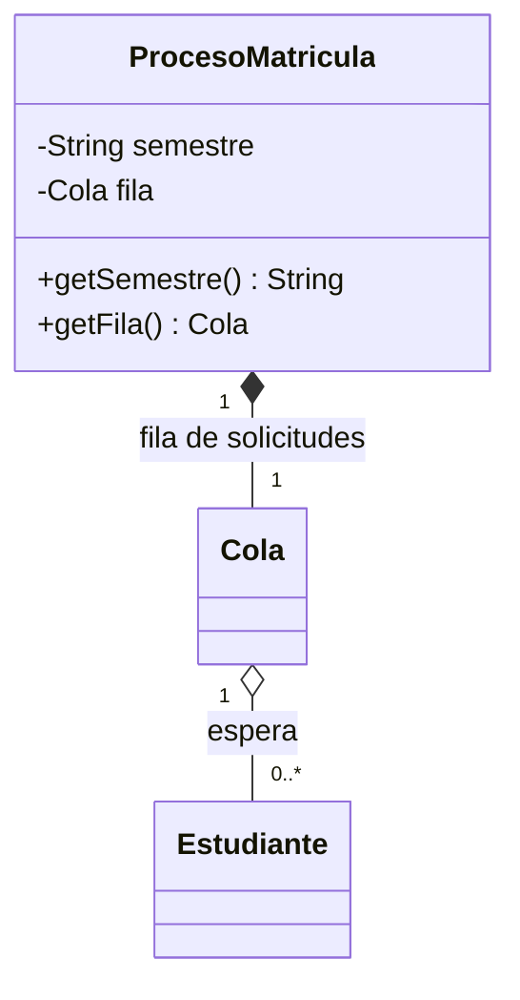
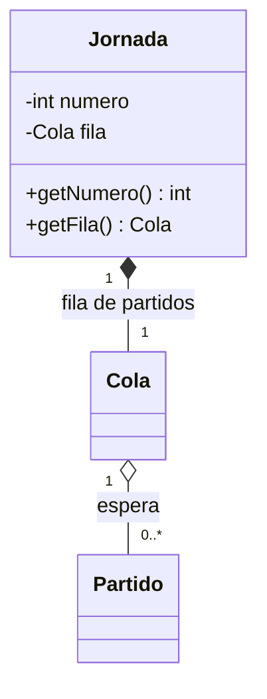

# Laboratorio — Colas en el proyecto de aula

Repositorio de referencia del proyecto (Sistema Bancario), donde este laboratorio ya está resuelto: [github.com/santiagoSuarez219/estructura-de-datos-sistema-bancario](https://github.com/santiagoSuarez219/estructura-de-datos-sistema-bancario). Úsalo como referencia para ver cómo encaja cada pieza; la implementación en tu proyecto debe ser tuya y adaptada a tu dominio.

## Objetivo

Construir la estructura `Cola<T>` desde cero con nodos enlazados e integrarla
a su proyecto de aula respetando las tres capas: la cola vive en
`model/structures/`, una entidad nueva del dominio la guarda como atributo, el
`Service` expone las cinco operaciones del TAD y la `View` ofrece un menú de
consola que solo llama al `Service`.

**Competencias esperadas:**
- Implementar `enqueue`, `dequeue`, `front`, `isEmpty` y `size` reasignando
  referencias sobre `Nodo<T>` y manteniendo `frente` y `fin` coherentes, sin
  usar `Queue`, `LinkedList`, `ArrayDeque` ni ninguna otra colección de
  `java.util`.
- Decidir qué entidad del dominio aloja una fila y justificar por qué una
  disciplina FIFO resuelve ese problema.
- Leer un diagrama de clases con composición y agregación y traducirlo a código.
- Proteger `dequeue` y `front` ante una cola vacía lanzando una excepción en el
  punto exacto del error.
- Integrar una estructura genérica a una arquitectura de tres capas sin que la
  `View` conozca la estructura.

---

## Requisitos Previos

- Lección "Implementación de colas en Java": TAD Cola, regla FIFO y la
  implementación con `frente`, `fin` y `tamano`.
- Lección "Implementación de pilas en Java" y laboratorio "Pilas en el proyecto
  de aula": su proyecto ya tiene `Pila<T>`, un menú de pilas y un `Service`
  que oculta la estructura a la `View`.
- Lección "Nodos y memoria dinámica en Java": la clase `Nodo<T>` ya existe en
  `model/structures/` de su proyecto, junto con `ListaSimple<T>` y `Pila<T>`.
- Clase de utilidad `ConsoleUtils` del laboratorio de pilas: toda la lectura
  por consola pasa por ella.
- Lección "Introducción al UML": leer composición y agregación en un diagrama
  de clases.

---

## Cómo leer esta guía

Los fragmentos de código usan el **Sistema Bancario** como ejemplo (una
ventanilla con la fila de clientes que esperan ser atendidos). Cada fragmento
es una **base**: marca con `TODO` las líneas que usted debe escribir y deja
visible en qué archivo y en qué lugar de la clase va cada una. No copie los
nombres a ciegas: la tabla de la Parte 1 le dice qué nombres corresponden a su
proyecto.

Trabaje en una rama `feature/cola-en-el-proyecto` creada desde `main` y haga un
commit al terminar cada Parte.

---

## Desarrollo del Laboratorio

### Parte 1 — Entidad que aloja la cola

Una cola se justifica cuando el problema pide **atender en orden de llegada**.
En el laboratorio de pilas la estructura vivía en una entidad que ya existía
(`Cuenta`, `Paciente`, `Partido`). Aquí ninguna entidad actual es la "dueña"
natural de una fila: los clientes, pacientes o pedidos ya viven en las listas
de su `Service`, y la fila es otra cosa, **el lugar donde esperan**. Por eso
cada proyecto agrega **una entidad nueva** que posee la cola; los elementos
siguen existiendo en su lista y la fila solo guarda referencias a ellos.

| Proyecto | Cola | Entidad nueva (dueña) | Al hacer `dequeue` |
|---|---|---|---|
| Sistema Bancario | `Cola<Cliente>` | `Ventanilla` | Se atiende al cliente que lleva más tiempo esperando |
| Papelería | `Cola<Pedido>` | `PedidosPendientes` | Se procesa el pedido a proveedor más antiguo |
| Consultorio Médico | `Cola<Paciente>` | `SalaDeEspera` | El médico llama al paciente que llegó primero |
| Clínica Veterinaria | `Cola<Animal>` | `SalaDeEspera` | El veterinario llama a la mascota que llegó primero |
| Sistema Académico | `Cola<Estudiante>` | `ProcesoMatricula` | Se resuelve la solicitud de matrícula más antigua |
| Liga de Fútbol | `Cola<Partido>` | `Jornada` | Se juega el partido que lleva más tiempo programado |

**Lea el diagrama de su proyecto, ubíquelo y trabaje solo sobre él.** En todos
la relación es la misma: la entidad nueva **compone** la `Cola` (la fila nace
y muere con ella: si no hay ventanilla, no hay fila) y la `Cola` **agrega**
los elementos (un `Cliente` existe aunque no esté en la fila: puede salir de
ella y seguir en la lista de clientes).

**Sistema Bancario**



**Papelería**



**Consultorio Médico**



**Clínica Veterinaria**



**Sistema Académico**



**Liga de Fútbol**



En los diagramas `Cola` se escribe sin tipo para no cargarlos: en su código es
`Cola<T>` y el tipo concreto es el de la columna "Cola" de la tabla.

---

### Parte 2 — Construya la clase `Cola<T>`

**Archivo nuevo:** `src/model/structures/Cola.java`, en el mismo paquete que
`Nodo<T>`, `ListaSimple<T>` y `Pila<T>`. Reutilice su `Nodo<T>` (con `getDato()`,
`getSiguiente()` y `setSiguiente()`); no cree otra clase de nodo.

Recuerde la lección: la cola guarda **dos** referencias, `frente` (por donde
sale) y `fin` (por donde entra). Ninguna operación recorre la cadena.

```java
package model.structures;

import java.util.NoSuchElementException;

public class Cola<T> {
    private Nodo<T> frente;   // primer nodo: el que sale; null cuando la cola está vacía
    private Nodo<T> fin;      // último nodo: detrás de él entra el siguiente; null cuando está vacía
    private int tamano;       // cuántos nodos hay, llevado al día en enqueue y dequeue

    public Cola() {
        this.frente = null;
        this.fin = null;
        this.tamano = 0;
    }

    public void enqueue(T elemento) {
        // TODO 1: si elemento es null, lanzar IllegalArgumentException
        // TODO 2: crear el nodo nuevo con el elemento
        // TODO 3: si la cola está vacía, el nodo nuevo es frente (y también será fin);
        //         si no, enlazar el nodo nuevo detrás del fin actual (fin.setSiguiente)
        //         -- si hace fin.setSiguiente con la cola vacía, fin es null: NullPointerException
        // TODO 4: mover fin al nodo nuevo (en ambos casos)
        // TODO 5: incrementar tamano
    }

    public T dequeue() {
        // TODO 1: si la cola está vacía, lanzar NoSuchElementException("La cola está vacía")
        // TODO 2: guardar el dato del frente en una variable local ANTES de mover el frente
        // TODO 3: mover frente al siguiente nodo
        // TODO 4: si frente quedó en null, la cola quedó vacía: fin también debe quedar en null
        //         -- si lo omite, fin sigue apuntando a un nodo que ya salió
        // TODO 5: decrementar tamano
        // TODO 6: devolver el dato guardado en el paso 2
        return null; // reemplazar por el retorno del TODO 6
    }

    public T front() {
        // TODO 1: si la cola está vacía, lanzar NoSuchElementException("La cola está vacía")
        // TODO 2: devolver el dato del frente SIN modificar frente, fin ni tamano
        return null; // reemplazar por el retorno del TODO 2
    }

    public boolean isEmpty() {
        // TODO: una sola línea; la cola está vacía cuando frente no apunta a ningún nodo
        return false; // reemplazar
    }

    public int size() {
        // TODO: una sola línea; no recorra la cadena, el tamaño ya está contado
        return 0; // reemplazar
    }
}
```

**Requisitos:**
- Las cinco operaciones cuestan **O(1)**: ningún `while` ni `for`.
- `dequeue` y `front` sobre una cola vacía lanzan `NoSuchElementException`;
  nunca devuelven `null`.
- `enqueue(null)` lanza `IllegalArgumentException` y deja la cola intacta.
- Cuando `dequeue` retira al último elemento, `frente` **y** `fin` quedan en
  `null`.
- `Cola<T>` solo importa `java.util.NoSuchElementException`; ninguna colección
  de `java.util` (`Queue`, `LinkedList`, `ArrayDeque`, `PriorityQueue`...).

**Punto de control (compruébelo con un `Main` temporal):** encole `"A"`, `"B"` y
`"C"`; `front()` devuelve `"A"`; tres `dequeue()` seguidos devuelven `"A"`,
`"B"`, `"C"`; después `isEmpty()` es `true` y un cuarto `dequeue()` lanza la
excepción. Luego encole `"D"` en la cola ya vaciada y compruebe que `front()`
devuelve `"D"`: si falla, `fin` quedó mal en el último `dequeue`.

---

### Parte 3 — Cree la entidad que aloja la cola

**Archivo nuevo:** `src/model/domain/` + la entidad que indica la tabla de la
Parte 1 (en el Sistema Bancario, `Ventanilla.java`). Es una clase de dominio
pequeña: un nombre o identificador, la cola como atributo `private` y un getter.
Construya exactamente lo que dice el diagrama de su proyecto.

```java
package model.domain;

import model.structures.Cola;

public class Ventanilla {
    // TODO 1: atributo privado String nombre
    // TODO 2: atributo privado Cola<Cliente> fila

    public Ventanilla(String nombre) {
        // TODO 3: validar que nombre no sea null ni vacío (IllegalArgumentException)
        // TODO 4: asignar nombre
        // TODO 5: crear la cola vacía; sin esta línea, el primer enqueue
        //         lanza NullPointerException
    }

    // TODO 6: getNombre()
    // TODO 7: getFila() que devuelve la cola
}
```

Si su proyecto usa otro nombre de entidad, aplique la misma estructura con los
atributos que muestra su diagrama (`descripcion`, `semestre`, `numero`...).
Recuerde importar `model.structures.Cola`.

**Requisitos:**
- El atributo de la cola es `private` y se crea en el constructor; no hay
  `setFila`.
- Solo el `Service` usa `getFila()`.
- La entidad no tiene lógica de filas: no decide quién se atiende ni en qué
  orden. La regla FIFO es de `Cola<T>`.

---

### Parte 4 — Implemente los métodos en el `Service`

**Archivo existente:** el `Service` que ya gestiona el elemento que se encola
(en el Sistema Bancario, `src/service/ClienteService.java`). Agregue un atributo
con **una** instancia de la entidad nueva y **cinco métodos**, uno por operación
del TAD. El `Service` es el único que toca la cola: recibe datos simples de la
`View` y devuelve datos simples (nunca devuelve ni recibe la `Cola<T>`).

| Operación del TAD | Método del `Service` | Qué devuelve |
|---|---|---|
| `enqueue` | `registrarLlegada` | nada |
| `dequeue` | `atenderSiguiente` | el cliente atendido |
| `front` | `consultarSiguiente` | el cliente que sigue, sin atenderlo |
| `isEmpty` | `sinClientesEnEspera` | `boolean` |
| `size` | `contarEnEspera` | `int` |

```java
// Dentro de ClienteService (ajuste los nombres a su entidad)

private final Ventanilla ventanilla = new Ventanilla("Ventanilla 1");
// TODO 0: una sola ventanilla por Service; si creara una nueva en cada método,
//         cada operación vería una fila distinta

public void registrarLlegada(String identificacion) {
    // TODO 1: buscar al cliente con el buscador que su Service ya tiene
    //         (buscarClienteOFallar); si no existe, la excepción de ese buscador se propaga
    // TODO 2: ponerlo al final de la fila (enqueue)
}

public Cliente atenderSiguiente() {
    // TODO 1: retirar al cliente del frente (dequeue); si la fila está vacía la
    //         excepción de Cola se propaga: no la atrape aquí
    // TODO 2: devolverlo
    //         -- el cliente sale de la FILA, no de la lista de clientes del Service:
    //            no lo elimine de ningún otro lugar
    return null; // reemplazar por el retorno del TODO 2
}

public Cliente consultarSiguiente() {
    // TODO: devolver al cliente del frente SIN retirarlo (front)
    return null; // reemplazar
}

public boolean sinClientesEnEspera() {
    // TODO: devolver isEmpty de la fila
    return false; // reemplazar
}

public int contarEnEspera() {
    // TODO: devolver size de la fila
    return 0; // reemplazar
}
```

**Requisitos:**
- `registrarLlegada` obtiene el elemento con el buscador que su `Service` ya
  tenía; no duplique la búsqueda.
- Si el elemento no existe, el método falla con la misma excepción que ya usa su
  `Service` para ese caso, y la fila no cambia.
- `Cola<T>` no aparece en ninguna firma pública del `Service`.
- En los demás proyectos, renombre los cinco métodos a su dominio con los
  nombres que ya dice su sprint: por ejemplo `procesarSiguientePedido`,
  `siguientePaciente`, `siguienteAnimal`, `procesarSiguienteSolicitud` o
  `jugarSiguientePartido`. Si su `Service` ya tiene un método que registra el
  elemento, agregue ahí el `enqueue` en vez de duplicar esa lógica.

**Punto de control:** el proyecto compila y un `Main` temporal puede registrar la
llegada de tres clientes, consultar quién sigue, atender a uno y contar los que
quedan.

---

### Parte 5 — Construya el menú en `view/`

**Archivo nuevo:** `src/view/MenuColaView.java`. Sigue el mismo patrón de
`MenuPilaView`: recibe el `Service` por constructor, lee con la clase de
utilidad `ConsoleUtils` (la misma del laboratorio de pilas; no use `Scanner`
directamente), llama **un** método del `Service` por opción y muestra el
resultado. La `View` no importa `Cola`, `Nodo`, la entidad nueva ni ningún
paquete de `model.structures`.

```java
package view;

import model.domain.Cliente;
import service.ClienteService;
import utils.ConsoleUtils;

public class MenuColaView {
    private final ClienteService clienteService;

    public MenuColaView(ClienteService clienteService) {
        this.clienteService = clienteService;
    }

    public void iniciar() {
        int opcion;
        do {
            mostrarOpciones();
            opcion = ConsoleUtils.leerEntero("Elija una opción: ");
            switch (opcion) {
                case 1 -> registrarLlegada();
                case 2 -> atender();
                case 3 -> consultarSiguiente();
                case 4 -> verSiHayEnEspera();
                case 5 -> contar();
                case 6 -> listar();
                case 0 -> System.out.println("Saliendo del menú de colas...");
                default -> System.out.println("Opción inválida");
            }
        } while (opcion != 0);
    }

    private void mostrarOpciones() {
        System.out.println("1. Registrar llegada (enqueue)");
        System.out.println("2. Atender al siguiente (dequeue)");
        System.out.println("3. Ver quién sigue (front)");
        System.out.println("4. ¿Hay clientes en espera? (isEmpty)");
        System.out.println("5. Cantidad en espera (size)");
        System.out.println("6. Listar la fila (Parte 7)");
        System.out.println("0. Salir");
    }

    private void registrarLlegada() {
        String identificacion = ConsoleUtils.leerTexto("Identificación del cliente: ");
        // TODO 1: llamar a clienteService.registrarLlegada y confirmar por consola
    }

    private void atender() {
        // TODO 2: si clienteService.sinClientesEnEspera() es true, mostrar
        //         "No hay clientes en espera" y salir del método; si no, llamar a
        //         atenderSiguiente y mostrar al cliente atendido
        //         -- sin este chequeo, un dequeue sobre fila vacía lanza la excepción y cierra el programa
    }

    private void consultarSiguiente() {
        // TODO 3: si no hay clientes en espera, mostrar el mismo mensaje del TODO 2;
        //         si hay, llamar a consultarSiguiente y mostrar al cliente que sigue
    }

    private void verSiHayEnEspera() {
        // TODO 4: llamar a sinClientesEnEspera y mostrar un mensaje legible
        //         ("No hay clientes en espera" / "Hay clientes en espera")
    }

    private void contar() {
        // TODO 5: llamar a contarEnEspera y mostrar el número
    }

    private void listar() {
        // TODO 6: se completa en la Parte 7, cuando exista listarEnEspera en el Service
    }
}
```

**Requisitos:**
- Cada opción 1 a 5 ejecuta exactamente una de las cinco operaciones del TAD;
  la opción 6 usa `listarEnEspera` de la Parte 7.
- Toda lectura de consola pasa por `ConsoleUtils`: la `View` no crea ni importa
  `Scanner`.
- La `View` no usa `try` / `catch`. Antes de atender o consultar, pregunta al
  `Service` con `sinClientesEnEspera` y, si no hay nadie, muestra un mensaje y
  vuelve al menú: una fila vacía no cierra el programa.
- La `View` no contiene otras reglas de negocio: a quién le toca y cómo se
  atiende es de la cola y del `Service`.
- El menú asume datos válidos (identificación de un cliente existente); no se
  valida en la `View`.

---

### Parte 6 — Conecte el menú en `Main`

**Archivo existente:** `src/Main.java`. El `Service` que ya se construye ahí se
comparte con el menú nuevo; no cree un segundo `Service`, porque tendría otra
ventanilla y otra fila.

```java
// Dentro de main, junto a lo que ya se construye
// TODO 1: crear MenuColaView pasándole el mismo clienteService
// TODO 2: ofrecer una opción en MenuPrincipal (o llamar a menuCola.iniciar()) para
//         entrar al menú de colas
```

---

### Parte 7 — Liste la fila sin destruirla

El menú necesita mostrar **todos** los que esperan, del frente hacia el fin, sin
perder a nadie. Pero el TAD no permite recorrer: una cola no expone sus nodos, y
un `dequeue` tras otro la dejaría vacía. En el laboratorio de pilas el truco
era una pila auxiliar, porque sacar y volver a apilar **invierte** el orden. La
cola resuelve esto de otra forma: si usted saca al del frente y lo vuelve a
poner al **fin**, la fila **rota** sin cambiar de orden. Repetido exactamente
`size()` veces, cada elemento pasa por el frente una vez y la fila termina como
empezó.

**Archivo existente:** el mismo `Service` de la Parte 4. Agregue un sexto método,
`listarEnEspera`, que devuelve un `String` con un elemento por línea, numerados
desde el frente. La `Cola<T>` sigue sin salir del `Service`: la `View` solo
recibe texto.

```java
// Dentro de ClienteService

public String listarEnEspera() {
    Cola<Cliente> fila = ventanilla.getFila();

    // TODO 1: si la fila está vacía, devolver "No hay clientes en espera"
    // TODO 2: crear un StringBuilder y guardar en una variable local el total
    //         de elementos (size) ANTES del ciclo
    //         -- no use "mientras no esté vacía": al volver a encolar, la fila
    //            nunca se vaciaría y el ciclo no terminaría

    // TODO 3: repetir total veces (un for): retirar al cliente del frente (dequeue),
    //         agregar al StringBuilder una línea numerada con él (1., 2., 3....) y
    //         ponerlo de nuevo al fin (enqueue)
    //         -- al terminar las total vueltas, cada cliente volvió a su posición original

    // TODO 4: devolver el texto armado (toString del StringBuilder)
    return null; // reemplazar por el retorno del TODO 4
}
```

Luego agregue la **opción 6** al menú de la Parte 5 (`6. Listar la fila`):
complete `listar()` en `MenuColaView` para que llame a `listarEnEspera` e
imprima el texto que recibe. La `View` no arma ni ordena nada.

**Requisitos:**
- Tras listar, la fila queda **idéntica**: mismo `size()` y mismo `front()` que
  antes. Un `atenderSiguiente` inmediato devuelve al mismo cliente que habría
  devuelto sin listar.
- Con la fila vacía no lanza excepción: devuelve el mensaje "No hay clientes en
  espera".
- No agrega ningún método a `Cola<T>` y no usa una segunda estructura; el
  recorrido usa solo las cinco operaciones del TAD.

**Punto de control:** registre la llegada de tres clientes, liste (aparecen del
primero al tercero), liste otra vez (el resultado es el mismo) y compruebe con
`contarEnEspera` que siguen siendo 3 y con `consultarSiguiente` que sigue el
primero.

---

## Entregable

Repositorio de su proyecto de aula en GitHub, con la rama
`feature/cola-en-el-proyecto` fusionada a `main`. El entregable es el estado del
repositorio al vencer el plazo; no se entrega `.zip`.

```
proyecto-aula/
  src/
    Main.java                   # cablea el menú de colas
    utils/
      ConsoleUtils.java         # ya existe (laboratorio de pilas)
    view/
      <Menú de pilas>View.java  # ya existe
      <Menú de la entidad>View.java   # nuevo: menú de las cinco operaciones y el listado
    service/
      <Service del elemento>.java   # atributo y seis métodos nuevos (cinco del TAD + listarEnEspera)
    model/
      domain/
        <Entidad dueña de la cola>.java   # nueva: Ventanilla, SalaDeEspera, Jornada...
      structures/
        Nodo.java               # ya existe
        ListaSimple.java        # ya existe
        Pila.java               # ya existe
        Cola.java               # nuevo
```

Su menú debe poder recorrer, sin
cerrarse, esta **secuencia de verificación**, que el docente ejecutará al revisar:

1. Registrar la llegada de tres elementos (por ejemplo, tres clientes).
2. Consultar quién sigue y comprobar que es el primero que llegó.
3. Contar: debe decir 3. Listar: aparecen el primero, el segundo y el tercero,
   en ese orden; listar otra vez da lo mismo y contar sigue diciendo 3.
4. Atender: debe devolver el primero. Consultar quién sigue: ahora es el segundo.
5. Contar: debe decir 2.
6. Atender a los dos restantes. Preguntar si hay alguien en espera: debe decir
   que no.
7. Intentar atender otra vez: el menú muestra el mensaje de que no hay clientes
   en espera y sigue funcionando.
8. Registrar la llegada de un elemento nuevo después de haber vaciado la fila:
   consultar quién sigue debe devolver ese elemento (comprueba que `fin` se
   restableció).

**Plazo de entrega:** por definir. Se anunciará en clase.

---

## Criterios de Evaluación

| Criterio | Puntos | Descripción |
|---|---|---|
| **`Cola<T>` correcta** | 30 | `enqueue`, `dequeue`, `front`, `isEmpty` y `size` funcionan con `Nodo<T>`, cuestan O(1) sin ningún ciclo, mantienen `tamano` al día y no usan ninguna colección de `java.util`; `enqueue` en cola vacía asigna `frente` y `fin`, y `dequeue` del último elemento deja ambos en `null`. |
| **Casos límite** | 10 | `dequeue` y `front` sobre cola vacía lanzan `NoSuchElementException` con mensaje; `enqueue(null)` lanza `IllegalArgumentException` sin alterar la cola; ninguna operación devuelve `null` para señalar un error; encolar tras vaciar la cola funciona. |
| **UML y entidad dueña** | 15 | La entidad de la Parte 3 coincide con el diagrama de su proyecto: la cola es un atributo `private` creado en el constructor, sin `setFila`, con su getter, y la entidad no contiene lógica de filas. |
| **Integración en el `Service`** | 25 | El `Service` expone los cinco métodos más `listarEnEspera`, ninguno devuelve ni recibe `Cola<T>`, atender saca al elemento de la fila sin eliminarlo de su lista, y listar deja la fila intacta (mismo tamaño y mismo orden). |
| **Menú en `view/`** | 10 | El menú ofrece las cinco operaciones y el listado, cada opción llama a un solo método del `Service`, lee solo con `ConsoleUtils` (sin `Scanner` ni `try` / `catch`), no importa nada de `model.structures` y una fila vacía no cierra el programa porque el menú consulta `sinClientesEnEspera` antes de atender o consultar. |
| **Buenas prácticas** | 10 | Commits descriptivos y frecuentes sobre la rama `feature/`, fusionada a `main`; nombres de clases, métodos y variables siguiendo las convenciones de Java. |
| **TOTAL** | **100** | |

---

## Dificultades Comunes

### "Encolé y me sale NullPointerException en `enqueue`"
- Casi siempre es la primera llegada: con la cola vacía `fin` es `null` y
  `fin.setSiguiente(nuevo)` falla. Cuando la cola está vacía no hay a quién
  enlazar: el nodo nuevo se asigna a `frente` y, como en todos los casos, a `fin`.

### "Vacié la cola, encolé otro y `front()` devuelve el cliente que ya atendí"
- Falta el paso de `dequeue` que deja `fin` en `null` cuando se va el último.
  Con la cola vacía, `frente` es `null` pero `fin` sigue señalando al nodo
  retirado; el siguiente `enqueue` se enlaza a un nodo que ya no pertenece a la
  fila y `frente` nunca lo ve.

### "`dequeue` me lanza NullPointerException en vez de mi mensaje"
- Falta la validación de cola vacía al inicio. Sin ella,
  `frente.getDato()` se ejecuta con `frente == null`. Valide primero, antes de
  tocar el frente.

### "Mi `listarEnEspera` no termina nunca"
- Está usando `while (!fila.isEmpty())`. Como cada elemento sacado vuelve a
  entrar, la fila nunca se vacía. Guarde `size()` en una variable **antes** del
  ciclo y repita exactamente ese número de veces.

### "Después de listar, el primero de la fila cambió"
- Hizo un número distinto de vueltas al total, o usó `size()` dentro del
  ciclo (que cambia mientras se retira). Cada elemento debe salir y volver
  exactamente una vez.

### "Al atender, el cliente desapareció de mi lista de clientes"
- Atender solo quita al cliente de la **fila**; no es lo mismo que darlo de baja.
  Revise que `atenderSiguiente` no llame al eliminar de la lista del `Service`.

### "¿Puedo agregarle a `Cola` un método para ver al último o al del medio?"
- No. Una cola solo da acceso al frente: esa restricción es lo que garantiza
  FIFO. Si necesita ver todo el contenido, use la rotación de la Parte 7.

---

## Extensiones Sugeridas (Bonus)

- Impida que un mismo elemento esté dos veces en la fila: antes de encolar,
  recórrala con la rotación de la Parte 7 y rechace el duplicado con
  `IllegalArgumentException`.
- Agregue una **fila preferencial** en el `Service` con `PriorityQueue<E>` de
  `java.util` (aquí sí está permitida): una urgencia o un adulto mayor se atiende
  antes que quienes llegaron primero. Explique por qué ya no es FIFO.
- Cree dos ventanillas y reparta las llegadas alternando entre ambas
  (la que tenga menos gente en espera, según `contarEnEspera`).

---

## Recursos

- **Lección:** "Implementación de colas en Java" — el código de `enqueue` y
  `dequeue` que se adapta en la Parte 2.
- **Lección:** "Implementación de pilas en Java" y laboratorio "Pilas en el
  proyecto de aula" — la integración en tres capas que este laboratorio repite.
- **Lección:** "Nodos y memoria dinámica en Java" — `Nodo<T>` y sus métodos de
  acceso.
- **Lección:** "Introducción al UML" — composición y agregación en diagramas de
  clases.
- **Documentación de Java:** `NoSuchElementException` e `IllegalArgumentException`
  en la API de `java.util` y `java.lang`.
- **Proyecto de aula:** la sección "Sprint 3 — Pilas y Colas" de la descripción
  de su caso de estudio.
