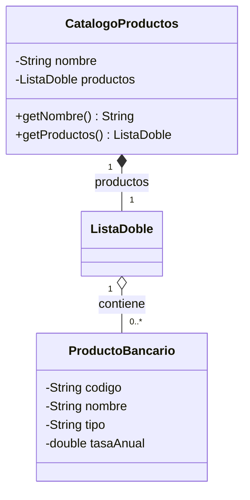
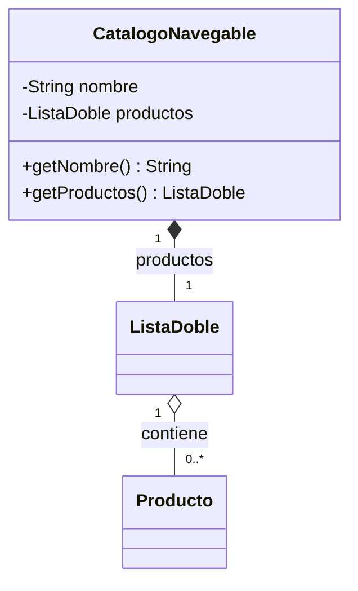
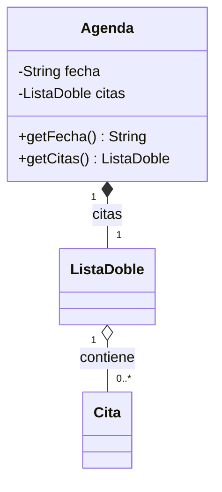
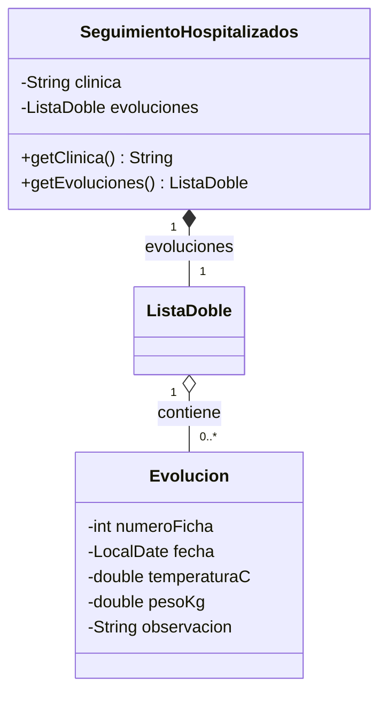
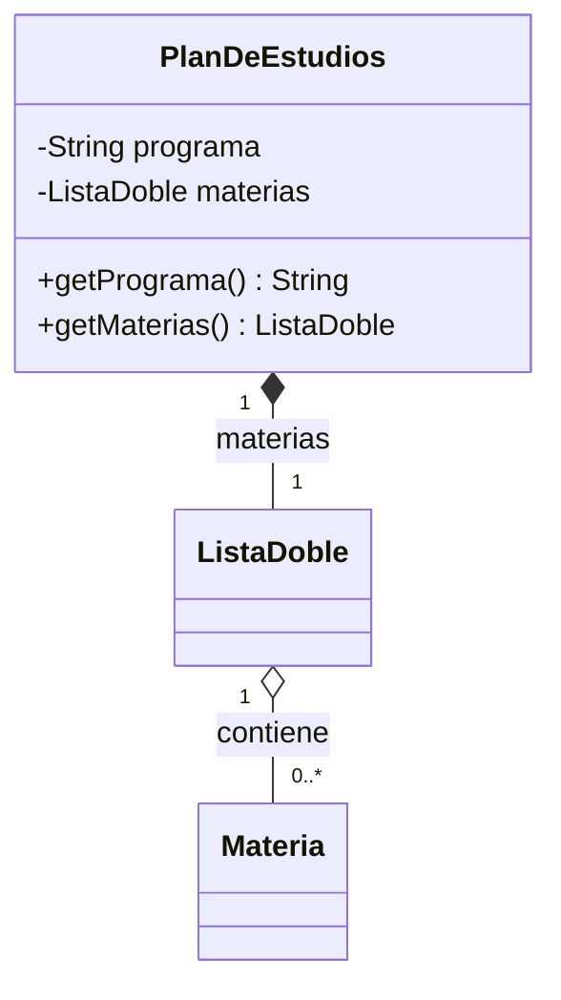
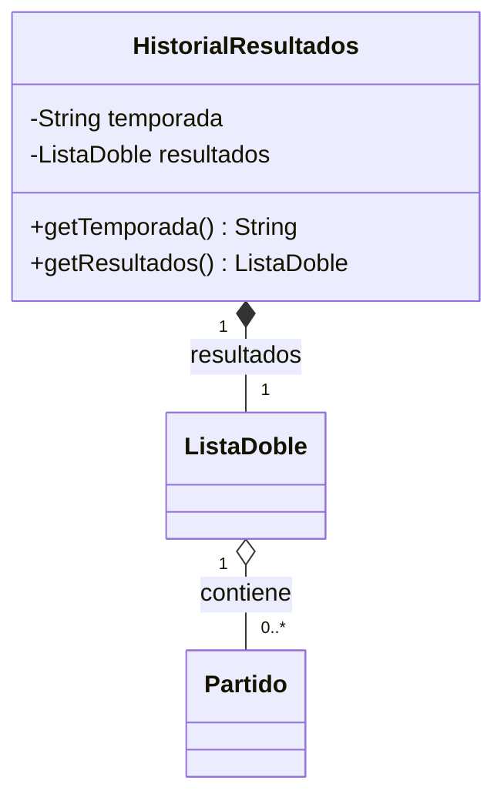
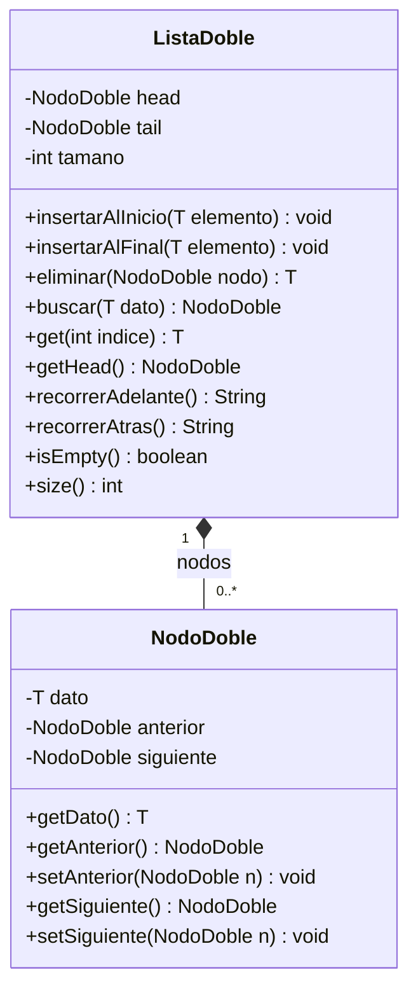

# Laboratorio — Listas dobles y archivos en el proyecto de aula

Este laboratorio vale el **5 % de la nota final** y corresponde a la mitad del **Momento evaluativo 4 — Manejo de archivos (10 %)**. Se trabaja en equipo sobre el repositorio de su proyecto de aula.

Repositorio de referencia del proyecto (Sistema Bancario): [github.com/santiagoSuarez219/estructura-de-datos-sistema-bancario](https://github.com/santiagoSuarez219/estructura-de-datos-sistema-bancario). Úselo como referencia para ver cómo encaja cada pieza; la implementación en su proyecto debe ser suya y adaptada a su dominio.

## Objetivo

Construir la estructura `ListaDoble<T>` desde cero con nodos que conocen a su
anterior y a su siguiente, usarla en una funcionalidad nueva de su proyecto de
aula donde recorrer en ambos sentidos aporta algo que la lista simple no da, y
**persistir en archivos de texto** esa lista y otra estructura del proyecto,
respetando las tres capas: las estructuras viven en `model/structures/`, el
`Service` es el único que lee y escribe archivos, y la `View` solo llama al
`Service`.

**Competencias esperadas:**
- Implementar `NodoDoble<T>` con `anterior` y `siguiente` y una `ListaDoble<T>` con
  `head`, `tail` y `tamano`, con inserción en ambos extremos, eliminación de un nodo y
  recorrido hacia adelante y hacia atrás, sin usar `LinkedList`, `ArrayList`,
  `Deque` ni ninguna otra colección de `java.util`.
- Reenlazar correctamente `anterior` y `siguiente` en los cuatro casos de eliminación
  (único nodo, primero, último y del medio).
- Decidir cuándo una lista doble se justifica frente a una simple y defender
  esa decisión con la funcionalidad del proyecto.
- Guardar y cargar estructuras en archivos de texto con `BufferedWriter`,
  `BufferedReader`, `try-with-resources` y manejo de `IOException`, preservando
  el orden de los elementos.
- Tolerar un archivo inexistente y líneas corruptas sin tumbar el programa.
- Mantener la `View` libre de archivos y de estructuras.

**Fuera de alcance:** las listas circulares y los algoritmos de ordenamiento
sobre listas no se evalúan en este laboratorio.

---

## Requisitos Previos

- Lección "Lista doblemente enlazada y lista circular": nodo con `anterior` y
  `siguiente`, recorrido inverso y casos de reenlace.
- Lecciones "Fundamentos de archivos" y "Lectura, escritura y modificación":
  `BufferedReader`, `BufferedWriter`, `try-with-resources`, `IOException` y
  formato de texto estructurado.
- Lección "Nodos y memoria dinámica en Java" y el laboratorio de lista simple:
  su proyecto ya tiene `ListaSimple<T>` en `model/structures/`.
- Laboratorios "Pilas en el proyecto de aula" y "Colas en el proyecto de aula":
  su proyecto ya tiene `ConsoleUtils`, un `Service` que oculta las estructuras
  y un menú que solo llama al `Service`.
- Lección "Introducción al UML": leer composición y agregación en un diagrama
  de clases.

---

## Cómo leer esta guía

Los fragmentos de código usan el **Sistema Bancario** como ejemplo (un
catálogo de productos que se puede recorrer en ambos sentidos y guardar en
disco). Cada fragmento es una **base**: marca con `TODO` las líneas que usted
debe escribir y deja visible en qué archivo y en qué lugar de la clase va cada
una. No copie los nombres a ciegas: la tabla de la Parte 1 le dice qué nombres
corresponden a su proyecto.

Trabaje en una rama `feature/lista-doble-y-archivos` creada desde `main` y haga
un commit al terminar cada Parte.

---

## Desarrollo del Laboratorio

### Parte 1 — Elija la funcionalidad de su proyecto

Una lista doble se justifica cuando el problema pide **ir y volver**: mirar el
elemento anterior, recorrer del más reciente al más antiguo o quitar un
elemento del medio sin perder el hilo. Cada proyecto tiene una funcionalidad
fija, que puede vivir en una entidad que ya existe o en una nueva.

| Proyecto | Lista | Dónde vive | Funcionalidad nueva | Por qué doble y no simple |
|---|---|---|---|---|
| Sistema Bancario | `ListaDoble<ProductoBancario>` | `CatalogoProductos` (nueva), junto con la clase nueva `ProductoBancario` (código, nombre, tipo, tasa anual) | Catálogo de productos del banco (cuenta de ahorros, CDT, tarjeta, crédito): hojearlo hacia adelante y hacia atrás, listarlo en orden inverso y retirar un producto descontinuado | Hojear "producto anterior" es un movimiento hacia atrás: en una lista simple habría que recorrerla desde la head en cada paso |
| Papelería | `ListaDoble<Producto>` | `CatalogoNavegable` (nueva) | Catálogo que se hojea hacia adelante y hacia atrás, y permite retirar un producto del catálogo sin alterar el inventario | Hojear "página anterior" es un movimiento hacia atrás: con `siguiente` solamente habría que volver a empezar |
| Consultorio Médico | `ListaDoble<Cita>` | `Agenda` (nueva) | Agenda del día: ver la cita anterior y la siguiente, listarla de la última a la primera y cancelar una cita del medio | Cancelar una cita del medio exige conocer a su anterior para reenlazar; con `anterior` no se recorre desde el inicio |
| Clínica Veterinaria | `ListaDoble<Evolucion>` | `SeguimientoHospitalizados` (nueva), junto con la clase nueva `Evolucion` (número de ficha, fecha, temperatura, peso, observación) | Bitácora de evolución clínica de los animales hospitalizados: ver la evolución anterior o siguiente, listarla de la más reciente a la más antigua y anular un registro mal digitado | El veterinario consulta primero "cómo amaneció hoy" y luego retrocede; un registro erróneo del medio se quita sin recorrer todo |
| Sistema Académico | `ListaDoble<Materia>` | `PlanDeEstudios` (nueva) | Plan de estudios ordenado por semestre: recorrerlo hacia adelante y hacia atrás, listarlo del último semestre al primero y retirar una materia del plan | Navegar "materia anterior / siguiente" del plan es la operación principal; en una lista simple cada retroceso cuesta recorrerla de nuevo |
| Liga de Fútbol | `ListaDoble<Partido>` | `HistorialResultados` (nueva) | Resultados de la liga: listarlos del último al primero, navegar al resultado anterior o siguiente y anular un resultado del medio | La tabla de resultados se lee "del último hacia atrás" y un resultado mal digitado se quita sin recorrer todo |

En todos los proyectos la entidad dueña es **nueva** y nace en
`model/domain/` (en tres de ellos, junto con la clase del elemento que la lista
guarda). La relación del diagrama es la misma: la entidad dueña **compone** la
lista y la lista **agrega** los elementos (un `Producto` o una `Materia` existe
aunque salga del catálogo o del plan).

**Lea el diagrama de su proyecto, ubíquelo y trabaje solo sobre él.**

**Sistema Bancario**



**Papelería**



**Consultorio Médico**



**Clínica Veterinaria**



**Sistema Académico**



**Liga de Fútbol**



En los diagramas `ListaDoble` se escribe sin tipo para no cargarlos: en su
código es `ListaDoble<T>` y el tipo concreto es el de la columna "Lista" de la
tabla. `Materia` ya existe en su proyecto: reutilícela sin modificarla.

---

### Parte 2 — Construya `NodoDoble<T>` y `ListaDoble<T>`

**Archivos nuevos:** `src/model/structures/NodoDoble.java` y
`src/model/structures/ListaDoble.java`, en el mismo paquete que `Nodo<T>`,
`ListaSimple<T>`, `Pila<T>` y `Cola<T>`. `NodoDoble<T>` es una clase nueva: no
modifique su `Nodo<T>` existente.



Recuerde la lección: cada nodo apunta en **dos** direcciones y la lista guarda
**dos** extremos, `head` y `tail`. Insertar o quitar un nodo exige reenlazar
`anterior` **y** `siguiente` de sus vecinos; olvidar uno de los dos deja una lista que
funciona hacia adelante y falla hacia atrás.

```java
package model.structures;

import java.util.NoSuchElementException;

public class ListaDoble<T> {
    private NodoDoble<T> head;     // primer nodo; null cuando la lista está vacía
    private NodoDoble<T> tail;     // último nodo; null cuando la lista está vacía
    private int tamano;            // cuántos nodos hay, llevado al día en cada inserción y eliminación

    public ListaDoble() {
        this.head = null;
        this.tail = null;
        this.tamano = 0;
    }

    public void insertarAlFinal(T elemento) {
        // TODO 1: si elemento es null, lanzar IllegalArgumentException
        // TODO 2: crear el nodo nuevo con el elemento
        // TODO 3: si la lista está vacía, el nodo nuevo es head (y también será tail);
        //         si no, enlazar en AMBOS sentidos: tail.setSiguiente(nuevo) y nuevo.setAnterior(tail)
        //         -- si solo hace el primero, el recorrido inverso se corta en el nodo nuevo
        // TODO 4: mover tail al nodo nuevo (en ambos casos)
        // TODO 5: incrementar tamano
    }

    public NodoDoble<T> buscar(T dato) {
        // TODO 1: empezar en head y avanzar con getSiguiente mientras el nodo actual no sea null
        // TODO 2: si el dato del nodo actual es igual al buscado (equals), devolver ese nodo
        // TODO 3: si se recorrió toda la lista sin encontrarlo, devolver null (no lanzar excepción)
        return null; // reemplazar
    }

    // Todas las eliminaciones (primero, último y del medio) pasan por aquí
    public T eliminar(NodoDoble<T> nodo) {
        // TODO 1: guardar en dos variables locales los vecinos del nodo: antes (anterior) y despues (siguiente)
        // TODO 2: lado de atrás -- si antes es null, el nodo era `head` y `head` pasa a despues;
        //         si no, antes.setSiguiente(despues)
        // TODO 3: lado de adelante -- si despues es null, el nodo era `tail` y `tail` pasa a antes;
        //         si no, despues.setAnterior(antes)
        //         -- los dos if son independientes: cubren juntos los cuatro casos (único, primero, último, medio)
        // TODO 4: dejar en null el anterior y el siguiente del nodo retirado
        // TODO 5: decrementar tamano y devolver el dato del nodo
        return null; // reemplazar
    }

    public NodoDoble<T> getHead() {
        return head;
    }

    public String recorrerAtras() {
        // TODO 1: crear un StringBuilder y empezar en tail
        // TODO 2: mientras el nodo actual no sea null, agregar su dato y un salto de línea
        //         y retroceder con getAnterior
        // TODO 3: devolver el texto armado
        //         -- no use get(i) en un ciclo: cada get volvería a empezar desde un extremo
        return null; // reemplazar
    }
}
```

Complete usted el resto de operaciones de la clase con la misma disciplina:

| Método | Qué hace | Condiciones |
|---|---|---|
| `insertarAlInicio` | Agrega un elemento antes de `head` | Simétrico a `insertarAlFinal`; null lanza `IllegalArgumentException` |
| `get(int indice)` | Devuelve el elemento de esa posición sin quitarlo | Índice fuera de `0..size()-1` lanza `IndexOutOfBoundsException`; parte de `head` si el índice está en la primera mitad y de `tail` si está en la segunda |
| `recorrerAdelante()` | Devuelve un `String` con un elemento por línea, de `head` a `tail` | Una sola pasada, sin `get(i)`; lista vacía devuelve cadena vacía |
| `isEmpty()` / `size()` | Consultas | Una línea cada una, sin recorrer |

`getHead()` permite que el `Service` recorra los nodos por su cuenta (con
`getSiguiente`) cuando necesita dar formato propio a cada elemento, por ejemplo
para guardar en un archivo.

**Requisitos:**
- Las inserciones en los extremos y `eliminar(NodoDoble<T>)` cuestan **O(1)**: ningún
  `while` ni `for`. Solo `buscar(T)`, `get`, `recorrerAdelante` y
  `recorrerAtras` recorren la cadena.
- Tras cualquier operación, recorrer hacia adelante y hacia atrás entrega los
  mismos elementos en orden inverso.
- Cuando se elimina el último nodo que queda, `head` **y** `tail` quedan en
  `null`; el primer nodo siempre tiene `anterior` en `null` y el último siempre
  tiene `siguiente` en `null`.
- `ListaDoble<T>` solo importa `java.util.NoSuchElementException`; ninguna colección de `java.util`
  (`LinkedList`, `ArrayList`, `Deque`, `ArrayDeque`...).

**Punto de control (compruébelo con un `Main` temporal):** inserte `"B"` al
final, `"C"` al final y `"A"` al inicio; adelante imprime `A B C` y atrás
imprime `C B A`. Elimine `"B"` (caso del medio) y repita ambos recorridos: `A C`
y `C A`. Elimine `"A"`, luego `"C"` (caso del único nodo) y compruebe que
`isEmpty()` es `true`. Inserte `"D"` en la lista ya vaciada y confirme que
`recorrerAtras` también imprime `D`.

---

### Parte 3 — Cree o adapte la entidad dueña

**Archivo:** el que indica la tabla de la Parte 1 (en el Sistema Bancario,
`src/model/domain/CatalogoProductos.java`, nuevo, más `ProductoBancario.java`).
Construya exactamente lo que dice el diagrama de su proyecto.

```java
package model.domain;

import model.structures.ListaDoble;

public class CatalogoProductos {
    // TODO 1: atributo privado String nombre
    // TODO 2: atributo privado ListaDoble<ProductoBancario> productos

    public CatalogoProductos(String nombre) {
        // TODO 3: validar que nombre no sea null ni vacío (IllegalArgumentException)
        // TODO 4: asignar nombre
        // TODO 5: crear la lista vacía; sin esta línea, la primera inserción
        //         lanza NullPointerException
    }

    // TODO 6: getNombre()
    // TODO 7: getProductos() que devuelve la lista
}
```

**Requisitos:**
- El atributo de la lista es `private` y se crea en el constructor; no hay
  `setProductos` (ni equivalente).
- Solo el `Service` usa el getter de la lista.
- La entidad no contiene lógica de recorrido, navegación ni archivos.

---

### Parte 4 — Implemente la funcionalidad en el `Service`

**Archivo existente:** el `Service` que ya gestiona los elementos de la lista
(en el Sistema Bancario, `src/service/CuentaService.java`). Agregue un atributo
con **una** instancia de la entidad dueña y los métodos de la funcionalidad. El
`Service` es el único que toca la lista: recibe datos simples de la `View` y
devuelve datos simples o texto (nunca devuelve ni recibe `ListaDoble<T>` ni
`NodoDoble<T>`).

| Operación | Método del `Service` (Sistema Bancario) | Qué devuelve |
|---|---|---|
| `insertarAlFinal` | `registrarProducto` | nada |
| `recorrerAdelante` | `listarProductosEnOrden` | `String`, un producto por línea, del primero al último |
| `recorrerAtras` | `listarProductosEnOrdenInverso` | `String`, del último al primero |
| `get(posicion - 1)` | `verProductoAnterior` / `verProductoSiguiente` | el producto al que se mueve el cursor |
| `buscar` y `eliminar(nodo)` | `retirarProducto` | el producto retirado |
| `size` | `contarProductos` | `int` |

```java
// Dentro de CuentaService (ajuste los nombres a su dominio)
// Imports necesarios: model.domain.CatalogoProductos y model.domain.ProductoBancario

// Un solo catálogo por Service: si se creara uno nuevo en cada método,
// cada operación vería una lista distinta
private final CatalogoProductos catalogo = new CatalogoProductos("Catálogo del banco");

// Posición (empezando en 0) del producto que el usuario está mirando; -1 si aún no mira ninguno
private int posicionActual = -1;

public void registrarProducto(String codigo, String nombre, String tipo, double tasaAnual) {
    // TODO 1: rechazar con IllegalArgumentException cualquier texto que contenga ";"
    //         (el separador del archivo de la Parte 5)
    // TODO 2: crear el ProductoBancario con sus cuatro campos
    // TODO 3: insertarlo al final de la lista
}

public String listarProductosEnOrdenInverso() {
    // TODO 1: si la lista está vacía, devolver "No hay productos en el catálogo"
    // TODO 2: devolver lo que arma recorrerAtras de la lista (un producto por línea)
    //         -- ProductoBancario debe sobrescribir toString para que cada línea se lea bien
    return null; // reemplazar
}

public ProductoBancario verProductoAnterior() {
    // TODO 1: si no hay productos, lanzar NoSuchElementException("No hay productos")
    // TODO 2: si posicionActual es -1, ubicarse en el último producto (size - 1);
    //         si no, retroceder una posición; si ya está en la 0, lanzar
    //         NoSuchElementException("No hay producto anterior")
    // TODO 3: devolver el producto de posicionActual (get)
    return null; // reemplazar
}

public ProductoBancario retirarProducto(int posicion) {
    // TODO 1: obtener el producto de esa posición con get (una posición inválida
    //         deja salir IndexOutOfBoundsException: no la atrape aquí)
    // TODO 2: ubicar su nodo con buscar y quitarlo de la lista con eliminar(nodo)
    // TODO 3: reiniciar posicionActual a -1: la posición guardada ya no es confiable
    // TODO 4: devolver el producto retirado
    return null; // reemplazar
}
```

`verProductoSiguiente`, `listarProductosEnOrden` y `contarProductos`
siguen el mismo patrón: complételos usted.

**Requisitos:**
- El `Service` expone, además de registrar, las dos listas (cronológica e
  inversa), la navegación anterior/siguiente, la anulación del medio y el
  conteo. Renombre los métodos a su dominio (por ejemplo `hojearCatalogoAtras`,
  `cancelarCita`, `verEvolucionAnterior`, `verMateriaSiguiente`,
  `anularResultado`).
- Cada método de listado devuelve **texto**; la `View` no recibe la lista.
- Navegar a un extremo (anterior desde la posición 0, siguiente desde la
  última) lanza `NoSuchElementException` con mensaje; anular una posición
  inexistente lanza `IndexOutOfBoundsException`.
- Anular un elemento solo lo quita de **esta** lista: no lo elimina de ninguna
  otra lista del `Service` (el producto sale del catálogo, no del inventario;
  la materia sale del plan, no de la lista de materias).
- Si el elemento refiere a otra entidad (la `Evolucion` a un animal por su
  número de ficha, la `Materia` ya existe en su lista), valide con el buscador
  que su `Service` ya tiene que esa entidad existe antes de insertar.
- Todo texto que luego se guarde en archivo y que contenga `;` se rechaza al
  registrarlo con `IllegalArgumentException`.

**Punto de control:** un `Main` temporal registra cuatro productos, lista en
ambos sentidos (los dos listados son el inverso uno del otro), hojea dos veces
hacia atrás, retira el segundo y vuelve a listar: quedan tres, en el mismo orden
relativo.

---

### Parte 5 — Guarde y cargue en archivos de texto

El laboratorio exige persistir **al menos dos estructuras distintas** de su
proyecto: la `ListaDoble<T>` nueva y una estructura que ya existe (un
`ListaSimple<T>` de su Sprint 2). Cada una va en su propio archivo dentro de
`data/`, en texto, una línea por elemento y campos separados por `;`.

| Proyecto | Archivo de la `ListaDoble` y formato de línea | Segunda estructura (archivo y formato) | Cargar en este orden |
|---|---|---|---|
| Sistema Bancario | `data/productos.txt`: `codigo;nombre;tipo;tasaAnual` (el orden de líneas es el orden del catálogo) | `data/clientes.txt`: `identificacion;nombre;telefono;direccion` | cualquiera (no se refieren entre sí) |
| Papelería | `data/catalogo.txt`: `codigo` (solo el código; el orden de líneas es el orden del catálogo) | `data/inventario.txt`: `tipo;codigo;nombre;precio;stock` (`tipo` indica la subclase: OFICINA, ESCOLAR o ARTE) | inventario, catálogo |
| Consultorio Médico | `data/agenda.txt`: `idPaciente;idMedico;fecha;hora;motivo` | `data/pacientes.txt`: `identificacion;nombre;telefono;fechaNacimiento;tipoSangre` | pacientes, agenda |
| Clínica Veterinaria | `data/evoluciones.txt`: `numeroFicha;fecha;temperaturaC;pesoKg;observacion` | `data/mascotas.txt`: `tipo;numeroFicha;nombre;especie;fechaNacimiento;dato` (`tipo` PERRO o GATO; `dato` es la raza o indoor/outdoor) | mascotas, evoluciones |
| Sistema Académico | `data/plan.txt`: `codigoMateria` (solo el código; el orden de líneas es el orden del plan) | `data/materias.txt`: `codigo;nombre;creditos;codigoProfesor` | materias, plan |
| Liga de Fútbol | `data/resultados.txt`: `fecha;equipoLocal;equipoVisitante;golesLocal;golesVisitante` | `data/equipos.txt`: `nombre;ciudad;entrenador` | equipos, resultados |

Fechas en formato `yyyy-MM-dd` (el que produce `LocalDate.toString()`). Los
archivos que **refieren** a otra entidad por identificador (la agenda a un
paciente, la evolución a una mascota, el plan a una materia, los resultados a un equipo) se cargan
después de ella; si el identificador no aparece, la línea cuenta como
corrupta. Si en el Sprint 4 su equipo ya definió estos archivos con otro
formato, conserve el suyo siempre que cumpla los requisitos de abajo.

**Cada `Service` implementa `guardar...()` y `cargar...()` para cada una de las
dos estructuras.** Ambos métodos devuelven un `String` que la `View` solo
imprime: así el programa nunca se cae por un problema de archivo.

```java
// Dentro de CuentaService
// Imports necesarios: java.io.BufferedReader, BufferedWriter, File, FileReader, FileWriter, IOException

private static final String ARCHIVO_PRODUCTOS = "data/productos.txt";
private static final String SEPARADOR = ";";

public String guardarProductos() {
    // La carpeta data/ puede no existir la primera vez
    File carpeta = new File("data");
    if (!carpeta.exists()) {
        carpeta.mkdirs();
    }

    // TODO 1: armar en un StringBuilder una línea por producto, del primero al último
    //         (recorra los nodos desde getHead con getSiguiente): codigo;nombre;tipo;tasaAnual
    //         seguido de salto de línea
    //         -- escriba ADELANTE: si guarda hacia atrás, el archivo queda invertido al cargar
    //         -- se arma el texto primero y se escribe después en una sola llamada, para que
    //            el try-with-resources contenga solo la escritura

    try (BufferedWriter escritor = new BufferedWriter(new FileWriter(ARCHIVO_PRODUCTOS))) {
        // TODO 2: escribir en el archivo el texto armado en el TODO 1
        // TODO 3: devolver "Se guardaron N productos en data/productos.txt"
        //         -- el try-with-resources cierra el archivo solo, aun si algo falla
        return null; // reemplazar por el retorno del TODO 3
    } catch (IOException e) {
        // TODO 4: devolver "No se pudo guardar: " + e.getMessage(); no relance la excepción
        return null; // reemplazar por el retorno del TODO 4
    }
}

public String cargarProductos() {
    File archivo = new File(ARCHIVO_PRODUCTOS);

    // TODO 1: si el archivo no existe, devolver
    //         "No existe data/productos.txt; se inicia con el catálogo vacío" (sin error)

    // TODO 2: dejar la lista vacía antes de leer: mientras getHead no sea null,
    //         eliminar(getHead())
    //         -- sin esto, cargar dos veces duplica todos los productos
    posicionActual = -1;

    int cargados = 0;
    int omitidas = 0;
    StringBuilder detalle = new StringBuilder();

    try (BufferedReader lector = new BufferedReader(new FileReader(archivo))) {
        String linea;
        int numeroLinea = 0;
        while ((linea = lector.readLine()) != null) {
            numeroLinea++;
            // TODO 3: ignorar las líneas en blanco sin contarlas como corruptas
            // TODO 4: separar con linea.split(SEPARADOR, -1); si no tiene exactamente 4 campos,
            //         contarla como omitida, anotar "línea N" en detalle y pasar a la siguiente
            //         (continue)
            // TODO 5: convertir tasaAnual dentro de un try / catch de NumberFormatException;
            //         si falla, tratarla igual que en el TODO 4
            // TODO 6: crear el ProductoBancario con sus 4 campos e insertarlo con insertarAlFinal
            //         -- en el mismo orden del archivo; insertarAlInicio invertiría la lista
            // TODO 7: incrementar cargados
        }
    } catch (IOException e) {
        // TODO 8: devolver "No se pudo leer: " + e.getMessage(); no relance la excepción
        return null; // reemplazar por el retorno del TODO 8
    }

    // TODO 9: devolver un resumen: "Se cargaron N productos" y, si omitidas > 0,
    //         agregar cuántas se omitieron y cuáles (detalle)
    return null; // reemplazar por el retorno del TODO 9
}
```

Haga lo mismo con la **segunda estructura** (en el Sistema Bancario,
`guardarClientes()` y `cargarClientes()` sobre `data/clientes.txt`). Si ya la
tiene del Sprint 4, ajústela para que cumpla estos mismos requisitos.

**Requisitos:**
- Todos los archivos se abren con `BufferedReader` / `BufferedWriter` dentro de
  `try-with-resources`; ningún `close()` manual.
- `guardar` y `cargar` viven en el `Service`. Las entidades, las estructuras y
  la `View` no importan nada de `java.io`.
- **Archivo inexistente:** `cargar` no falla; informa y deja la estructura
  vacía. `guardar` crea `data/` si falta.
- **Líneas corruptas:** una línea con campos de menos o de más, un número o una
  fecha inválidos, o un identificador que no existe se **informa** (número de
  línea) y se omite; las demás líneas se cargan igual.
- `cargar` reemplaza el contenido: llamarlo dos veces seguidas deja la
  estructura con los mismos elementos, no con el doble.
- **El orden se preserva:** lo que se guarda de `head` a `tail` se carga de
  `head` a `tail`, y `anterior` queda bien enlazado (el recorrido inverso
  funciona sobre una lista recién cargada).
- Un `IOException` nunca llega a la `View` ni cierra el programa.

**Punto de control:** registre tres productos, guarde, abra
`data/productos.txt` en un editor de texto (tres líneas en orden), cierre el
programa, ábralo de nuevo y cargue: la lista adelante y atrás coincide con la
que tenía.

---

### Parte 6 — Menú en `view/` y conexión en `Main`

**Archivo nuevo:** `src/view/MenuCatalogoView.java` (nombre según su
funcionalidad). Sigue el mismo patrón de `MenuPilaView` y `MenuColaView`:
recibe el `Service` por constructor, lee con `ConsoleUtils` (no use `Scanner`
directamente), llama **un** método del `Service` por opción y muestra el
resultado. La `View` no importa `ListaDoble`, `NodoDoble`, la entidad dueña,
`java.io` ni ningún paquete de `model.structures`, y no crea ni abre archivos.

```java
package view;

import service.CuentaService;
import utils.ConsoleUtils;

public class MenuCatalogoView {
    private final CuentaService cuentaService;

    public MenuCatalogoView(CuentaService cuentaService) {
        this.cuentaService = cuentaService;
    }

    public void iniciar() {
        // Al abrir el menú se carga lo guardado la última vez (primero los clientes)
        System.out.println(cuentaService.cargarClientes());
        System.out.println(cuentaService.cargarProductos());

        int opcion;
        do {
            mostrarOpciones();
            opcion = ConsoleUtils.leerEntero("Elija una opción: ");
            switch (opcion) {
                case 1 -> registrar();
                case 2 -> System.out.println(cuentaService.listarProductosEnOrden());
                case 3 -> System.out.println(cuentaService.listarProductosEnOrdenInverso());
                case 4 -> verAnterior();
                case 5 -> verSiguiente();
                case 6 -> retirar();
                case 7 -> guardarTodo();
                case 0 -> guardarTodo();
                default -> System.out.println("Opción inválida");
            }
        } while (opcion != 0);
    }

    private void mostrarOpciones() {
        System.out.println("1. Registrar producto en el catálogo");
        System.out.println("2. Listar del primero al último");
        System.out.println("3. Listar del último al primero");
        System.out.println("4. Hojear producto anterior");
        System.out.println("5. Hojear producto siguiente");
        System.out.println("6. Retirar un producto");
        System.out.println("7. Guardar");
        System.out.println("0. Guardar y salir");
    }

    private void verAnterior() {
        // TODO 1: preguntar al Service si el catálogo tiene productos y si existe uno anterior
        //         (agregue hayProductoAnterior / hayProductoSiguiente si lo necesita);
        //         si no, mostrar un mensaje y volver al menú
        //         -- la View no usa try / catch: el chequeo previo evita la excepción
    }

    private void guardarTodo() {
        // TODO 2: llamar a guardarClientes y guardarProductos del Service e imprimir
        //         el texto que devuelve cada uno
    }

    // registrar, verSiguiente y retirar: complételos usted con el mismo patrón
}
```

En `Main`, cree `MenuCatalogoView` con el **mismo** `Service` que ya usan los
demás menús (otro `Service` tendría otro catálogo vacío) y ofrezca una opción
de `MenuPrincipal` para entrar a él.

**Requisitos:**
- El menú ofrece registrar, ambos listados, navegar anterior y siguiente,
  anular y guardar; **cargar ocurre al abrir el menú**, no como opción que el
  usuario pueda repetir.
- La `View` solo imprime lo que el `Service` devuelve de `guardar` y `cargar`.
- Navegar más allá de un extremo, anular con una posición inexistente o listar
  una lista vacía muestran un mensaje y **no cierran el programa**.
- Salir (opción 0) guarda antes de terminar.

---

### Parte 7 — Verifique el ciclo guardar → cerrar → cargar

Su programa debe poder recorrer, sin cerrarse, esta **secuencia de
verificación**, que el docente ejecutará al revisar:

1. Borrar la carpeta `data/` y arrancar: el programa informa que no existen
   los archivos y inicia con las estructuras vacías.
2. Registrar cinco elementos de la lista doble (por ejemplo, cinco
   productos) y dos de la segunda estructura (dos clientes).
3. Listar adelante y atrás: son inversos exactos. Guardar con la opción 7.
4. Abrir un archivo de `data/` en un editor de texto y **dañar una línea** a
   mano (borrar un campo). Guardar el cambio.
5. Cerrar el programa con la opción 0 y volver a ejecutarlo.
6. Verificar que el programa informa la línea dañada, cargó todas las demás y
   no se cayó.
7. Listar adelante y atrás: el orden es el original (menos la línea dañada) y
   el listado inverso sigue siendo el espejo del directo.
8. Navegar al anterior y al siguiente desde varias posiciones y anular uno del
   medio; guardar, cerrar y cargar de nuevo: el elemento anulado no reaparece.
9. Entrar al menú y salir dos veces seguidas: la cantidad de elementos no
   cambia (cargar no duplica).

**Plazo de entrega:** domingo 8 de noviembre de 2026.

---

## Entregable

Repositorio de su proyecto de aula en GitHub, con la rama
`feature/lista-doble-y-archivos` fusionada a `main`. El entregable es el estado
del repositorio al vencer el plazo; no se entrega `.zip`. Incluya en el
repositorio una carpeta `data/` con archivos de ejemplo ya cargados para que el
docente pueda ejecutar la secuencia de verificación.

```
proyecto-aula/
  data/
    <archivo de la lista doble>.txt     # nuevo: productos.txt, plan.txt, evoluciones.txt...
    <archivo de la segunda estructura>.txt   # clientes.txt, inventario.txt, pacientes.txt...
  src/
    Main.java                   # cablea el menú nuevo con el mismo Service
    utils/
      ConsoleUtils.java         # ya existe
    view/
      <Menú de la funcionalidad>View.java   # nuevo: sin archivos ni estructuras
    service/
      <Service del elemento>.java   # funcionalidad nueva, guardar y cargar de dos estructuras
    model/
      domain/
        <Entidad dueña de la lista>.java   # nueva: CatalogoProductos, Agenda...
      structures/
        Nodo.java               # ya existe
        ListaSimple.java        # ya existe
        Pila.java               # ya existe
        Cola.java               # ya existe
        NodoDoble.java          # nuevo
        ListaDoble.java         # nuevo
```

---

## Criterios de Evaluación

| Criterio | Puntos | Descripción |
|---|---|---|
| **`ListaDoble<T>` correcta** | 30 | Las inserciones en ambos extremos y `eliminar(nodo)` cuestan O(1) sin ciclos y mantienen `tamano`; los cuatro casos de eliminación (único, primero, último, medio) dejan `anterior` y `siguiente` coherentes y `head` y `tail` en `null` al quedar vacía; el recorrido hacia atrás entrega exactamente el inverso del recorrido hacia adelante; null en `insertar` lanza `IllegalArgumentException`, y eliminar o consultar en lista vacía o fuera de rango lanza `NoSuchElementException` o `IndexOutOfBoundsException` con mensaje; no usa ninguna colección de `java.util`. |
| **Funcionalidad nueva** | 20 | La entidad dueña coincide con el diagrama de su proyecto (lista `private`, creada en el constructor, sin setter); el `Service` implementa el listado en ambos sentidos, la navegación anterior/siguiente y la anulación del medio; navegar más allá de un extremo y anular una posición inexistente lanzan la excepción esperada; anular no elimina el elemento de ninguna otra lista. |
| **Archivos de texto** | 25 | Persisten dos estructuras distintas en archivos separados dentro de `data/`; `guardar` y `cargar` usan `BufferedWriter` / `BufferedReader` con `try-with-resources` y capturan `IOException`; un archivo inexistente arranca vacío sin error; una línea corrupta se informa con su número y las demás se cargan; `cargar` dos veces no duplica; el ciclo guardar → cerrar → cargar conserva el orden y `anterior` queda enlazado (el listado inverso de una lista recién cargada es correcto). |
| **Integración en capas** | 15 | Las estructuras viven en `model/structures/`; `guardar`, `cargar` y toda la funcionalidad están en el `Service`; ninguna firma pública del `Service` recibe ni devuelve `ListaDoble<T>` o `NodoDoble<T>`; la `View` lee solo con `ConsoleUtils`, no usa `try` / `catch`, no importa `java.io` ni `model.structures`, y un problema de lista vacía, de extremo o de archivo no cierra el programa; `Main` comparte el mismo `Service`. |
| **Buenas prácticas** | 10 | Commits descriptivos al terminar cada Parte sobre la rama `feature/`, fusionada a `main`; nombres de clases, métodos y variables según las convenciones de Java; ningún archivo deja flujos sin cerrar; la carpeta `data/` incluye archivos de ejemplo. |
| **TOTAL** | **100** | |

---

## Dificultades Comunes

### "Recorro hacia adelante y funciona, pero hacia atrás se corta a la mitad"
- Casi siempre es un `anterior` sin reenlazar. Al insertar al final hay que hacer
  **dos** asignaciones: `tail.setSiguiente(nuevo)` y `nuevo.setAnterior(tail)`. Lo mismo
  al eliminar del medio: el anterior apunta al siguiente **y** el siguiente
  apunta al anterior.

### "Al eliminar el último nodo, la lista quedó con un nodo fantasma"
- En el caso del único nodo, `head` y `tail` deben quedar los dos en `null`.
  Si solo limpia uno, la lista parece vacía por un lado y con elementos por el
  otro.

### "Eliminé el primero y el nuevo primero sigue apuntando hacia atrás al nodo eliminado"
- Al mover `head` hay que poner `anterior` del nuevo primero en `null`; de lo
  contrario el recorrido inverso se sale por detrás de la lista y puede dar un
  ciclo.

### "`guardar` guarda `ProductoBancario@1a2b3c` en lugar de los datos"
- Usó `recorrerAdelante()` de la lista, que devuelve el `toString` de cada
  elemento. Para el archivo arme cada línea usted con los campos separados por
  `;`, recorriendo los nodos desde `getHead()` con `getSiguiente()`.

### "Cargué y mis datos salieron al revés"
- Cargó con `insertarAlInicio`, o guardó recorriendo hacia atrás. El archivo se
  escribe de `head` a `tail` y se lee insertando **al final**.

### "Cada vez que abro el menú, los elementos se duplican"
- `cargar` agrega sobre lo que ya hay. Vacíe la lista antes de leer (elimine `getHead()` mientras exista) y
  cargue una sola vez, al abrir el menú, no en cada opción.

### "Al cargar, el listado inverso falla pero el directo funciona"
- Está armando los nodos a mano sin reenlazar `anterior`. Cargue siempre a través
  de `insertarAlFinal`, que ya se encarga de los dos sentidos.

### "Mi dirección tiene una coma y el archivo se rompió"
- Por eso el separador es `;` y no `,`. Si un texto del usuario también
  contiene `;` el archivo se desalinea: rechácelo al registrar con
  `IllegalArgumentException`. Además, use `split(SEPARADOR, -1)` para que un
  último campo vacío (observaciones sin texto) no desaparezca.

### "El programa se cae si borro el archivo, o si una línea está mal"
- Falta el chequeo de `File.exists()` antes de abrir, o falta capturar
  `NumberFormatException` y `DateTimeParseException` al convertir cada línea.
  Una línea mala se cuenta y se informa; nunca se propaga.

### "Guardé, pero el archivo quedó vacío o a medias"
- Dejó de usar `try-with-resources` y olvidó cerrar el `BufferedWriter`: lo
  escrito se queda en el buffer y nunca llega al disco. Con
  `try-with-resources` el cierre es automático.

### "`NullPointerException` al cargar el plan, las evoluciones o la agenda"
- Cargó el archivo que refiere a otra entidad antes que ella. Respete el orden
  de la tabla de la Parte 5: mascotas antes que sus evoluciones, materias antes que el plan, equipos antes
  que sus resultados.

### "¿Puedo guardar y cargar desde la `View`?"
- No. La `View` solo pide al `Service` que guarde o cargue e imprime el texto
  que devuelve. Si la `View` importa `java.io`, la separación de capas está rota.

---

## Extensiones Sugeridas (Bonus)

- Agregue a `ListaDoble<T>` un cursor interno (`irAlInicio`, `siguiente`,
  `anterior`) de modo que la navegación del `Service` no necesite el `int
  posicionActual` ni `get(i)`.
- Guarde de forma segura: escriba primero en `data/<archivo>.tmp` y solo si todo
  salió bien reemplace el archivo original, de modo que un fallo a mitad de
  escritura no destruya lo guardado.
- Haga que `cargar` informe el **motivo** de cada línea omitida (campos de más,
  fecha inválida, identificador inexistente).
- Agregue una opción que compare, para su funcionalidad, cuántos pasos cuesta
  llegar al penúltimo elemento con `ListaSimple<T>` y con `ListaDoble<T>`.

---

## Recursos

- **Lección:** "Lista doblemente enlazada y lista circular" — el nodo con `anterior`
  y `siguiente` y los casos de reenlace que se adaptan en la Parte 2.
- **Lección:** "Fundamentos de archivos" y "Lectura, escritura y modificación" —
  `BufferedReader`, `BufferedWriter`, `try-with-resources` y formato CSV-like de
  las Partes 5 y 7.
- **Lección:** "Nodos y memoria dinámica en Java" — `Nodo<T>` y la idea de
  enlazar referencias.
- **Laboratorios:** "Pilas en el proyecto de aula" y "Colas en el proyecto de
  aula" — la integración en tres capas y el uso de `ConsoleUtils` que este
  laboratorio repite.
- **Lección:** "Introducción al UML" — composición y agregación en diagramas de
  clases.
- **Documentación de Java:** `BufferedReader`, `BufferedWriter`,
  `LocalDate.parse` y `NoSuchElementException` en la API de `java.io`,
  `java.time` y `java.util`.
- **Proyecto de aula:** la sección "Sprint 4 — Persistencia y recursividad" de
  la descripción de su caso de estudio.
