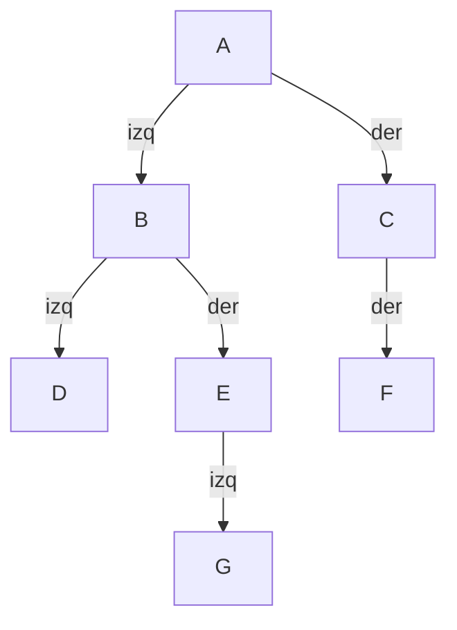

> 📘 **Lección guion para clase en vivo.** Se dicta en la sesión y se sigue paso a paso: ten tu editor abierto, escribe el código a medida que avanzamos y haz cada traza en papel **antes** de mirar la tabla. El código vive en dos archivos acumulativos: `NodoArbol.java` (secciones «El nodo del árbol» e «Insertar») y `Recorridos.java` (desde «Construir el árbol de ejemplo»). «Añade» significa dentro de la clase y encima de `main` (en `NodoArbol.java`, debajo de lo que ya hay); «reemplaza lo que sigue a la construcción» significa borrar las líneas de `main` posteriores a `c.insertarDerecho("F");` y poner las nuevas.

## Caminar por las carpetas: tres momentos para anotar

Tienes que recorrer todas las carpetas de un disco sin saltarte ninguna. Para simplificar, cada carpeta tiene como máximo **dos subcarpetas**, llamadas `Izq` y `Der`. La regla de la caminata es siempre la misma: entras a una carpeta, recorres completa la subcarpeta `Izq`, y luego recorres completa la subcarpeta `Der`.

Mientras caminas llevas una libreta, y en cada carpeta hay **tres momentos** en que puedes anotar su nombre:

| Momento | Cuándo ocurre | Nombre del recorrido |
|---|---|---|
| Uno | Al **llegar** a la carpeta, antes de entrar a ninguna subcarpeta | **Pre-orden** |
| Dos | **Entre** las dos subcarpetas: ya volviste de `Izq` y aún no entras a `Der` | **In-orden** |
| Tres | Al **salir**, cuando ya recorriste `Izq` y `Der` | **Post-orden** |

Los tres recorridos son **la misma caminata**: pasas por las mismas carpetas en el mismo recorrido de ida y vuelta. Lo único que cambia es el momento en que sacas la libreta.

🛑 **Pausa:** quieres un índice que muestre cada carpeta **antes** de su contenido. ¿En qué momento anotas el nombre? Y si en vez del nombre quieres el **tamaño** de la carpeta, ¿en qué momento puedes calcularlo?

## El árbol de ejemplo

Es el mismo árbol de la lección Conceptos y TAD árbol binario. Las carpetas `Izq` y `Der` de la caminata son los hijos izquierdo y derecho de cada nodo:



La raíz es `A`, las hojas son `D`, `G` y `F`, y `C` solo tiene hijo derecho. En Java, un **árbol vacío** se representa con `null`: la carpeta `Izq` que no existe es un `null`.

## El nodo del árbol

Para guardar este árbol en Java necesitas un nodo con **dos** referencias a otros nodos: una al hijo izquierdo y otra al derecho. Es la misma idea de `Nodo<T>` de la lección Nodos y memoria dinámica en Java, que tenía una sola referencia al siguiente. Crea `NodoArbol.java`:

```java
public class NodoArbol<T> {
    private T dato;
    private NodoArbol<T> izquierdo;
    private NodoArbol<T> derecho;

    public NodoArbol(T dato) {
        this.dato = dato;
        this.izquierdo = null;      // sin hijo izquierdo todavia
        this.derecho = null;        // sin hijo derecho todavia
    }

    public T getDato() {
        return dato;
    }

    public NodoArbol<T> getIzquierdo() {
        return izquierdo;
    }

    public NodoArbol<T> getDerecho() {
        return derecho;
    }
}
```

Los campos son `private` y no hay *setters*: desde fuera solo se puede leer. Las referencias cambiarán únicamente dentro de la clase, con las operaciones de la siguiente sección.

🛑 **Pausa:** si acabas de ejecutar `new NodoArbol<>("D")`, ¿cuánto valen `izquierdo` y `derecho`?

Valen `null` los dos: son los dos subárboles vacíos. Eso es justo lo que define a una hoja.

## Insertar: colgar un hijo de un padre

En una carpeta nueva, crear una subcarpeta `Izq` es una acción sobre la carpeta **padre**. Aquí pasa igual: insertar es pedirle a un nodo que cuelgue un hijo nuevo de uno de sus dos lados. No hay ninguna regla de orden: **tú decides dónde cuelga cada dato**. Añade estos métodos dentro de `NodoArbol`, debajo de `getDerecho`:

```java
    public NodoArbol<T> insertarIzquierdo(T dato) {
        if (izquierdo != null) {
            throw new IllegalStateException("El lado izquierdo de " + this.dato + " ya esta ocupado");
        }
        izquierdo = new NodoArbol<>(dato);
        return izquierdo;
    }

    public NodoArbol<T> insertarDerecho(T dato) {
        if (derecho != null) {
            throw new IllegalStateException("El lado derecho de " + this.dato + " ya esta ocupado");
        }
        derecho = new NodoArbol<>(dato);
        return derecho;
    }
```

El parámetro `dato` oculta el campo `dato`, por eso el mensaje usa `this.dato`: el dato del **padre**, no el del hijo que intentas colgar. Cada método **devuelve el nodo nuevo**, para poder colgarle a su vez sus propios hijos.

🛑 **Pausa:** si `B` ya tiene a `D` a su izquierda y llamas `b.insertarIzquierdo("X")`, ¿qué debería pasar? ¿Por qué no simplemente reemplazar a `D` por `X`?

Debe lanzar la excepción. Reemplazar dejaría a `D` desconectado y, con él, **todo el subárbol** que cuelga de `D`: se perdería en silencio. Es mejor fallar con un mensaje claro que perder datos sin avisar.

## Construir el árbol de ejemplo

Crea `Recorridos.java` y construye el árbol del diagrama, nodo por nodo. Cada línea cuelga un hijo de un padre; solo guardamos en una variable los nodos a los que luego les colgamos algo:

```java
public class Recorridos {

    public static void main(String[] args) {
        NodoArbol<String> a = new NodoArbol<>("A");
        NodoArbol<String> b = a.insertarIzquierdo("B");
        NodoArbol<String> c = a.insertarDerecho("C");
        b.insertarIzquierdo("D");
        NodoArbol<String> e = b.insertarDerecho("E");
        e.insertarIzquierdo("G");
        c.insertarDerecho("F");

        System.out.println(e.getIzquierdo().getDato());
    }
}
```

Compila `NodoArbol.java` y `Recorridos.java` y ejecuta:

```text
G
```

Se lee de izquierda a derecha: `e` es el nodo `E`, su hijo izquierdo es `G`, y de `G` pedimos el dato. El árbol ya está construido y `a` es su raíz.

## Pre-orden: visitar, izquierda, derecha

El pre-orden anota el nombre **al llegar**: visita el nodo, y luego recorre el subárbol izquierdo y el derecho. Como el hijo de un nodo es otro árbol, el recorrido es recursivo, con las dos preguntas de la lección Fundamentos de recursividad: **¿cuándo paro?** Cuando el árbol está vacío, que es el caso base de la lección Conceptos y TAD árbol binario.

Los métodos son `static` y reciben el nodo como parámetro. No pueden ser métodos del nodo: un árbol vacío es `null`, y sobre `null` no se puede invocar ningún método. Añade el método encima de `main`, en `Recorridos`:

```java
    static <T> void preOrden(NodoArbol<T> nodo) {
        if (nodo == null) {                         // caso base: arbol vacio
            return;
        }
        System.out.print(nodo.getDato() + " ");     // visitar: al llegar
        preOrden(nodo.getIzquierdo());              // recorrer el subarbol izquierdo
        preOrden(nodo.getDerecho());                // recorrer el subarbol derecho
    }
```

Reemplaza lo que sigue a la construcción:

```java
        System.out.print("pre-orden: ");
        preOrden(a);
        System.out.println();
```

🛑 **Antes de ejecutar:** escribe en papel el orden en que crees que se imprimen los nodos, y luego compila.

```text
pre-orden: A B D E G C F 
```

Cada línea de recorrido termina en un espacio, porque `print` escribe el dato y un espacio detrás de cada nodo. Ahora la traza a mano: hay 15 llamadas, 7 con un nodo y 8 con un árbol vacío. Completa en papel qué imprime cada una antes de mirar la tabla; las llamadas están en el orden en que **empiezan**:

| # | Llamada | Imprime |
|---|---|---|
| 1 | `preOrden(A)` | `A` |
| 2 | `preOrden(B)` (izquierdo de `A`) | `B` |
| 3 | `preOrden(D)` (izquierdo de `B`) | `D` |
| 4 | Árbol vacío (izquierdo de `D`) | nada |
| 5 | Árbol vacío (derecho de `D`) | nada |
| 6 | `preOrden(E)` (derecho de `B`) | `E` |
| 7 | `preOrden(G)` (izquierdo de `E`) | `G` |
| 8 | Árbol vacío (izquierdo de `G`) | nada |
| 9 | Árbol vacío (derecho de `G`) | nada |
| 10 | Árbol vacío (derecho de `E`) | nada |
| 11 | `preOrden(C)` (derecho de `A`) | `C` |
| 12 | Árbol vacío (izquierdo de `C`) | nada |
| 13 | `preOrden(F)` (derecho de `C`) | `F` |
| 14 | Árbol vacío (izquierdo de `F`) | nada |
| 15 | Árbol vacío (derecho de `F`) | nada |

Fíjate en que cada nodo se imprime en el momento en que **llega** su llamada, antes de bajar por el hijo izquierdo.

## Mover la línea de visitar: in-orden y post-orden

El in-orden y el post-orden se escriben igual que el pre-orden. Añade estos dos métodos encima de `main`, sin ejecutar todavía:

```java
    static <T> void inOrden(NodoArbol<T> nodo) {
        if (nodo == null) {
            return;
        }
        inOrden(nodo.getIzquierdo());
        System.out.print(nodo.getDato() + " ");     // visitar: entre los dos subarboles
        inOrden(nodo.getDerecho());
    }

    static <T> void postOrden(NodoArbol<T> nodo) {
        if (nodo == null) {
            return;
        }
        postOrden(nodo.getIzquierdo());
        postOrden(nodo.getDerecho());
        System.out.print(nodo.getDato() + " ");     // visitar: al salir
    }
```

🛑 **Pausa:** compáralos con `preOrden`. ¿Qué cambió?

Solo la **posición de la línea que imprime**: al llegar en `preOrden`, entre las dos llamadas en `inOrden` y después de ambas en `postOrden`. Las tres llamadas recursivas siguen siendo las mismas y en el mismo orden.

## 🗳️ Votación — ¿qué imprime inOrden(a)?

Haz la traza en papel y, sin ejecutar y sin hablar con nadie: ¿qué imprime `inOrden(a)` sobre el árbol de ejemplo?

- (a) `A B D E G C F`
- (b) `D B G E A C F`
- (c) `D G E B F C A`
- (d) `D B E G A C F`

Vota solo. Si entre el 30 % y el 70 % del grupo acierta, discutan 2 minutos en parejas y vuelvan a votar; si más del 70 % acierta, la explicación es rápida; si menos del 30 %, vuelve a explicar los tres momentos antes de discutir.

## Comprobar la votación: in-orden y post-orden

Ejecuta ambos. Reemplaza lo que sigue a la construcción:

```java
        System.out.print("in-orden: ");
        inOrden(a);
        System.out.println();
        System.out.print("post-orden: ");
        postOrden(a);
        System.out.println();
```

```text
in-orden: D B G E A C F 
post-orden: D G E B F C A 
```

**La respuesta es (b).** Qué revela cada opción: (a) es el pre-orden, que visita al llegar y no entre los subárboles; (c) es el post-orden, que visita al salir; (d) visita `E` antes de bajar por su hijo izquierdo `G`, o sea, olvida que «en medio» también vale en un nodo que solo tiene hijo izquierdo.

Para ver los tres momentos juntos, sigue los 12 eventos del subárbol de `B`. Cada nodo tiene exactamente tres momentos, y cada uno corresponde a un recorrido:

| # | Evento | Se anota en |
|---|---|---|
| 1 | Llega a `B` | pre-orden: `B` |
| 2 | Llega a `D` | pre-orden: `D` |
| 3 | Vuelve de la izquierda de `D` (vacía) | in-orden: `D` |
| 4 | Sale de `D` | post-orden: `D` |
| 5 | Vuelve de la izquierda de `B` (ya recorrió `D`) | in-orden: `B` |
| 6 | Llega a `E` | pre-orden: `E` |
| 7 | Llega a `G` | pre-orden: `G` |
| 8 | Vuelve de la izquierda de `G` (vacía) | in-orden: `G` |
| 9 | Sale de `G` | post-orden: `G` |
| 10 | Vuelve de la izquierda de `E` (ya recorrió `G`) | in-orden: `E` |
| 11 | Sale de `E` | post-orden: `E` |
| 12 | Sale de `B` | post-orden: `B` |

Leyendo cada columna en orden, el subárbol de `B` da: pre-orden `B D E G`, in-orden `D B G E` y post-orden `D G E B`. Es la misma caminata, anotada en tres momentos.

## Dónde se rompe la analogía

Las carpetas explican bien dos de los tres recorridos y fallan en el tercero:

- El **pre-orden** y el **post-orden** tienen su análogo: anotar al llegar a una carpeta y anotar al salir de ella.
- El **in-orden** no: nadie anota «en medio» de dos carpetas hermanas, porque las subcarpetas de una carpeta real no tienen lado. Por eso el in-orden se apoya en el dibujo del árbol y no en la caminata: si cada hijo izquierdo queda a la izquierda de su padre y cada hijo derecho a su derecha, el in-orden lee los nodos de izquierda a derecha.
- Una carpeta real admite **n subcarpetas sin orden**; el árbol binario admite dos, y cada una tiene su lado.

## Resumen operativo

| Recorrido | Cuándo visita | Salida en el árbol de ejemplo |
|---|---|---|
| Pre-orden | Al llegar, antes de los subárboles | `A B D E G C F` |
| In-orden | Entre el subárbol izquierdo y el derecho | `D B G E A C F` |
| Post-orden | Al salir, después de los dos subárboles | `D G E B F C A` |

## Síntesis

- Pre-orden, in-orden y post-orden son **la misma caminata** por las carpetas; solo cambia el momento en que se anota el nombre: al llegar, entre las dos subcarpetas o al salir.
- Un `NodoArbol<T>` guarda un dato y dos referencias, `izquierdo` y `derecho`; en una hoja valen `null`, los dos subárboles vacíos.
- Los campos son privados y sin *setters*: las referencias cambian solo con `insertarIzquierdo` e `insertarDerecho`.
- Insertar es colgar un hijo de un padre dado, sin regla de orden; si el lado está ocupado se lanza `IllegalStateException`, porque reemplazar perdería un subárbol en silencio.
- El árbol de ejemplo se construye con siete llamadas a `insertarIzquierdo` e `insertarDerecho`, guardando solo los nodos que luego reciben hijos.
- Los recorridos son métodos `static` y genéricos porque un árbol vacío es `null`, y su caso base es el árbol vacío.
- El pre-orden visita al llegar: `A B D E G C F`; su traza tiene 15 llamadas, 7 con nodo y 8 con árbol vacío.
- In-orden y post-orden solo mueven la línea que imprime; la votación pedía predecir el in-orden, `D B G E A C F`, y el post-orden da `D G E B F C A`.
- La analogía se rompe en el in-orden, que no tiene análogo en las carpetas, y en que una carpeta admite n subcarpetas sin lado y el árbol binario solo dos.
