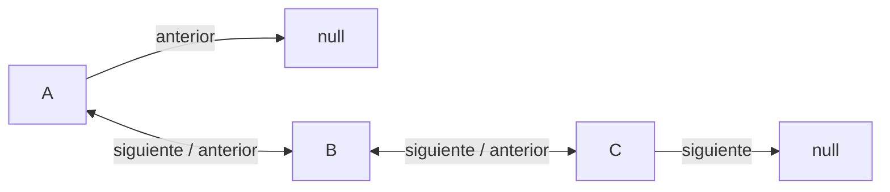
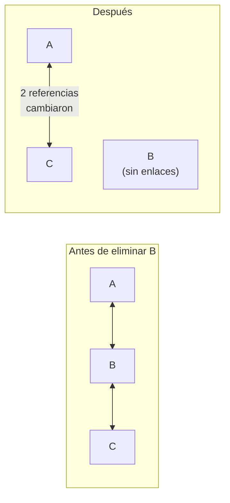
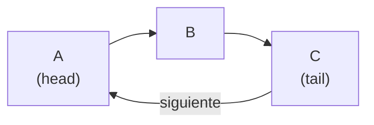

> 📖 Lectura previa a la clase — unos 12 minutos. Al final, responde la autoevaluación.

## El carrusel de fotos del celular

Abres la galería y deslizas a la izquierda: aparece la foto siguiente. Deslizas a la derecha: vuelves a la anterior. Desde cualquier foto puedes ir **en los dos sentidos**, y la galería no tiene que contar nada ni empezar desde la primera foto para devolverte una.

Los bordes son distintos: en la primera foto no hay "anterior" y en la última no hay "siguiente"; el celular simplemente no se mueve. Y si borras una foto del medio, las dos vecinas pasan a ser vecinas entre sí: la galería no se rompe ni deja un hueco.

Compáralo con una lista simple, donde cada nodo solo conoce al siguiente: ahí solo podrías deslizar hacia un lado.

## Del carrusel a las reglas: la lista doblemente enlazada

Cada gesto es una referencia que el nodo debe guardar:

| En el carrusel | En la estructura |
|---|---|
| Deslizar a la siguiente foto | referencia al nodo siguiente |
| Deslizar a la anterior | referencia al nodo anterior |
| Primera y última foto | `head` y `tail` |
| No hay foto más allá del borde | `null` |



> **Nodo doble:** nodo que guarda un dato y **dos** referencias: al nodo que lo sigue y al nodo que lo precede.

> **Lista doblemente enlazada:** cadena de nodos dobles con un extremo inicial (`head`) y uno final (`tail`), donde `head.anterior` y `tail.siguiente` son `null`.

La literatura suele llamar a esas referencias `prev` y `next`; en este curso se llaman `anterior` y `siguiente`.

## Nodo doble, head/tail y recorrido inverso

**Así en la vida real:** cada foto sabe cuál va antes y cuál después, y la galería recuerda dónde está la primera y la última.

**Así en código:** el nodo suma una referencia respecto al `Nodo<T>` que ya conoces, y la lista guarda los dos extremos:

```java
public class NodoDoble<T> {
    private T dato;
    private NodoDoble<T> siguiente;   // null si es el último
    private NodoDoble<T> anterior;    // null si es el primero

    public NodoDoble(T dato) { this.dato = dato; }
    public T getDato() { return dato; }
    public NodoDoble<T> getSiguiente() { return siguiente; }
    public NodoDoble<T> getAnterior() { return anterior; }
    public void setSiguiente(NodoDoble<T> siguiente) { this.siguiente = siguiente; }
    public void setAnterior(NodoDoble<T> anterior) { this.anterior = anterior; }
}
```

```java
public class ListaDoble<T> {
    private NodoDoble<T> head;   // primer nodo; null si la lista está vacía
    private NodoDoble<T> tail;   // último nodo; null si la lista está vacía
    private int tamano;

    public boolean estaVacia() { return head == null; }

    public void recorrerInverso() {
        NodoDoble<T> actual = tail;           // se parte del final...
        while (actual != null) {
            System.out.println(actual.getDato());
            actual = actual.getAnterior();    // ...y se retrocede un nodo por paso
        }
    }
}
```

En una lista simple, ir hacia atrás obliga a recorrer desde `head` hasta el nodo previo en cada paso (**O(n²)** en total) o a invertir la lista. Aquí es un recorrido de **O(n)**: ir hacia atrás cuesta lo mismo que ir hacia adelante.

## Insertar y eliminar con cuatro referencias en juego

**Así en la vida real:** agregar una foto al final, o borrar la que tienes en pantalla, es un gesto único; no empiezas a buscarla desde la primera.

**Así en código:** insertar al final usa `tail` y toca dos nodos, sin recorrer nada:

```java
public void insertarFinal(T dato) {
    NodoDoble<T> nuevo = new NodoDoble<>(dato);
    if (estaVacia()) {
        head = nuevo;                 // único nodo: es head y tail a la vez
    } else {
        tail.setSiguiente(nuevo);     // el último actual apunta al nuevo...
        nuevo.setAnterior(tail);      // ...y el nuevo apunta de vuelta
    }
    tail = nuevo;
    tamano++;
}
```

Eliminar un nodo que ya tienes localizado es donde la lista doble gana: el nodo mismo dice quién está antes y quién después, así que no hay que buscar a su predecesor.

```java
public T eliminar(NodoDoble<T> nodo) {
    NodoDoble<T> antes = nodo.getAnterior();
    NodoDoble<T> despues = nodo.getSiguiente();
    if (antes == null) {
        head = despues;                    // era el primero (o el único)
    } else {
        antes.setSiguiente(despues);       // el de atrás salta al de adelante
    }
    if (despues == null) {
        tail = antes;                      // era el último (o el único)
    } else {
        despues.setAnterior(antes);        // el de adelante apunta al de atrás
    }
    nodo.setSiguiente(null);               // el nodo eliminado ya no enlaza a nadie
    nodo.setAnterior(null);
    tamano--;
    return nodo.getDato();
}
```

Los tres casos borde salen de las dos preguntas `antes == null` y `despues == null`: si ambas son verdaderas era el único nodo y la lista queda con `head` y `tail` en `null`.



Costos: insertar o eliminar en los extremos es **O(1)**; eliminar un nodo ya localizado es **O(1)**; encontrarlo por valor sigue siendo **O(n)**.

## Cuando el carrusel da la vuelta: la lista circular

**Así en la vida real:** una playlist en bucle: al terminar la última canción, vuelve a sonar la primera. No hay un "final": siempre hay una siguiente.

**Así en código:** basta un cambio al enlazar los extremos. En la circular simple, el último apunta al primero; en la circular doble, además el primero apunta al último:

```java
tail.setSiguiente(head);       // circular simple y doble
head.setAnterior(tail);        // solo en la circular doble
```

Ya no hay `null` en los bordes, y eso rompe el recorrido de antes: `while (actual != null)` **nunca termina**. Hay que detenerse al volver al punto de partida:

```java
if (head != null) {
    NodoDoble<T> actual = head;
    do {
        System.out.println(actual.getDato());
        actual = actual.getSiguiente();
    } while (actual != head);      // una vuelta completa
}
```

Se usa `do { } while` porque la condición compara con `head`, que es donde se empieza: un `while` normal terminaría sin imprimir nada.



> **Lista circular:** lista en la que el último nodo enlaza de nuevo con el primero, de modo que ningún nodo tiene `null` como siguiente (ni como anterior, en la circular doble).

## Resumen operativo

| | Simple | Doble | Circular |
|---|---|---|---|
| Referencias por nodo | 1 | 2 | 1 o 2 |
| Recorrido inverso | No (O(n²) o invertir) | Sí, O(n) | Solo si es doble |
| Eliminar un nodo ya localizado | O(n) (hay que hallar el anterior) | **O(1)** | Igual que su base |
| Insertar al final con `tail` | O(1) | O(1) | O(1) |
| Memoria por nodo | Menor | Mayor (una referencia más) | Igual que su base |
| Riesgo típico | Perder la cadena al reasignar | Dejar una de las 4 referencias sin actualizar | Bucle infinito |

Límites que ninguna de las tres supera: no hay acceso por índice (llegar a la posición *k* cuesta **O(n)**, a diferencia de un arreglo); cada referencia extra es una asignación más que se puede olvidar; y la circular no avisa cuándo terminó una vuelta, eso lo decide tu condición de parada.

## Síntesis

- Un **nodo doble** guarda `siguiente` y `anterior`: desde cualquier foto del carrusel puedes ir en los dos sentidos.
- La **lista doble** guarda `head` y `tail`, y recorrerla hacia atrás es **O(n)**, no **O(n²)**.
- `insertarFinal` es **O(1)** gracias a `tail`; `eliminar` sobre un nodo ya localizado es **O(1)** y debe reparar hasta cuatro referencias, con los casos borde: único nodo, `head` y `tail`.
- La **lista circular** enlaza el último con el primero (y en la doble, el primero con el último); sin `null` en los bordes, el recorrido se detiene con `do { } while (actual != head)`.
- Lo que se paga: una referencia más por nodo, más asignaciones que equivocar, y ningún acceso por índice.
