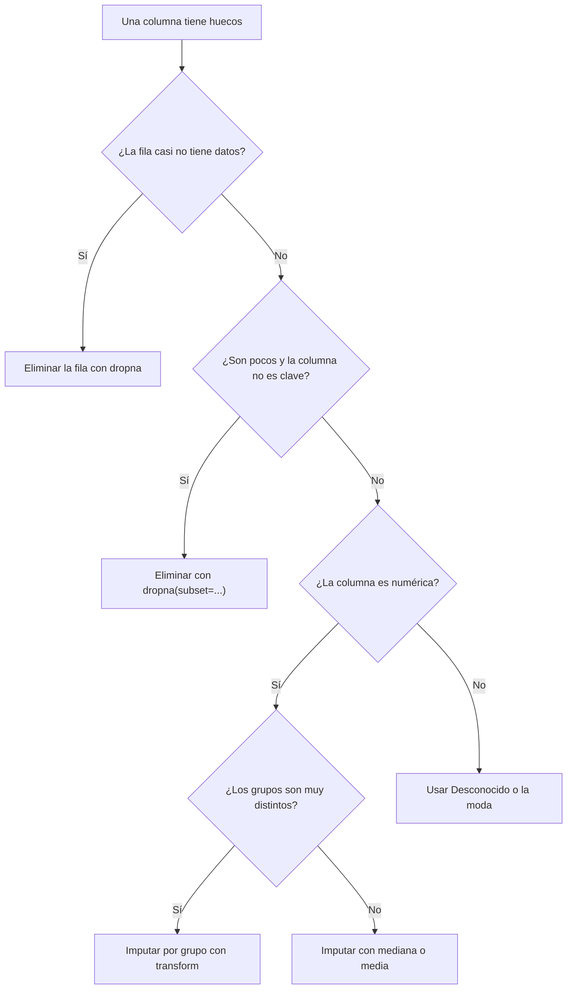

> 📖 Lección de trabajo independiente — unos 20 minutos. Ejecuta cada bloque de código en Colab y compara tu salida con la que aparece aquí.

<YouTubeEmbed id="ARwHkq4t2q0" title="Video de apoyo de la lección" />

## El problema: una casilla vacía no es un cero

Imagina la hoja de asistencia de un curso de 30 estudiantes. Al final del semestre ves que hay casillas en blanco. ¿Qué significa cada una? Puede ser que el estudiante faltó, que el profesor olvidó anotar, o que el estudiante estaba en una práctica y nadie sabía dónde registrarlo. **Una casilla en blanco no es un "no vino"**: es una pregunta sin responder. Si el profesor la cuenta como falta, inventa un dato; si la ignora sin avisar, también decide algo.

Una tabla de datos tiene el mismo problema. Vamos a trabajar con un dataset de 344 pingüinos medidos en la Antártida (especie, isla, medidas del pico, la aleta, el peso y el sexo). Cárgalo en Colab:

```python
import numpy as np
import pandas as pd
import seaborn as sns

pinguinos = sns.load_dataset("penguins")
print(pinguinos.shape)
```

```text
(344, 7)
```

Ahora hazle una pregunta sencilla: ¿qué proporción de los pingüinos son hembras? Calcúlala de dos maneras que parecen equivalentes:

```python
print(round((pinguinos["sex"] == "Female").mean(), 3))
print(round(pinguinos["sex"].value_counts(normalize=True)["Female"], 3))
```

```text
0.48
0.495
```

Dos códigos sin errores, dos respuestas: 48 % y 49.5 %. La diferencia está en que la columna `sex` tiene celdas vacías: la primera fórmula divide entre las 344 filas y la segunda solo entre las 333 que sí tienen sexo registrado. Ninguna te avisó.

¿Por qué la primera no omitió los vacíos, si `mean()` ignora los datos faltantes? Porque cuando `mean()` entra en acción ya no hay ninguno. La comparación `pinguinos["sex"] == "Female"` pregunta celda por celda "¿es igual a `Female`?", y una celda vacía no es igual a nada, así que la respuesta es `False`, no un hueco. El resultado son 344 valores `True` o `False`, y las 11 filas sin sexo quedaron convertidas en "no es hembra" sin que nadie lo decidiera. La segunda fórmula, en cambio, usa `value_counts`, que descarta las celdas vacías por defecto y cuenta solo las 333 con sexo.

Esta lección trata de esas celdas vacías: cómo encontrarlas, cómo medirlas, por qué aparecen y qué hacer con ellas. Para eso vas a usar tres herramientas de pandas, `isna().sum()`, `dropna` y `fillna`, desarmadas pieza por pieza para que entiendas qué hace cada parte.

## Cómo se ve un dato faltante en pandas

En pandas, una celda vacía numérica se guarda como `NaN` (_Not a Number_, "no es un número"). En una columna de texto, la celda vacía también se muestra como `NaN`. Lo importante es que un dato faltante **no es** `0` ni es un texto vacío `""`: un peso de `0` gramos es un dato falso; un `NaN` es la honestidad de decir "aquí no sé".

```python
serie = pd.Series([10, 20, np.nan])
print(serie)
print(serie.mean())
print(serie.count())
```

```text
0    10.0
1    20.0
2     NaN
dtype: float64
15.0
2
```

Fíjate en dos cosas. Primero, `mean()` dio 15.0: sumó 10 + 20 y dividió entre 2, **no entre 3**, porque ignora el hueco. Segundo, `count()` cuenta solo las celdas con dato (2), no las 3 posiciones. Si el hueco hubiera sido un `0`, el promedio habría sido 10.0, un resultado falso.

Hay una rareza: un `NaN` no es igual ni a sí mismo.

```python
print(np.nan == np.nan)
print(pd.isna(np.nan))
```

```text
False
True
```

Por eso **no puedes detectar un hueco con `==`**. Escribir `pinguinos["sex"] == np.nan` no encuentra nada, porque ninguna celda vacía es "igual" a otra. Para eso pandas tiene su propia pregunta, `isna()`, que veremos con detalle en la siguiente sección.

> **NaN:** marca de pandas para "dato faltante". No es 0 ni texto vacío, no es igual a nada (ni a sí mismo), y funciones como `mean`, `min`, `max` y `count` lo ignoran.

## Medir el tamaño del hueco: isna().sum() paso a paso

Antes de decidir qué hacer, necesitas saber **cuántos** datos faltan y **dónde**. La pregunta más usada es `pinguinos.isna().sum()`. Parece una sola instrucción, pero son dos pasos encadenados. Desarmémosla.

**Paso 1: `isna()`.** Recorre cada celda de la tabla y responde "¿esta celda está vacía?" con `True` o `False`. El resultado es una tabla del mismo tamaño, pero llena de `True` y `False` (una **máscara booleana**). Para una sola columna:

```python
print(pinguinos["sex"].isna().head(5))
```

```text
0    False
1    False
2    False
3     True
4    False
Name: sex, dtype: bool
```

La fila 3 es `True`: ese pingüino no tiene sexo registrado.

**Paso 2: `sum()`.** En Python, `True` vale 1 y `False` vale 0. Entonces sumar una columna de `True` y `False` equivale a **contar los `True`**, es decir, los huecos.

```python
print(pinguinos["sex"].isna().sum())
```

```text
11
```

**Paso 3: aplicarlo a toda la tabla.** Si quitas la selección de una columna, `isna()` produce una máscara de toda la tabla y `sum()` suma **por columna** (cada columna aporta un total):

```python
print(pinguinos.isna().sum())
```

```text
species               0
island                0
bill_length_mm        2
bill_depth_mm         2
flipper_length_mm     2
body_mass_g           2
sex                  11
dtype: int64
```

Resumen de la anatomía:

| Pieza | Qué hace | Qué devuelve |
|---|---|---|
| `pinguinos` | La tabla completa (344 filas, 7 columnas) | un DataFrame |
| `.isna()` | Pregunta celda por celda "¿está vacía?" | un DataFrame de `True` y `False` |
| `.sum()` | Suma cada columna (`True` = 1, `False` = 0) | una Series con un total por columna |

Su gemela es `notna()`, que pregunta lo contrario ("¿tiene dato?"). Con `pinguinos["sex"].notna().sum()` obtienes 333, las celdas con sexo registrado.

Contar no basta; un 2 en una tabla de 344 filas no pesa lo mismo que un 2 en una tabla de 10. Convierte el conteo en porcentaje con `mean()`: el promedio de ceros y unos es la proporción de unos.

```python
print((pinguinos.isna().mean() * 100).round(1))
```

```text
species              0.0
island               0.0
bill_length_mm       0.6
bill_depth_mm        0.6
flipper_length_mm    0.6
body_mass_g          0.6
sex                  3.2
dtype: float64
```

También importa **por filas**. `isna().any(axis=1)` pregunta, fila por fila, "¿tiene al menos un hueco?":

```python
print(pinguinos.isna().any(axis=1).sum())
print(pinguinos.isna().all(axis=1).sum())
```

```text
11
0
```

Hay 11 filas con al menos un hueco, y ninguna fila está completamente vacía. Con esta información ya tienes un diagnóstico: los huecos son pocos (3.2 % como máximo por columna), y casi todos están en `sex`. Una guía práctica para leer el porcentaje por columna:

| Porcentaje de nulos | Lectura habitual |
|---|---|
| Menos de 5 % | Poco; eliminar o imputar suele afectar muy poco |
| Entre 5 % y 30 % | Hay que mirar con cuidado por qué faltan antes de decidir |
| Más de 30 % | La columna puede no servir; considera descartarla |

Esta tabla es una guía, no una ley: una columna con 2 % de nulos que son justo los casos más importantes sigue siendo un problema.

## ¿Por qué falta? Los huecos tienen causa

Volvamos a la hoja de asistencia. Una casilla vacía porque el profesor olvidó anotar es muy distinta a una vacía porque el estudiante faltó siempre los mismos días. La primera es azar; la segunda es un patrón. En los datos pasa igual, y de eso depende qué solución es honesta.

Hay tres situaciones típicas, sin necesidad de jerga:

- **Falta al azar.** El hueco no tiene relación con nada; un sensor falló un momento. Eliminar o imputar es poco riesgoso.
- **Falta por una causa que puedes ver en otra columna.** Los huecos se concentran en un grupo. Por ejemplo, un instrumento de medición que solo se usó en una isla.
- **Falta por culpa del propio valor.** Las personas con ingresos muy altos no responden esa pregunta. El hueco esconde justo el tipo de dato que más importa. Es el más difícil de detectar, porque lo que falta es lo que no puedes ver.

Para investigar, filtra las filas con hueco (usando `isna()` como filtro dentro de corchetes) y cuenta con `groupby(...).size()` cuántas caen en cada especie o isla.

```python
sin_sexo = pinguinos[pinguinos["sex"].isna()]
print(sin_sexo.groupby("species").size())
print(sin_sexo.groupby("island").size())
```

```text
species
Adelie    6
Gentoo    5
dtype: int64
island
Biscoe       5
Dream        1
Torgersen    5
dtype: int64
```

Los 11 pingüinos sin sexo son Adelie y Gentoo, y ninguno es Chinstrap. Además, 10 de 11 están en Biscoe o Torgersen. Con solo 11 casos no puedes afirmar que haya una causa, pero sí que **los huecos no se reparten parejo**, y eso es una advertencia para ser prudente: si rellenaras con "lo más común", estarías tomando decisiones sobre grupos desiguales.

## Opción 1: eliminar con dropna paso a paso

La reacción más simple ante un hueco es descartar la fila. `dropna()` ("quitar nulos") hace justo eso. Tiene varios parámetros; cada uno cambia la pregunta que le haces. Partamos del uso más básico:

```python
print(pinguinos.shape)
print(pinguinos.dropna().shape)
```

```text
(344, 7)
(333, 7)
```

Sin argumentos, `dropna()` descarta **cualquier fila que tenga al menos un hueco, en cualquier columna**. Pasamos de 344 a 333 filas: perdimos 11. Dos detalles importantes: devuelve **una tabla nueva** (la original `pinguinos` sigue intacta) y no te dice cuántas filas quitó; eso lo mides tú comparando `shape`.

Los parámetros que más vas a usar:

| Parámetro | Qué le dices | Ejemplo | Resultado en pingüinos |
|---|---|---|---|
| (ninguno) | Quita la fila si **cualquier** columna está vacía | `dropna()` | 333 filas |
| `subset=[...]` | Mira **solo estas columnas** para decidir | `dropna(subset=["body_mass_g"])` | 342 filas |
| `how="all"` | Quita la fila solo si **todas** las columnas están vacías | `dropna(how="all")` | 344 filas |
| `thresh=n` | Conserva la fila si tiene **al menos n datos** | `dropna(thresh=5)` | 342 filas |
| `axis=1` | Quita **columnas** en lugar de filas | `dropna(axis=1)` | 2 columnas |

Veamos el que más sirve en la práctica, `subset`. Si tu pregunta es sobre el peso, no hay razón para perder pingüinos por tener el sexo vacío:

```python
solo_con_peso = pinguinos.dropna(subset=["body_mass_g"])
print(solo_con_peso.shape)
print(round(solo_con_peso["body_mass_g"].mean(), 1))
```

```text
(342, 7)
4201.8
```

Con `subset`, pierdes 2 filas (0.6 %) en lugar de 11 (3.2 %). Y las 9 filas que `dropna()` a secas habría tirado tenían un peso perfectamente bueno.

`how="all"` es la opción más suave: aquí devuelve 344 filas porque ninguna fila está completamente vacía. `thresh=5` exige que la fila tenga al menos 5 celdas con dato de sus 7 (se conservan las que les falta una o dos); descarta las filas 3 y 339, que solo tienen `species` e `island`, y devuelve 342. `axis=1` cambia el objetivo: elimina las **columnas** con algún hueco, y solo sobreviven `species` e `island`. Rara vez es lo que quieres: pierdes cinco de siete columnas por unos pocos huecos.

El costo de eliminar siempre se mide en **cuántas filas (o columnas) pierdes**, y se mide comparando el `shape` antes y después. Un descarte del 0.6 % casi no cambia nada; uno del 40 % cambia lo que tus datos representan.

> **dropna:** devuelve una tabla nueva sin las filas (o columnas) con huecos. `subset` limita en qué columnas se buscan los huecos, `how` decide si basta uno o deben ser todos, y `thresh` fija el mínimo de datos que una fila debe tener para quedarse.

## Opción 2: imputar con un valor típico, fillna paso a paso

Si no quieres perder la fila, puedes **imputar**: rellenar el hueco con un valor razonable. `fillna()` ("llenar nulos") recibe el valor y lo escribe en cada celda vacía. Como en la hoja de asistencia: en lugar de dejar la casilla en blanco, escribes la nota típica del curso. Sirve, pero estás **inventando un dato**, y debes saberlo.

Desarmemos la instrucción completa:

```python
mediana = pinguinos["body_mass_g"].median()
peso_imputado = pinguinos["body_mass_g"].fillna(mediana)
print(mediana)
print(peso_imputado.isna().sum())
```

```text
4050.0
0
```

Paso a paso:

1. `pinguinos["body_mass_g"]` selecciona la columna con huecos.
2. `.median()` calcula el valor típico ignorando los huecos: 4050.0 g.
3. `.fillna(mediana)` busca cada celda vacía y escribe 4050.0 en ella; las celdas con dato no se tocan.
4. El resultado se guarda en `peso_imputado`: una Series nueva, sin huecos (`isna().sum()` da 0).

Observa que **`fillna` no modifica la tabla original**: devuelve una copia rellena. Si quieres que el cambio quede en una tabla, debes asignar el resultado de vuelta, sobre una copia:

```python
limpio = pinguinos.copy()
limpio["body_mass_g"] = limpio["body_mass_g"].fillna(mediana)
print(pinguinos["body_mass_g"].isna().sum())
print(limpio["body_mass_g"].isna().sum())
```

```text
2
0
```

El original conserva sus 2 huecos y la copia ya no tiene ninguno. `copy()` te protege: si te equivocas de valor, puedes volver a empezar sin recargar el dataset. Esa es la razón de trabajar siempre sobre una copia.

> ⚠️ Evita `inplace=True`. En su forma encadenada, `df["col"].fillna(..., inplace=True)`, pandas 3 no modifica tu tabla: los huecos siguen ahí y solo recibes una advertencia. El patrón que siempre funciona, y el más claro de leer, es `df["col"] = df["col"].fillna(valor)`.

¿Con qué valor rellenar? Depende del tipo de columna:

| Tipo de columna | Valor habitual | Por qué |
|---|---|---|
| Número sin extremos | media (`mean()`) | Es el promedio de todos |
| Número con valores extremos | mediana (`median()`) | Un extremo arrastra a la media, pero no a la mediana |
| Texto o categoría | moda (`mode()[0]`) o un texto como `"Desconocido"` | No existe media de un texto |

Mira lo que ocurre con la media del peso:

```python
masa = pinguinos["body_mass_g"]
print(round(masa.mean(), 2), masa.median())
con_media = masa.fillna(masa.mean())
print(round(masa.std(), 2), round(con_media.std(), 2))
```

```text
4201.75 4050.0
801.95 799.61
```

Rellenar con la media dejó el promedio igual (4201.75) pero bajó la desviación estándar de 801.95 a 799.61. Es lógico: agregaste valores idénticos al centro y los datos se ven un poquito más agrupados de lo que son. Con 2 huecos el efecto es mínimo; con 200 sería notorio. **Imputar con un único valor siempre hace que los datos parezcan menos variados de lo que realmente son.**

Para una columna de texto como `sex` no hay media. Tienes dos caminos, con consecuencias distintas:

```python
moda = pinguinos["sex"].mode()[0]
print(moda)
print(pinguinos["sex"].fillna(moda).value_counts())
print(pinguinos["sex"].fillna("Desconocido").value_counts())
```

```text
Male
sex
Male      179
Female    165
Name: count, dtype: int64
sex
Male           168
Female         165
Desconocido     11
Name: count, dtype: int64
```

Con la moda (`Male`), los 11 pingüinos pasan a ser machos: inventaste 11 sexos y desbalanceaste la tabla (179 machos frente a 165 hembras, cuando en los datos reales eran 168 y 165). Con `"Desconocido"` no inventas nada: dejas explícito que no se sabe, y la categoría queda a la vista. Para una columna categórica, **declarar el hueco suele ser más honesto que adivinar**.

Si tienes varias columnas que rellenar con valores distintos, `fillna` acepta un diccionario `{columna: valor}` en una sola instrucción:

```python
relleno = pinguinos.fillna({"body_mass_g": mediana, "sex": "Desconocido"})
print(relleno.isna().sum())
```

```text
species              0
island               0
bill_length_mm       2
bill_depth_mm        2
flipper_length_mm    2
body_mass_g          0
sex                  0
dtype: int64
```

Solo se rellenaron las dos columnas indicadas; las demás conservan sus 2 huecos.

> **fillna:** devuelve una tabla (o columna) nueva con los huecos reemplazados por el valor que le des. Recibe un valor único para una columna, o un diccionario para varias. No modifica el original: debes asignar el resultado.

## Opción 3: imputar mirando al grupo

Rellenar con la mediana de **toda** la tabla supone que todos los pingüinos son iguales. No lo son. Las dos filas con peso vacío son el pingüino 3 (un Adelie) y el 339 (un Gentoo). Mira cuánto cambia el valor típico según la especie:

```python
print(pinguinos.groupby("species")["body_mass_g"].median())
```

```text
species
Adelie       3700.0
Chinstrap    3700.0
Gentoo       5000.0
Name: body_mass_g, dtype: float64
```

Un Gentoo típico pesa 5000 g, pero la mediana global (4050 g) se lo habría asignado al pingüino 339, unos 950 g por debajo de lo normal para su especie. Es como poner a un estudiante de último año la nota típica de primer semestre: rellenaste, pero con un valor que no le corresponde.

La solución es calcular la mediana **dentro de cada grupo** y usarla para rellenar a cada fila. `transform` es la pieza clave: hace lo mismo que `median()`, pero devuelve un valor **por cada fila** de la tabla original (la mediana de su propio grupo) en lugar de una fila por grupo:

```python
mediana_por_especie = pinguinos.groupby("species")["body_mass_g"].transform("median")
print(mediana_por_especie.loc[[3, 339]])  # loc[[3, 339]] muestra solo las filas con etiqueta 3 y 339
```

```text
3      3700.0
339    5000.0
Name: body_mass_g, dtype: float64
```

Cada fila trae ahora la mediana de su especie. Esa Series se usa como relleno: `fillna` recibe una Series y rellena cada hueco con el valor que esa Series tiene **para la misma fila** (alinea por la etiqueta del índice, es decir, el número de fila):

```python
peso_por_grupo = pinguinos["body_mass_g"].fillna(mediana_por_especie)
print(peso_por_grupo.isna().sum())
print(peso_por_grupo.loc[[3, 339]].tolist())
```

```text
0
[3700.0, 5000.0]
```

Ahora el Adelie recibió 3700 g y el Gentoo 5000 g: valores razonables para cada uno. Imputar por grupo cuesta un poco más de código, pero protege tus comparaciones: si luego comparas el peso promedio entre especies, no habrás contaminado los grupos con valores que no les pertenecen.

## Elegir con criterio y dejar rastro

Ya conoces tres caminos. No existe uno "correcto" en abstracto; existe el que mejor responde a tu situación. Este esquema resume cómo decidir, columna por columna:



Aplicado a los pingüinos, tiene sentido así: las filas 3 y 339 casi no tienen datos (solo especie e isla), así que se eliminan; el sexo no se puede estimar con una mediana, así que los 9 vacíos restantes se marcan como `"Desconocido"` si la pregunta no depende del sexo, o se excluyen de ese cálculo si sí depende.

Toda decisión de limpieza modifica tus datos, y quien lea tu análisis necesita saberlo. Lleva una **bitácora de limpieza**: una nota breve con qué columna, cuántos huecos había, qué hiciste, por qué, y cuántas filas quedaron.

| Columna | Huecos | Decisión | Motivo | Filas antes → después |
|---|---|---|---|---|
| `body_mass_g` | 2 (0.6 %) | `dropna(subset=["body_mass_g"])` | Las 2 filas no tenían ninguna medida corporal | 344 → 342 |
| `sex` | 9 tras el paso anterior | Rellenar con `"Desconocido"` | No hay valor típico para un texto; no quiero inventar un sexo | 342 → 342 |

Con esa tabla, cualquiera entiende por qué tu análisis usa 342 pingüinos y no 344. Y tres hábitos que evitan sorpresas:

1. **Trabaja sobre una copia** (`df.copy()`), nunca sobre el original recién cargado.
2. **Mide antes y después** (`shape`, `isna().sum()`): si no lo mides, no sabes cuánto cambiaste.
3. **Decide por columna**, no para toda la tabla: `sex` y `body_mass_g` merecen decisiones distintas.

> ⚡ **Para ir más lejos:** si tus datos son una secuencia en el tiempo (temperaturas diarias, por ejemplo), `ffill()` repite el último valor conocido, `bfill()` usa el siguiente, e `interpolate()` calcula un valor intermedio: en `pd.Series([1.0, np.nan, 3.0]).interpolate()` el hueco se rellena con 2.0. Y si crees que el hecho de que falte un dato es información en sí misma, crea una columna indicadora antes de rellenar: `df["sex_faltante"] = df["sex"].isna()` guarda un `True` por cada pingüino al que le faltaba el sexo, y así no pierdes el rastro de cuáles valores inventaste.

## Síntesis

Cada decisión sobre un hueco tiene su herramienta y su señal de alerta:

| Pregunta | Herramienta | Señal de alerta |
|---|---|---|
| ¿Cuántos huecos hay y dónde? | `isna().sum()`, `isna().mean()` | Mirar solo el total y no el porcentaje por columna |
| ¿Cuáles filas tienen huecos? | `isna()` como máscara, `isna().any(axis=1)` | Detectar con `==` (un `NaN` no es igual a nada) |
| ¿Por qué faltan? | `groupby` sobre las filas con hueco | Huecos concentrados en un solo grupo |
| ¿Elimino? | `dropna`, `subset`, `how`, `thresh` | No comparar `shape` antes y después |
| ¿Relleno con un valor típico? | `fillna(mediana)`, `fillna("Desconocido")` | Olvidar asignar el resultado, o encadenar `fillna(..., inplace=True)` |
| ¿Relleno según el grupo? | `groupby(...).transform("median")` | Dar a un grupo el valor típico de otro |
| ¿Cómo lo dejo documentado? | Bitácora de limpieza | Un análisis cuyas filas "desaparecen" sin explicación |

Y por sección:

- **El problema:** una casilla vacía es una pregunta sin responder, no un cero ni una falta; ignorarla y contarla son dos decisiones distintas.
- **Cómo se ve un dato faltante:** `NaN` no es 0 ni texto vacío, no es igual a nada, y `mean` y `count` lo ignoran.
- **isna().sum():** `isna()` crea una máscara de `True` y `False`, `sum()` cuenta los `True`; con `mean()` obtienes el porcentaje.
- **¿Por qué falta?:** al azar, por una causa visible en otra columna, o por culpa del propio valor; `groupby` sobre las filas con hueco ayuda a distinguirlo.
- **dropna:** devuelve una tabla nueva; `subset` limita las columnas, `how` y `thresh` definen cuándo descartar, y su costo son las filas perdidas.
- **fillna:** devuelve una copia rellena; elige media, mediana o moda según el tipo de dato, y asigna el resultado sobre una copia.
- **Imputar por grupo:** `transform` calcula el valor típico de cada grupo para rellenar con uno que sí le corresponde.
- **Elegir con criterio:** decide por columna, mide antes y después, y deja una bitácora.
