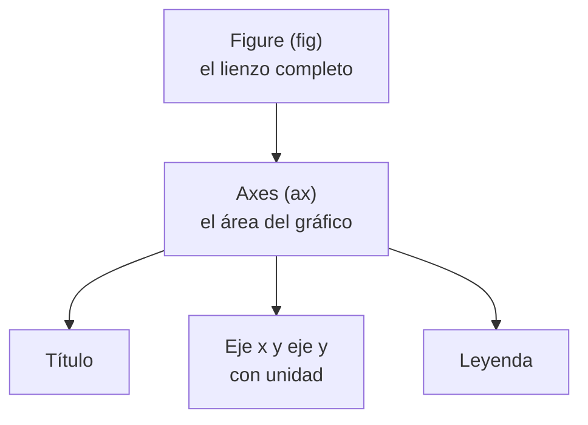

> 📖 Lectura previa a la clase — unos 13 minutos. Al final, responde la autoevaluación.

## El problema: un número que miente

Un estudiante tiene dos notas: 5.0 en un examen que vale poco y 1.0 en uno que vale mucho. Su promedio simple es 3.0 y parece "regular". Pero ese número esconde que le fue perfecto en una cosa y fatal en otra. El resumen no está mal calculado: está incompleto.

Con los pingüinos pasa algo parecido. Quieres saber si los picos más largos son también más profundos, y le pides a pandas un solo número, la correlación:

```python
import pandas as pd
import seaborn as sns

pinguinos = sns.load_dataset("penguins")
print(round(pinguinos["bill_length_mm"].corr(pinguinos["bill_depth_mm"]), 2))
```

```text
-0.24
```

Un valor negativo: a más largo, menos profundo. Parece una ley de la biología, y no lo es. Un número comprime 342 pares de medidas en uno solo y no te dice si el patrón es real. Un gráfico bien elegido sí. Esa es la idea de la lección: **un número resume, un gráfico dice si el resumen miente**. Al final de la lección volverás a este -0.24 con otros ojos.

## Antes de graficar: ¿qué tipo de variable tengo?

El gráfico correcto no se elige por gusto: lo decide el tipo de dato. Pregúntate primero qué es cada columna, categórica (especie, isla) o numérica (masa, largo del pico), y qué quieres mostrar.

| Quiero mostrar… | Variables | Gráfico | Matplotlib | Seaborn |
|---|---|---|---|---|
| Cómo se distribuye una cantidad | 1 numérica | histograma | `ax.hist` | `histplot` |
| Cuántos hay de cada categoría | 1 categórica | barras | `ax.bar` | `countplot` |
| Cómo se comparan grupos | 1 numérica + 1 categórica | boxplot | `ax.boxplot` | `boxplot` |
| Si dos cantidades se relacionan | 2 numéricas | dispersión | `ax.scatter` | `scatterplot` |
| Cómo cambia algo en una secuencia ordenada | 1 numérica + orden | líneas | `ax.plot` | `lineplot` |
| Qué parte del total es cada categoría (3 o 4 partes) | 1 categórica | torta | `ax.pie` | no tiene |
| La forma suave de una distribución | 1 numérica | histograma con KDE, KDE | `ax.hist` | `histplot(kde=True)`, `kdeplot` |
| Una relación con su recta de ajuste | 2 numéricas | regresión | `np.polyfit` | `regplot`, `lmplot` |
| Una relación y la distribución de cada eje | 2 numéricas | jointplot | no tiene | `jointplot` |
| Una tercera numérica en la dispersión | 3 numéricas | burbujas | `ax.scatter(s=...)` | `scatterplot(size=...)` |
| Qué términos se repiten más | 1 categórica de texto | nube de palabras | `WordCloud` (librería `wordcloud`) | no tiene |

Hay tres gráficos que casi siempre estorban. El **pastel** con más de cuatro porciones (con tres o cuatro partes de un total sí sirve): el ojo no compara ángulos y termina leyendo las etiquetas. Las **líneas sin orden**: unir con una línea categorías como "Biscoe, Dream, Torgersen" sugiere una continuidad que no existe. Y el **3D** en datos que caben en dos dimensiones: la perspectiva distorsiona lo que mides.

> **Elección del gráfico:** decisión que parte del tipo de variable y de la pregunta, no de qué gráfico se ve más vistoso.

## Matplotlib: la figura y los ejes

Matplotlib es la librería base: casi todo lo demás en Python la usa por debajo. Su idea central son dos objetos. La **figura** (`fig`) es el lienzo completo; los **ejes** (`ax`) son el área donde se dibuja, con su título, sus ejes y su leyenda.



Se crean juntos con `plt.subplots()` y todo lo demás se pide sobre `ax`. Un histograma de la masa corporal:

```python
import matplotlib.pyplot as plt

fig, ax = plt.subplots(figsize=(8, 4.5))
ax.hist(pinguinos["body_mass_g"], bins=20)
ax.set_title("Distribución de la masa corporal de los pingüinos")
ax.set_xlabel("Masa corporal (g)")
ax.set_ylabel("Número de pingüinos")
fig.savefig("histograma-masa.png", dpi=150, bbox_inches="tight")
plt.show()
```


`figsize` fija el tamaño en pulgadas, `bins` cuántas columnas tiene el histograma, y `savefig` guarda la imagen: `dpi=150` da nitidez y `bbox_inches="tight"` evita que se recorten los títulos. Fíjate en la forma: no hay una campana, hay dos jorobas. Un promedio de 4202 g describiría a muy pocos pingüinos, porque la tabla mezcla especies chicas y grandes.

Una advertencia que ya conoces de la lección Filtrado, agregación y limpieza de datos: la columna tiene 2 nulos y Matplotlib los ignora **en silencio**. Dibuja 342 pingüinos, no 344, y no te avisa. Si el número importa, cuéntalo tú con `isna().sum()`.

> **Figure y Axes:** la figura es el lienzo; los ejes son el gráfico dentro de él. Título, etiquetas y leyenda se configuran sobre los ejes.

## Matplotlib: barras, dispersión y líneas

Para comparar categorías, las **barras** muestran una cantidad por grupo. Primero resumes con `groupby` y luego dibujas:

```python
medias = pinguinos.groupby("species")["body_mass_g"].mean()

fig, ax = plt.subplots(figsize=(8, 4.5))
ax.bar(medias.index, medias.values)
ax.set_title("Masa corporal promedio por especie")
ax.set_xlabel("Especie")
ax.set_ylabel("Masa corporal promedio (g)")
plt.show()
```

Las medias son 3701 g, 3733 g y 5076 g. Las barras **empiezan en 0**: su altura representa la cantidad, así que cortar el eje miente: si lo cortas en 3500 g, las barras de 3701 g y 5076 g miden 201 y 1576, y la segunda parece ocho veces la primera cuando es apenas 1.4 veces. Para dos variables numéricas, la **dispersión** pone un punto por pingüino:

```python
fig, ax = plt.subplots(figsize=(8, 4.5))
ax.scatter(pinguinos["flipper_length_mm"], pinguinos["body_mass_g"])
ax.set_title("Longitud de la aleta y masa corporal")
ax.set_xlabel("Longitud de la aleta (mm)")
ax.set_ylabel("Masa corporal (g)")
plt.show()
```

La nube sube de izquierda a derecha: a mayor aleta, mayor masa, con una correlación de 0.87. Aquí el número y el gráfico cuentan la misma historia. Para una secuencia con orden, como el tiempo, usas **líneas**. El dataset no tiene fechas, así que este ejemplo usa siete pesajes inventados de un solo pingüino, solo para ver la forma de la llamada:

```python
pesajes = [3750, 3800, 3880, 3950, 4020, 4090, 4150]

fig, ax = plt.subplots(figsize=(8, 4.5))
ax.plot(range(1, 8), pesajes, marker="o")
ax.set_title("Masa de un pingüino en siete pesajes (datos de ejemplo)")
ax.set_xlabel("Número de pesaje")
ax.set_ylabel("Masa corporal (g)")
ax.tick_params(axis="x", labelrotation=45)
fig.tight_layout()
plt.show()
```

`tick_params` gira o ajusta las marcas de los ejes cuando las etiquetas se pisan, y `tight_layout()` reacomoda los márgenes para que nada quede cortado.

> **Barras, dispersión y líneas:** barras comparan una cantidad entre categorías y parten de 0; dispersión muestra la relación entre dos numéricas; líneas siguen una cantidad a lo largo de un orden.

## Seaborn: la misma gráfica en una línea

Seaborn se construye sobre Matplotlib y entiende los DataFrames: le dices qué columna va en cada eje y se encarga del resto. Se activa un tema una sola vez, con una paleta que distingue colores incluso para quienes tienen daltonismo:

```python
sns.set_theme(palette="colorblind")

# Cada gráfico va en su propia celda; si los pegas juntos, se dibujan sobre los mismos ejes
sns.histplot(data=pinguinos, x="body_mass_g")
plt.show()

sns.countplot(data=pinguinos, x="species")
plt.show()

ax = sns.boxplot(data=pinguinos, x="species", y="body_mass_g")
ax.set_title("Masa corporal por especie")
plt.show()

ax = sns.scatterplot(data=pinguinos, x="bill_length_mm", y="bill_depth_mm", hue="species")
ax.set_title("Largo y profundidad del pico")
plt.show()
```

Cada línea reemplaza un bloque entero de Matplotlib: `countplot` cuenta las filas por especie (152 Adelie, 124 Gentoo, 68 Chinstrap) sin que hagas el `groupby`, y `hue="species"` pinta cada especie de un color. Como Seaborn devuelve un `ax` de Matplotlib, todo lo que aprendiste sigue valiendo: `ax.set_title(...)`, `ax.set_xlabel(...)` y `fig.savefig(...)` funcionan igual.

El **boxplot** compara grupos, y se lee así: la línea del centro es la mediana, la caja va del cuartil 1 al cuartil 3 (el rango intercuartílico, IQR, que usaste en la lección Filtrado, agregación y limpieza de datos), los bigotes llegan hasta 1.5 IQR, y los puntos sueltos son atípicos.


La mediana de Gentoo es 5000 g, con una caja de 4700 g a 5500 g; la de Adelie es 3700 g, con una caja de 3350 g a 4000 g. Las cajas casi no se tocan: Gentoo es otro grupo. Adelie y Chinstrap, en cambio, tienen la misma mediana (3700 g) y cajas que se traslapan.

> **Boxplot:** gráfico que resume la distribución de una numérica por grupo con su mediana, su IQR y los valores atípicos.

## Mapa de calor y pairplot: resolver el problema inicial

Para ver muchas relaciones a la vez, el **mapa de calor** pinta la matriz de correlaciones con colores. `numeric_only=True` descarta las columnas de texto, que no tienen correlación:

```python
corr = pinguinos.corr(numeric_only=True)
ax = sns.heatmap(corr, annot=True, fmt=".2f", cmap="vlag", vmin=-1, vmax=1)
ax.set_title("Correlación entre las medidas numéricas")
plt.show()
```


Ahí está de nuevo el -0.24 entre largo y profundidad del pico. Pero el mapa de calor, como la correlación, solo muestra el resumen global. Para ver los datos detrás, `pairplot` dibuja todas las parejas de variables en una cuadrícula, y con `hue` separa las especies:

```python
sns.pairplot(pinguinos, hue="species")
```

Y la dispersión de largo contra profundidad, coloreada por especie, es la que desmonta el número:


Hay tres nubes separadas: Adelie arriba a la izquierda, Chinstrap arriba a la derecha y Gentoo abajo a la derecha. Dentro de cada una, la tendencia sube. Calcúlalo por especie:

```python
for especie, grupo in pinguinos.groupby("species"):
    print(especie, round(grupo["bill_length_mm"].corr(grupo["bill_depth_mm"]), 2))
```

```text
Adelie 0.39
Chinstrap 0.65
Gentoo 0.64
```

Las tres correlaciones son positivas, y la global era -0.24. Ese fenómeno se llama **paradoja de Simpson**: una tendencia que aparece en el total puede invertirse dentro de cada grupo. Aquí, Gentoo tiene picos más largos y menos profundos que Adelie; al mezclar las especies, esa diferencia entre grupos tapa la relación que hay dentro de cada una. El -0.24 estaba bien calculado y respondía mal a tu pregunta.

Una advertencia más: incluso con el gráfico bien hecho, **correlación no es causa**. Que la aleta y la masa suban juntas (0.87) no prueba que alargar la aleta engorde al pingüino; ambas dependen del tamaño del animal.

> **Paradoja de Simpson:** una relación entre dos variables cambia de signo, o desaparece, cuando se separa por una tercera variable que define grupos.

## Más allá de lo básico: un catálogo rápido

Los gráficos de la tabla cubren casi todo, pero hay variantes que conviene conocer. Cada una va en su propia celda; el código es el mínimo, y en tus gráficos se completan título y ejes con unidad como siempre.

La **torta** muestra partes de un todo y solo sirve con tres o cuatro porciones; con más, usa barras. El **histograma con KDE** agrega una curva suave que muestra la forma sin depender del número de columnas:

```python
cuentas = pinguinos["species"].value_counts()
plt.pie(cuentas.values, labels=cuentas.index, autopct="%1.1f%%")   # Adelie 44.2 %, Gentoo 36.0 %, Chinstrap 19.8 %
plt.show()

sns.histplot(data=pinguinos, x="body_mass_g", kde=True)            # kdeplot dibuja solo la curva
plt.show()
```

El **boxplot de una variable** resume una columna entera (solo `x` o solo `y`) y las **barras agrupadas** parten cada barra por una segunda categoría con `hue`:

```python
sns.boxplot(data=pinguinos, x="body_mass_g")                       # mediana 4050 g, sin atípicos
plt.show()

sns.countplot(data=pinguinos, x="island", hue="species")           # Gentoo solo en Biscoe, Chinstrap solo en Dream
plt.show()
```

La **regresión** agrega la recta que mejor ajusta a la dispersión, y `jointplot` suma las distribuciones de cada eje:

```python
sns.regplot(data=pinguinos, x="flipper_length_mm", y="body_mass_g")                 # pendiente global: 49.7 g por mm
plt.show()

sns.jointplot(data=pinguinos, x="flipper_length_mm", y="body_mass_g", hue="species")   # también kind="reg" o "kde"
plt.show()
```

La pendiente 49.7 se lee con cautela: es una asociación, solo vale dentro del rango observado, y dentro de cada especie es distinta (de 32.8 a 54.6 g por mm), la paradoja de Simpson otra vez. Con `sns.lmplot(..., hue="species")` ves una recta por especie. Para una **tercera variable numérica**, el tamaño del punto: `ax.scatter(x, y, s=...)` en Matplotlib o `size=` en Seaborn.

```python
fig, ax = plt.subplots(figsize=(8, 4.5))
sns.scatterplot(data=pinguinos, x="bill_length_mm", y="bill_depth_mm", size="body_mass_g",
                hue="species", sizes=(20, 300), alpha=0.6, ax=ax)
plt.show()
```


Por último, la **nube de palabras** dibuja cada término con tamaño proporcional a su frecuencia. La librería `wordcloud` ya viene instalada en Colab y se alimenta con los conteos de una columna de texto, aquí el vector de entrada de los incidentes de ciberseguridad (1850 filas):

```python
from wordcloud import WordCloud

ciber = pd.read_csv("ciberseguridad_incidentes_colombia_2023_2025.csv")
frecuencias = ciber["vector_entrada"].value_counts().to_dict()
nube = WordCloud(width=1200, height=675, background_color="white").generate_from_frequencies(frecuencias)
plt.imshow(nube)
plt.axis("off")                     # una nube no tiene ejes
plt.show()
```


El correo electrónico entra en 674 de los 1850 incidentes. La nube sirve para explorar o ilustrar, pero no lleva escala: para comparar 164 contra 159 usa barras.

## Un gráfico que no se lee no sirve

Un gráfico tiene un trabajo: que alguien entienda algo sin preguntarte nada. Para eso cumple un estándar mínimo: **título** que diga qué se ve, **ejes con nombre y unidad** (masa en g, largo en mm), **leyenda** si hay más de un color, y **colores** que se distingan entre sí.

Pero un gráfico bonito aún no es un resultado. Una buena interpretación tiene tres partes: **qué pregunta** respondes, **qué se observa** (con cifras) y **qué implica**. Con la dispersión por especie sería: "¿Los picos más largos son más profundos? Dentro de cada especie sí: la correlación es de 0.39 en Adelie, 0.65 en Chinstrap y 0.64 en Gentoo, aunque la global sea -0.24. Implica que no se puede comparar el pico de especies distintas como si fueran un solo grupo". Sin cifras ni conclusión, es una descripción del dibujo.

Tres errores frecuentes al producir gráficos:

- **Barras con el eje y que no empieza en 0:** exagera diferencias pequeñas.
- **`savefig` después de `plt.show()`, o en otra celda:** al mostrar, la figura se cierra y el archivo guarda un PNG en blanco. Guarda **antes** de mostrar.
- **Guardar en una carpeta que no existe:** `fig.savefig("visualizaciones/grafico.png")` lanza `FileNotFoundError` si `visualizaciones/` no se creó.

```python
import os

os.makedirs("visualizaciones", exist_ok=True)
fig.savefig("visualizaciones/histograma-masa.png", dpi=150, bbox_inches="tight")
plt.show()
```

`exist_ok=True` evita el error si la carpeta ya existe, y el `savefig` va antes del `show`. Antes de entregar cualquier gráfico del conjunto de datos de tu proyecto, haz tú mismo estas tres comprobaciones: estándar mínimo, interpretación de tres partes y archivo guardado con contenido.

> **Estándar mínimo de un gráfico:** título, ejes con unidad, leyenda si hay varias series y colores distinguibles, más una interpretación con qué pregunta, qué se observa y qué implica.

## Síntesis

Cada pregunta tiene su gráfico y su señal de alerta:

| Pregunta | Gráfico | Matplotlib / Seaborn | Señal de alerta |
|---|---|---|---|
| ¿Cómo se distribuye una cantidad? | histograma | `ax.hist` / `histplot` | Dos jorobas: el promedio describe a pocos |
| ¿Cuántos hay de cada categoría? | barras | `ax.bar` / `countplot` | Eje y que no empieza en 0 |
| ¿Cómo se comparan grupos? | boxplot | `ax.boxplot` / `boxplot` | Cajas que se traslapan: no hay diferencia clara |
| ¿Se relacionan dos cantidades? | dispersión | `ax.scatter` / `scatterplot` con `hue` | Un solo número global sin mirar los grupos |
| ¿Cómo cambia algo en el tiempo? | líneas | `ax.plot` / `lineplot` | Unir categorías sin orden |
| ¿Qué relaciones hay entre muchas variables? | mapa de calor y pairplot | `sns.heatmap`, `sns.pairplot` | Confundir correlación con causa |
| ¿Qué parte del total es cada una? | torta | `ax.pie` | Más de cuatro porciones |
| ¿Qué forma tiene la distribución? | histograma con KDE, KDE | `histplot(kde=True)`, `kdeplot` | Curva suave con pocos datos |
| ¿Cuánto cambia y por unidad de x? | regresión, jointplot | `regplot`, `lmplot`, `jointplot` | Leer la pendiente como causa o fuera del rango |
| ¿Y una tercera numérica? | burbujas | `ax.scatter(s=...)`, `scatterplot(size=...)` | Burbujas que se tapan: bajar `alpha` |
| ¿Qué términos dominan? | nube de palabras | `WordCloud` | No hay escala para comparar |

Y por sección:

- **El problema:** un número resume y puede mentir; el -0.24 no decía lo que parecía.
- **Antes de graficar:** el tipo de variable y la pregunta eligen el gráfico; evita pastel con muchas porciones, líneas sin orden y 3D.
- **La figura y los ejes:** `fig, ax = plt.subplots()`, título y ejes con unidad, `savefig` con `dpi=150`; los nulos se ignoran en silencio.
- **Barras, dispersión y líneas:** barras desde 0, dispersión para dos numéricas, líneas solo con orden.
- **Seaborn:** una línea por gráfico, `hue` para separar grupos, y devuelve un `ax` de Matplotlib; el boxplot se lee con mediana, IQR y atípicos.
- **Mapa de calor y pairplot:** la correlación global puede invertirse dentro de los grupos (Simpson); correlación no es causa.
- **Catálogo rápido:** torta, KDE, boxplot de una variable, barras agrupadas con `hue`, regresión, `jointplot`, burbujas y nube de palabras, cada uno con su señal de alerta.
- **Un gráfico que se lee:** estándar mínimo, interpretación en tres partes, y guardar antes de mostrar en una carpeta que exista.
